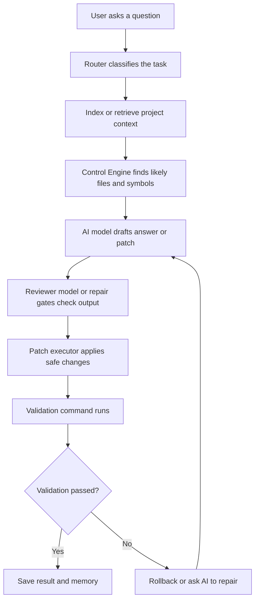

# C.A.T.T.U.S AI Coding Agent

C.A.T.T.U.S is an AI coding assistant that can read a software project, understand the user's question, find the most relevant code, suggest a safe fix, test that fix, and remember useful lessons for later.

Think of it like a careful senior student in a programming club:

- It first looks around the project so it knows what files exist.
- It reads the parts of the code that matter most.
- It asks AI models to reason about the problem.
- It checks whether a proposed code change is safe.
- It runs validation commands when possible.
- It stores what happened so the next run can learn from it.

## What This Project Does

This project is an AI coding mentor and repair system. It supports two main ways of working:

- Human learning mode: explains code, teaches step by step, and helps the user understand bugs or design choices.
- Agent mode: reviews code, plans changes, generates structured patch JSON, applies safe edits, validates them, and logs the result.

The system can run from the terminal or from a Flask web interface.

## Main Features

### 1. CLI and Web Interface

The project starts from `main.py`.

You can use:

- Terminal mode for interactive prompts.
- Web mode for a browser interface with repo path input, tabs, patch controls, graph views, and session history.

Important files:

- `main.py`
- `cli/interactive.py`
- `web/app.py`
- `web/runner.py`
- `web/templates/index.html`

### 2. Task Router

Before the agent can help, it tries to understand what kind of request it received.

For example, it can classify a request as:

- bug fix
- code explanation
- code review
- refactor
- feature addition
- architecture planning
- testing or validation

Important file:

- `core/router.py`

### 3. Repository Indexing

When the user gives the agent a project folder, the indexer scans the repository and builds a useful map.

It looks for:

- source files
- functions and classes
- imports
- function calls
- project structure
- code style patterns

Important files:

- `core/indexer.py`
- `core/repo_librarian.py`
- `core/code_dna.py`
- `graph/builder.py`
- `graph/project_map.py`

### 4. Retrieval and Context Gathering

The agent should not guess from the whole project at once. Instead, it retrieves the most relevant snippets.

This is like opening the right textbook page before answering a homework question.

Important files:

- `core/retriever.py`
- `core/feature_context.py`
- `core/source_snippet_fallback.py`

### 5. Control Engine

The Control Engine is the project's main reasoning hub. It uses graph evidence, code snippets, risk scoring, and execution traces to decide what code probably matters.

It produces structured information such as:

- likely target file
- likely target function
- top hypothesis
- evidence
- patch intent
- related snippets
- whether more evidence is needed

Important file:

- `core/control_engine.py`

### 6. AI Model Collaboration

The system uses AI models in different roles.

- Gemini drafts answers or patch proposals.
- DeepSeek or Ollama can review or critique.
- The pipeline can refine answers after review.

Important files:

- `agents/gemini_client.py`
- `agents/deepseek_client.py`
- `agents/ollama_client.py`

### 7. Patch Generation and Safety Gates

When the agent proposes a fix, it tries to keep the patch grounded in real code. The patch system checks whether the target file and target snippet are safe before applying anything.

Patch styles:

- `safe_minimal`: smallest grounded edit, strict safety.
- `balanced`: allows more design-level fixes, but still grounded.
- `vibe`: more creative, manual review expected.

Important files:

- `patching/patch_engine.py`
- `patching/patch_gates.py`
- `patching/patch_plan_executor.py`
- `policy/decision_helper.py`

### 8. Validation and Rollback

After applying a patch, the system can run a validation command such as:

```bash
python main.py
pytest
go test ./...
cargo test
npm test
```

If validation fails, the executor can roll back the file to its previous state.

Important files:

- `core/executor.py`
- `core/validator.py`
- `core/validation_command.py`
- `core/preflight.py`

### 9. Memory System

The project can store sessions, messages, code units, patch attempts, dependency edges, and engineering notes in PostgreSQL with pgvector.

This lets the agent remember:

- what it tried before
- which patches worked
- which validation commands are useful
- project-specific lessons

Important files:

- `database/memory.py`
- `database/schema.sql`
- `database/memory_consolidator.py`

### 10. Project Graph and Obsidian Export

The graph layer turns code into nodes and edges.

Examples:

- file contains function
- file imports another file
- function calls another function

The web UI can render graph views, and the project can export graph notes for Obsidian.

Important files:

- `graph/schema.py`
- `graph/builder.py`
- `graph/query.py`
- `graph/exporter.py`
- `graph/obsidian_exporter.py`
- `core/semantic_graph_pipeline.py`

### 11. Phantom Limb Scanner

The Phantom Limb scanner looks for missing structural pieces. It does not prove bugs. It gives careful suggestions.

Examples:

- Python script may need an `if __name__ == "__main__"` guard.
- HTML page may need a `<title>`.
- C++ class with virtual methods may need a virtual destructor.
- TypeScript code may have risky `any` usage.

Important file:

- `core/phantom_limb.py`

### 12. Mutation Oracle

A normal test can pass even when it is weak. The Mutation Oracle checks test strength by making small fake mistakes in the patched code and seeing whether validation catches them.

If the tests catch the fake mistakes, validation is stronger. If fake mistakes still pass, the project may need better tests.

Important file:

- `core/mutation_oracle.py`

### 13. Sleeping Consultant

The Sleeping Consultant is an overnight planning and research workflow. It can queue ideas, bugs, technical debt, or research items, then work on them in temporary copies of the repository.

This protects the real project while the agent explores.

Important files:

- `core/sleeping_consultant.py`
- `core/dream_artifacts.py`
- web routes under `web/app.py`

### 14. Benchmarks

The benchmark suite checks whether the agent can fix small broken projects in different languages.

Current case types include:

- Go wallet transfer logic
- Rust cart reservation logic
- Python discount validation
- JavaScript async missing await
- HTML accessibility
- C++ account interest
- TypeScript inventory restock

Important files:

- `benchmarks/run_benchmarks.py`
- `benchmarks/cases/`

## Pipeline

Here is the simple version:



## Pipeline Explained Like a School Project

Imagine your codebase is a big school notebook.

1. The router reads the question and decides what kind of help is needed.
2. The indexer flips through the notebook and makes a table of contents.
3. The retriever chooses the pages that are probably useful.
4. The Control Engine highlights the paragraph that most likely contains the answer.
5. Gemini writes a first answer or patch.
6. A reviewer checks whether the answer makes sense.
7. The patch engine changes the file only if the target is safe.
8. The validator runs the project's test or build command.
9. The memory system writes down what happened.

## Folder Guide

| Folder or file | What it is for |
| --- | --- |
| `main.py` | Main program entry point. |
| `config.py` | Environment variables, model names, file extensions, and safety settings. |
| `agents/` | AI model clients for Gemini, DeepSeek, and Ollama. |
| `cli/` | Terminal prompts and state creation. |
| `web/` | Flask web UI, patch buttons, sessions, graph view, and dream routes. |
| `core/` | Main system logic: routing, retrieval, prompts, validation, memory refresh, control engine. |
| `patching/` | Patch application, patch plans, and safety gates. |
| `graph/` | Program graph construction, querying, Mermaid export, and Obsidian export. |
| `database/` | PostgreSQL schema, memory storage, sessions, artifacts, patch attempts. |
| `reasoning/` | Risk analysis, state reasoning, and deeper project understanding. |
| `policy/` | Patch style policy and auto-apply rules. |
| `benchmarks/` | Small broken repos used to test whether the agent can fix bugs. |
| `.agent/` | Generated project maps, debug files, benchmark reports, graph exports, and dream artifacts. |

## How To Run

Create your environment:

```bash
python -m venv .venv
.venv\Scripts\activate
pip install -r requirements.txt
```

Copy the example environment file:

```bash
copy .env.example .env
```

Then add your API keys and database settings in `.env`.

Run the terminal app:

```bash
python main.py --terminal
```

Run the web app:

```bash
python main.py --web
```

Or:

```bash
python -m web.app
```

Index a repository:

```bash
python main.py --index path\to\repo
```

Run benchmark checks:

```bash
python benchmarks\run_benchmarks.py --check
```

Run benchmarks:

```bash
python benchmarks\run_benchmarks.py --fast --summary
```

## Environment Notes

The setup guide mentions two Python environments:

- Python 3.13+ for normal development.
- Python 3.12.13 for Tree-sitter compatibility work.

Important environment variables include:

- `GOOGLE_API_KEY`
- `DEEPSEEK_API_KEY`
- `HF_TOKEN`
- `DB_ENABLED`
- `DATABASE_URL_LOCAL`
- `DATABASE_URL_DOCKER`
- `ROUTER_USE_EMBEDDINGS`
- `INDEX_USE_EMBEDDINGS`
- `RETRIEVER_USE_EMBEDDINGS`
- `OLLAMA_ENABLED`

## Safety Principles

This project is designed to avoid reckless code changes.

- It blocks unsafe file paths.
- It prefers exact source snippets.
- It scores patch risk.
- It can reject ungrounded patches.
- It can run validation before trusting a fix.
- It can roll back when validation fails.
- It stores patch attempts for later learning.

## Current Project Status

This is an active AI engineering project, not a tiny demo. The code already includes:

- multi-model AI workflow
- graph-based code understanding
- semantic retrieval
- automatic patch execution
- validation and rollback
- memory storage
- benchmark cases across several languages
- web UI for patch review and project graphs
- overnight planning through the Sleeping Consultant

## Short Summary

C.A.T.T.U.S is a repo-aware AI coding agent. It reads a project, finds the important code, reasons about bugs or features, proposes safe patches, validates the result, and learns from each run.
