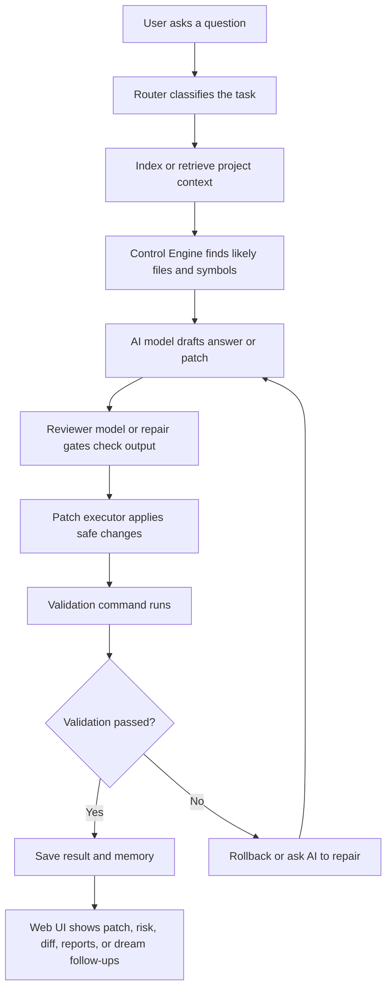

# C.A.T.T.U.S AI Coding Agent

C.A.T.T.U.S is an AI coding assistant that can read a software project, understand the user's question, find the most relevant code, suggest a safe fix, test that fix, and remember useful lessons for later.

Think of it like a careful senior student in a programming club:

- It first looks around the project so it knows what files exist.
- It reads the parts of the code that matter most.
- It asks AI models to reason about the problem.
- It checks whether a proposed code change is safe.
- It runs validation commands when possible.
- It stores what happened so the next run can learn from it.

## What This Project Does

This project is an AI coding mentor and repair system. It supports two main ways of working:

- Human learning mode: explains code, teaches step by step, and helps the user understand bugs or design choices.
- Agent mode: reviews code, plans changes, generates structured patch JSON, applies safe edits, validates them, and logs the result.

The system can run from the terminal or from a Flask web interface. The web interface has grown into a workspace-style dashboard with separate areas for goal-brief intake, chat/patching, benchmarks, dream runs, memory, graphs, and system health.

## Main Features

### 1. CLI and Web Workspace

The project starts from `main.py`.

You can use:

- Terminal mode for interactive prompts.
- Web mode for a browser workspace with repo path input, goal brief building, patch controls, benchmark history, graph views, health checks, dream queue controls, and session history.

Current web workspaces:

- Chat / Patch: answer, context, state, patch card, validation, diff, and candidate views.
- Goal Brief: turn a vague goal into a structured, evidence-based task prompt before an agent acts.
- Benchmarks: browse past benchmark reports and inspect results.
- Dream: queue overnight bug/debt/idea/research work.
- Memory: run memory consolidation, manage lessons/proposals, create handoffs, inspect worker runs, and launch MCP Inspector shortcuts.
- Graph: render clean or debug program graphs.
- Settings / Health: check API keys, DB, embeddings, Ollama, Tree-sitter, and local toolchains.

The Patch tab now shows a structured patch card instead of only raw JSON. It summarizes patch type, confidence, risk, validation command, changed files, and last action, while keeping raw JSON available for debugging.

### 1.5. Goal Brief Builder

Goal Brief Builder is a prompt-assisting intake flow for vague or risky goals. Use it before Dream, CONTROL, Claude, ChatGPT, or the full agent when the request is not yet concrete enough to act on safely.

It keeps a fixed `GoalBrief` schema and uses model guidance only for interviewing:

- ask at most a couple of focused clarifying questions
- summarize what is known
- identify missing evidence
- suggest safe terminal commands for the user to run manually
- accept pasted command output or manual observations
- generate a final high-quality task prompt once enough evidence exists

It writes artifacts under `.agent/goal_briefs/<timestamp>/`:

- `goal_brief.json`
- optional `goal_brief.md`

Important guardrail: Goal Brief Builder is a collector, not a solver. It does not run terminal commands, apply patches, run benchmarks, create benchmark cases, seed or promote lessons, promote memory, mutate proposals, or edit source files.

CLI:

```bash
python scripts/create_goal_brief.py --goal "Fix the weird checkout failure"
python scripts/create_goal_brief.py --brief-ref .agent/goal_briefs/<timestamp>/goal_brief.json --answer "<pasted result>" --export-md
```

Important files:

- `core/goal_brief.py`
- `scripts/create_goal_brief.py`
- `web/app.py`

### 1.6. Worker Assignment / Route Card

Worker Assignment creates a ready-to-copy route card from an existing artifact. It is draft-only: no worker is launched, no model is called, no patch is applied, no validation command runs, and no Dream / Project Evolution / lesson promotion path starts.

Default output:

- `.agent/worker_assignments/<assignment_id>/worker_assignment.json`
- `.agent/worker_assignments/<assignment_id>/worker_assignment.md`

CLI:

```bash
python scripts/create_worker_assignment.py --repo-path . --goal-brief .agent/goal_briefs/<timestamp>/goal_brief.json --mode debug --role implementer
python scripts/create_worker_assignment.py --repo-path . --seed-draft .agent/external_queue_exports/<id>/goal_brief_seed_draft.json --mode documentation --role documenter --dry-run --json
```

In the web UI, create or update a Goal Brief, then click **Create Worker Assignment**. The UI shows the assignment id, JSON path, Markdown path, and a read-only Markdown box with a **Copy assignment** button. Copy the Markdown to Codex / Claude / Gemini / Ollama manually. The route card keeps `human_approval_required=true`, `apply_allowed=false`, and `worker_launch_allowed=false`; no worker is launched automatically.

Important files:

- `main.py`
- `cli/interactive.py`
- `web/app.py`
- `web/runner.py`
- `web/templates/index.html`
- `web/static/style.css`
- `core/health.py`
- `core/benchmarks_view.py`

### 1.7. Driver Model Routing Contract (H.1)

Worker Assignment tells the human *what* task to send. The Driver tells them *what model level* ("vehicle") is appropriate — but it does not drive yet. H.1 is **contract/report-only**: it reads a worker assignment and recommends the safest allowed vehicle. No model is called, no provider is switched, no worker is launched, no patch is applied, no validation runs, and no Dream / Project Evolution / lesson-promotion path starts.

Vehicle levels (stable string constants):

- `local_only` — a local/free model is enough
- `free_model_ok` — a free model is fine
- `cheap_api_ok` — a cheap API is okay
- `strong_model_recommended` — a stronger API is recommended
- `strong_model_requires_approval` — strong model, only after explicit human approval
- `vision_or_human_caption_required` — a vision model or a human caption summary is required
- `human_only` — a human must handle it
- `blocked` — not permitted in this contract

Default output:

- `.agent/driver_decisions/<driver_decision_id>/driver_decision.json`
- `.agent/driver_decisions/<driver_decision_id>/driver_decision.md`

CLI — create a Worker Assignment, then evaluate the Driver Decision and copy the route manually:

```bash
python scripts/create_worker_assignment.py --repo-path . --goal-brief .agent/goal_briefs/<timestamp>/goal_brief.json
python scripts/evaluate_driver_route.py --worker-assignment .agent/worker_assignments/<assignment_id>/worker_assignment.json
```

Optional flags: `--json`, `--dry-run`, `--output-root`, plus deterministic `--driver-decision-id` / `--created-at` hooks. The two steps stay separate: F.5 does not auto-run H.1, and H.1 never executes anything — copy the recommended vehicle from the decision and route the work yourself. The decision JSON always carries inert flags `model_call_performed`, `provider_switch_performed`, `worker_launch_performed`, `patch_applied`, `validation_run`, and `promotion_performed`, all `false`.

Routing highlights: Review-only → `local_only`/`free_model_ok`; narrow Debug with validation → `free_model_ok`; missing validation → at least `cheap_api_ok` + `missing_validation` flag; Project Evolution → `strong_model_recommended` + approval; Dream Trial → experimental flag + approval (Dream does not start); visual evidence (screenshot / UI layout / chart / OCR / design) → `vision_or_human_caption_required`; security-sensitive work (secrets / API key / auth / token / credential / webhook security) → `strong_model_requires_approval`; `apply_allowed` / `worker_launch_allowed` → `blocked`; missing allowed files → `scope_unclear`; External Queue source → `external_untrusted_source` and never below `free_model_ok`. This contract is the routing foundation for the future A.16 Visual Evidence Intake Contract.

Important files:

- `core/driver_model_routing.py`
- `scripts/evaluate_driver_route.py`
- `tests/test_driver_model_routing.py`

### 1.8. Visual Evidence Intake Contract (A.16)

Text and code validation can pass while nobody has confirmed that a visual / UI / design issue was actually fixed. The Visual Evidence Intake Contract closes that gap. It is **contract-only**: given a Worker Assignment (F.5) or a Driver Decision (H.1) it records whether a visual issue is referenced, whether visual evidence or a human caption summary exists, whether a model could even read that evidence, and whether validation explicitly covers the visual issue — then it decides whether a "resolution claim" is allowed.

**Core rule: a visual/UI/design issue is not "resolved" just because text tests passed.** A claim that the visual issue is fixed requires *either* a human caption summary *or* a vision-capable model, **plus** explicit validation coverage of the visual issue. Validation passing on its own does not prove a visual/UI issue is fixed.

A.16 performs no OCR, calls no vision model, calls no model, and never inspects image bytes. `visual_evidence_readable_by_model` and `validation_covers_visual_issue` are only ever true when the operator passes them explicitly — they are never inferred from a file being present.

Default output:

- `.agent/visual_evidence/<visual_evidence_id>/visual_evidence_contract.json`
- `.agent/visual_evidence/<visual_evidence_id>/visual_evidence_contract.md`

CLI — manual sequence (each step stays separate; A.16 does not auto-run inside F.5 or H.1):

```bash
python scripts/create_worker_assignment.py --repo-path . --goal-brief .agent/goal_briefs/<timestamp>/goal_brief.json
python scripts/evaluate_driver_route.py --worker-assignment .agent/worker_assignments/<assignment_id>/worker_assignment.json
python scripts/create_visual_evidence_contract.py --source .agent/worker_assignments/<assignment_id>/worker_assignment.json --human-summary "Before: chart bars overlap the legend. After: bars are spaced."
```

Optional flags: `--visual-path` (repeatable), `--human-summary`, `--visual-readable-by-model true`, `--validation-covers-visual true`, `--json`, `--dry-run`, `--output-root`, plus deterministic `--visual-evidence-id` / `--created-at` hooks. The contract JSON always carries inert flags `model_call_performed`, `ocr_performed`, `vision_model_called`, `worker_launch_performed`, `patch_applied`, `validation_run`, and `promotion_performed`, all `false`. A.16 supports the H.1 `vision_or_human_caption_required` vehicle: when a task needs visual evidence, A.16 is where the human records the caption summary (or asserts a vision model) before any resolution claim is allowed.

Important files:

- `core/visual_evidence_contract.py`
- `scripts/create_visual_evidence_contract.py`
- `tests/test_visual_evidence_contract.py`

### 2. Task Router

Before the agent can help, it tries to understand what kind of request it received.

For example, it can classify a request as:

- bug fix
- code explanation
- code review
- refactor
- feature addition
- architecture planning
- testing or validation

Important file:

- `core/router.py`

### 3. Repository Indexing

When the user gives the agent a project folder, the indexer scans the repository and builds a useful map.

It looks for:

- source files
- functions and classes
- imports
- function calls
- project structure
- code style patterns

Important files:

- `core/indexer.py`
- `core/repo_librarian.py`
- `core/code_dna.py`
- `graph/builder.py`
- `graph/project_map.py`

### 4. Retrieval and Context Gathering

The agent should not guess from the whole project at once. Instead, it retrieves the most relevant snippets.

This is like opening the right textbook page before answering a homework question.

Important files:

- `core/retriever.py`
- `core/feature_context.py`
- `core/source_snippet_fallback.py`

### 5. Control Engine

The Control Engine is the project's main reasoning hub. It uses graph evidence, code snippets, risk scoring, and execution traces to decide what code probably matters.

It produces structured information such as:

- likely target file
- likely target function
- top hypothesis
- evidence
- patch intent
- related snippets
- whether more evidence is needed

The Control Engine's DFS sorts neighbors by `query_bonus * 2 + graph_weight`, where `graph_weight` is the universal node weight computed in `graph/weights.py`. That weight combines structural topology (in-degree, out-degree, complexity) with a history-driven **penalty** term: nodes that have failed before (blocked lessons or failed `patch_attempts` rows) sort to the top of any neighbor list. Each evidence row exposes `graph_weight` so debug context shows why a node ranked highly.

Important file:

- `core/control_engine.py`

### 6. AI Model Collaboration

The system uses AI models in different roles.

- Gemini drafts answers or patch proposals.
- DeepSeek or Ollama can review or critique.
- The pipeline can refine answers after review.
- Model-call attempts can be recorded during benchmark runs, including fallback count and selected model by role.

Important files:

- `agents/gemini_client.py`
- `agents/deepseek_client.py`
- `agents/ollama_client.py`
- `agents/model_stats.py`

### 7. Patch Generation and Safety Gates

When the agent proposes a fix, it tries to keep the patch grounded in real code. The patch system checks whether the target file and target snippet are safe before applying anything.

Patch styles:

- `safe_minimal`: smallest grounded edit, strict safety.
- `balanced`: allows more design-level fixes, but still grounded.
- `vibe`: more creative, manual review expected.

Important files:

- `patching/patch_engine.py`
- `patching/patch_gates.py`
- `patching/patch_plan_executor.py`
- `policy/decision_helper.py`

### 8. Validation and Rollback

After applying a patch, the system can run a validation command such as:

```bash
python main.py
pytest
go test ./...
cargo test
npm test
```

If validation fails, the executor can roll back the file to its previous state.

The web "Test Run Patch" flow now runs against a temporary copy of the repository. That means the real project stays safe while the user gets a more honest signal than a dry-run-only check.

Important files:

- `core/executor.py`
- `core/validator.py`
- `core/validation_command.py`
- `core/preflight.py`

### 9. Memory System

The project can store sessions, messages, code units, patch attempts, dependency edges, and engineering notes in PostgreSQL with pgvector.

This lets the agent remember:

- what it tried before
- which patches worked
- which validation commands are useful
- project-specific lessons

Past failures also feed back into graph reasoning: a blocked lesson (in `.agent/lessons/blocked/`) adds +5.0 to the weight of the file it touched, and each failed row in the `patch_attempts` table adds +1.0 to the matching file or symbol node (`<rel_path>::<target_node_name>` when the patcher recorded a specific symbol). CONTROL DFS, the project map's Critical Symbols list, and the Obsidian `AI_READ_FIRST` ranking all see this boost automatically — files and symbols that have failed before bubble up. The signal is computed at graph-build time and is fail-soft: a missing DB or absent lesson dir degrades silently to zero.

Important files:

- `database/memory.py`
- `database/schema.sql`
- `database/memory_consolidator.py`
- `graph/penalty.py`
- `graph/penalty_constants.py`

### 10. Project Graph and Obsidian Export

The graph layer turns code into nodes and edges.

Examples:

- file contains function
- file imports another file
- function calls another function

Every node carries a universal weight (`graph/weights.py`) that combines structural topology (`α·in_degree + β·out_degree + γ·complexity`, defaults `α=2.0`, `β=1.0`, `γ=0.5`) with a lesson-derived penalty term. CONTROL DFS sorts neighbors by this weight, the project map's Critical Symbols section ranks by it, and the Obsidian export's `AI_READ_FIRST` block lists files in weight order — so prioritization stays consistent across every consumer.

The web UI can render graph views, and the project can export graph notes for Obsidian.

Important files:

- `graph/schema.py`
- `graph/builder.py`
- `graph/query.py`
- `graph/weights.py`
- `graph/penalty.py`
- `graph/exporter.py`
- `graph/obsidian_exporter.py`
- `core/semantic_graph_pipeline.py`

### 11. Phantom Limb Scanner

The Phantom Limb scanner looks for missing structural pieces. It does not prove bugs. It gives careful suggestions.

Examples:

- Python script may need an `if __name__ == "__main__"` guard.
- HTML page may need a `<title>`.
- C++ class with virtual methods may need a virtual destructor.
- TypeScript code may have risky `any` usage.

Important file:

- `core/phantom_limb.py`

### 12. Mutation Oracle

A normal test can pass even when it is weak. The Mutation Oracle checks test strength by making small fake mistakes in the patched code and seeing whether validation catches them.

If the tests catch the fake mistakes, validation is stronger. If fake mistakes still pass, the project may need better tests.

Important file:

- `core/mutation_oracle.py`

### 13. Sleeping Consultant

The Sleeping Consultant is an overnight planning and research workflow. It can queue ideas, bugs, technical debt, or research items, then work on them in temporary copies of the repository.

This protects the real project while the agent explores.

It can also seed dream items from benchmark reports: failed cases become bug follow-ups, and slow passing cases can become technical-debt items.

How to see `auto_approved` or `needs_human_review` in Dream:

- Use Dream mode `patch_if_safe`.
- Queue a narrow `bug` or `debt` item. The planner must decide `safe_to_patch_now=true`.
- If the patch plan applies and validates in a temporary repository, the item status becomes `ready_to_apply`.
- During the refinement phase, `ready_to_apply` items are revalidated in a fresh temporary copy and graded by `lesson_quality`.
- Open the Dream report after the run. A successful revalidation shows badges like `READY_TO_APPLY`, `REFINED 1x`, and one lesson badge: `auto_approved`, `needs_human_review`, or `blocked`.

If the item only shows `PLANNED_NO_PATCH` and `REFINED 1x`, that means Dream only refined the plan. There was no saved `patch_plan.json`, so there is no lesson-quality badge yet. This usually happens when the item is too broad, marked unsafe to patch, or queued as `research` / `idea` instead of a narrow patchable `bug` or `debt`.

Important files:

- `core/sleeping_consultant.py`
- `core/dream_artifacts.py`
- web routes under `web/app.py`

### 14. Benchmarks

The benchmark suite checks whether the agent can fix small broken projects in different languages.

Current case types include:

- C++ account interest
- C++ boundary checks
- Go wallet transfers
- Go missing imports
- Go logging side effects
- Go wrong-file temptation
- HTML signup form accessibility
- JavaScript async missing await
- JavaScript array mutation side effect
- JavaScript null user profile
- JavaScript temperature conversion
- Python discount validation
- Python mutable default argument
- Python off-by-one pagination
- Python exception parsing
- Python SQL account transfer
- Python SQL join filter
- Rust cart reservation
- Rust result error handling
- TypeScript import/export mismatch
- TypeScript inventory restock
- TypeScript optional property guard

Benchmark reports are saved under `.agent/benchmarks/` as JSON, with optional Markdown reports. The web UI can list and open past reports.

Important files:

- `benchmarks/run_benchmarks.py`
- `benchmarks/cases/`
- `core/benchmarks_view.py`

### 15. Health and Observability

The Settings / Health workspace gives cheap, non-blocking checks for the local environment.

It checks:

- Google API key
- optional API keys
- PostgreSQL status
- embedding settings
- Ollama status
- Tree-sitter availability
- local toolchain binaries such as Python, Node, Go, Cargo, and g++

The benchmark runner also records useful metadata such as selected model, model attempts, fallback count, changed files, validation output, skipped toolchain failures, and grouped pass rates.

Important files:

- `core/health.py`
- `agents/model_stats.py`
- `benchmarks/run_benchmarks.py`

### 16. Mayor Mode and Worker Runs

Mayor Mode is the operator workflow for sending a bounded task to an external coding agent without giving that agent the real repo.

The flow is:

1. Create a handoff note under `.agent/handoffs/`.
2. Optionally run a worker in a temp clone with explicit operator approval.
3. Inspect the worker run under `.agent/worker_runs/`.
4. Import a complete worker run as a normal proposal under `.agent/proposals/`.
5. Validate that imported proposal in a temp clone.
6. If validation passes, synthesize lesson-ready proposal artifacts.
7. Create and promote a lesson through the normal manual lesson flow.

Important files:

- `core/handoff_notes.py`
- `core/worker_runs.py`
- `scripts/create_handoff_note.py`
- `scripts/run_subagent_handoff.py`

### 17. MCP Servers and Inspector

The project exposes a narrow MCP surface for external MCP-aware clients.

- Read-only MCP server: 10 evidence-reading tools, no writes.
- Artifact-write MCP server: the same read-only tools plus `create_handoff_note`, `import_worker_run_as_proposal`, and `validate_imported_worker_proposal`.
- MCP audit ledger: bounded summaries of artifact-write calls under `.agent/mcp_audit/invocations.jsonl`.
- MCP Inspector shortcuts: local web buttons that launch Inspector only for fixed read-only or artifact-write targets.

`validate_imported_worker_proposal` is the only artifact-write MCP tool that runs a subprocess, and it does so through the existing temp-clone validation path. It must never apply patches to the real repo.

Important files:

- `core/tool_registry.py`
- `core/mcp_audit.py`
- `mcp_server/read_only.py`
- `mcp_server/artifact_write.py`
- `scripts/mcp_readonly_server.py`
- `scripts/mcp_artifact_write_server.py`
- `web/mcp_inspector_processes.py`

## Pipeline

Here is the simple version:



## Pipeline Explained Like a School Project

Imagine your codebase is a big school notebook.

1. The router reads the question and decides what kind of help is needed.
2. The indexer flips through the notebook and makes a table of contents.
3. The retriever chooses the pages that are probably useful.
4. The Control Engine highlights the paragraph that most likely contains the answer.
5. Gemini writes a first answer or patch.
6. A reviewer checks whether the answer makes sense.
7. The patch engine changes the file only if the target is safe.
8. The validator runs the project's test or build command.
9. The memory system writes down what happened.

## Folder Guide

| Folder or file | What it is for |
| --- | --- |
| `main.py` | Main program entry point. |
| `config.py` | Environment variables, model names, file extensions, and safety settings. |
| `agents/` | AI model clients for Gemini, DeepSeek, and Ollama. |
| `cli/` | Terminal prompts and state creation. |
| `web/` | Flask web UI, workspace tabs, patch card, sessions, graph view, health panel, benchmark views, and dream routes. |
| `core/` | Main system logic: routing, retrieval, prompts, validation, memory refresh, control engine, health checks, benchmark report views. |
| `patching/` | Patch application, patch plans, and safety gates. |
| `graph/` | Program graph construction, querying, Mermaid export, and Obsidian export. |
| `database/` | PostgreSQL schema, memory storage, sessions, artifacts, patch attempts. |
| `reasoning/` | Risk analysis, state reasoning, and deeper project understanding. |
| `policy/` | Patch style policy and auto-apply rules. |
| `benchmarks/` | Small broken repos used to test whether the agent can fix bugs. |
| `mcp_server/` | Local MCP server modules for read-only and narrow artifact-write access. |
| `scripts/` | Operational scripts for background reports, proposal queues, handoffs, and MCP server shims. |
| `.agent/` | Generated project maps, debug files, benchmark reports, graph exports, dream artifacts, handoffs, worker runs, proposals, lessons, and MCP audit logs. |

## How To Run

Create your environment:

```bash
python -m venv .venv
.venv\Scripts\activate
pip install -r requirements.txt
```

Copy the example environment file:

```bash
copy .env.example .env
```

Then add your API keys and database settings in `.env`.

Run the terminal app:

```bash
python main.py --terminal
```

Run the web app:

```bash
python main.py --web
```

Or:

```bash
python -m web.app
```

`python main.py --web` and `python -m web.app` both route through the same web runner. CLI and web patch-result post-processing now share `core.postprocess_gates.run_postprocess_gate_battery(...)`; caller-specific behavior such as web harness decisions remains outside that helper. When the Flask server exits from a normal terminal shutdown path such as `Ctrl+C`, it also attempts to stop matching local MCP Inspector process trees.

Index a repository:

```bash
python main.py --index path\to\repo
```

Run benchmark checks:

```bash
python benchmarks\run_benchmarks.py --check
```

Run benchmarks:

```bash
python benchmarks\run_benchmarks.py --fast --summary
```

Useful benchmark options:

```bash
python benchmarks\run_benchmarks.py --fast --summary --markdown
python benchmarks\run_benchmarks.py --turbo --summary --limit 5
python benchmarks\run_benchmarks.py --latest
python benchmarks\run_benchmarks.py --compare .agent\benchmarks\old.json .agent\benchmarks\new.json
python benchmarks\run_benchmarks.py --fast --summary --skip-toolchain-failures
```

Run MCP helper checks:

```bash
python scripts\mcp_readonly_server.py --list-tools
python scripts\mcp_artifact_write_server.py --list-tools
```

Start MCP servers for an MCP client:

```bash
python scripts\mcp_readonly_server.py
python scripts\mcp_artifact_write_server.py
```

The running MCP servers require the optional `mcp` Python SDK:

```bash
pip install mcp
```

The `--list-tools` commands work without importing `mcp`, so they are safe sanity checks before installing optional dependencies.

View benchmark cases in the web UI:

1. Start the web app:

   ```bash
   python main.py --web
   ```

2. Open `http://127.0.0.1:5000` if the browser does not open automatically.

3. In the repo path box near the top, enter the project folder path. For this
   repo, that is usually:

   ```text
   C:\Users\Admin\Documents\Code\day 14\AI project
   ```

4. Click the **Benchmarks** tab.

5. Under **Past runs**, click a benchmark report. The detail panel shows totals,
   grouped results, flaky cases, slowest cases, and failed cases.

If **Past runs** is empty, create a report first:

```bash
python benchmarks\run_benchmarks.py --fast --summary --limit 5
```

To generate reports that can show flaky cases, run with retry:

```bash
python benchmarks\run_benchmarks.py --fast --summary --limit 5 --retry-failed 1
```

Note: the Benchmarks tab shows saved reports from `.agent\benchmarks\`. The raw
benchmark case folders live in `benchmarks\cases\`.

On Windows, if emoji output causes an encoding error, run:

```powershell
$env:PYTHONIOENCODING='utf-8'
```

## Environment Notes

The setup guide mentions two Python environments:

- Python 3.13+ for normal development.
- Python 3.12.13 for Tree-sitter compatibility work.

Important environment variables include:

- `GOOGLE_API_KEY`
- `DEEPSEEK_API_KEY`
- `HF_TOKEN`
- `DB_ENABLED`
- `DATABASE_URL_LOCAL`
- `DATABASE_URL_DOCKER`
- `ROUTER_USE_EMBEDDINGS`
- `INDEX_USE_EMBEDDINGS`
- `RETRIEVER_USE_EMBEDDINGS`
- `OLLAMA_ENABLED`
- `AUTO_PATCH_ENABLED`

Some expensive or environment-sensitive features are intentionally easy to turn off for web/local runs:

- Docker is optional.
- Ollama is optional.
- PostgreSQL memory is optional.
- Embeddings are optional.
- Tree-sitter may be skipped when Python environment switching becomes inconvenient.

This means the project can run in a lighter mode first, then grow into the full memory/retrieval stack when the environment is ready.

## Safety Principles

This project is designed to avoid reckless code changes.

- It blocks unsafe file paths.
- It prefers exact source snippets.
- It scores patch risk.
- It can reject ungrounded patches.
- It can run validation before trusting a fix.
- It can roll back when validation fails.
- It stores patch attempts for later learning.
- It can disable auto-patching through `AUTO_PATCH_ENABLED=false`.
- It ignores obviously destructive user-provided validation commands.
- It tests web patches in temporary repository copies before touching the real project.

## Operator Manual

The system has grown past "run-and-hope". The pieces below are how to drive it on purpose — who's the boss, when to use which tab, and when to stop.

### Mental model — four roles

- **You (the operator / "Mayor")** — the only role that decides what becomes memory or touches the real repo.
- **AI Coding Mentor (this project)** — workspace, evidence collection, safety layer. Not an authority.
- **Subagent (Codex / Claude Code / Gemini / other)** — external worker. Only ever runs in a temp clone, never the real repo.
- **Lessons** — promoted memory. Advisory hints to the prompt, never override the user, repo state, validation, or safety gate.

Core rule:

> **The subagent is not the boss. The Mentor is not certain. The human decides what becomes a lesson and what becomes active.**

### Operating Modes / Permission Matrix

The mode matrix is the permission map for C.A.T.T.U.S. It prevents power leakage between modes — a mode may only do what its row allows. If a future feature needs more power, it must pass through a stricter mode or gate rather than silently expanding the current mode.

It tells the operator which modes may call models, write artifacts, modify the real repo, apply patches, or require human approval.

Column guide:

- **Can call model?** — may the mode send a request to an AI model API.
- **Can write artifacts?** — may it write files under `.agent/`.
- **Can modify real repo?** — may it change source files outside `.agent/`.
- **Can apply patch?** — may it write a code patch to the real working tree.
- **Human approval?** — is an explicit human action required before anything consequential happens.
- **Main safety gate** — the mechanism that enforces the mode's limits.

| Mode | Purpose | Typical input | Typical output | Can call model? | Can write artifacts? | Can modify real repo? | Can apply patch? | Human approval? | Main safety gate |
| --- | --- | --- | --- | --- | --- | --- | --- | --- | --- |
| **Chat / Understanding** | Explain code, answer questions, plan | Question or code snippet | Text answer, context | Yes | No | No | No | N/A | No write path exists |
| **Goal Brief Builder** | Turn vague goals into evidence-based task briefs | Vague goal, pasted command output | `goal_brief.json`, optional `.md` | Yes (interviewer only) | Yes (`.agent/goal_briefs/`) | No | No | No (collector only) | Collector-only guardrail; no patch, no run, no promote |
| **Debug / Patch Flow** | Propose and apply a single targeted patch | Repo path, question | Patch card, diff, validation result | Yes | Yes (`.agent/`) | Yes (with gate) | Yes (with gate) | Apply action plus Patch Safety gate | `patch_plan` applies call `evaluate_patch_safety` through `run_lifecycle`; single-file `patch_candidate` real applies call it through `Executor.run`; path traversal guard remains a second layer; validation command safety is separate |
| **Dream / Sleeping Consultant** | Overnight planning, research, debt exploration | Queued items | Dream report, optional `patch_plan.json` | Yes | Yes (`.agent/dream/`) | Temp clone only | Temp clone only | `human_approved_for_proposal=true` required | Temp-clone isolation; real repo unchanged |
| **Proposal → Lesson Flow** | Convert a validated dream result into a lesson candidate | `proposal.md` + `patch_plan.json` | Lesson candidate under `.agent/lessons/candidate/` | No | Yes (`.agent/lessons/candidate/`) | No | No | Human creates candidate; human promotes | Candidate-only write; does not activate without Promote |
| **Lesson Mode** | Advisory hints to the CONTROL prompt | Active lesson files | Retrieved lesson text in prompt | No | No | No | No | Human promoted it to active | Advisory-only; never overrides user, repo state, validation, or Patch Safety gate |
| **Anti-Lesson Mode** | Block a lesson from prompt retrieval | Lesson to block | Moved to `.agent/lessons/blocked/` | No | Yes (moves file within `.agent/lessons/`) | No | No | Human blocks it | Block-only write; blocked lessons add penalty weight to graph nodes |
| **Project Evolution Mode** | Plan large migrations or provider changes | Repo path, migration goal | `migration_plan_dry_run.json`, `.md` | No | Yes (`.agent/project_evolution/`) | No | No | Human reviews plan before next phase | Dry-run only; no source mutation, no model call, no patch apply |
| **Executable Patch Draft** | Produce structured placeholder edit units from an approved plan chain | Approval + draft + candidates + text draft chain | `executable_patch_draft.json`, `.md` | No | Yes (`.agent/project_evolution/executable_patch_drafts/`) | No | No | Full chain approval required; `apply_allowed: false` | All edit units have `apply_allowed: false`; `old_text`/`new_text` are `null` placeholders |
| **Project Evolution Review Gate** | Human-facing risk summary and approval gate for an executable patch draft | Executable patch draft path | `review_gate.json`, `.md` | No | Yes (`.agent/project_evolution/review_gates/`) | No | No | **Required before any apply step** | `apply_allowed: false` locked; `human_approval_required: true`; `approval_status` starts as `pending` |
| **Mayor Mode / Handoff** | Send a bounded task to an external coding agent | Task description, allowed files, validation command | `handoff.md` under `.agent/handoffs/`; optional worker run under `.agent/worker_runs/` | No | Yes (`.agent/handoffs/`, `.agent/worker_runs/`) | No | No | Explicit "Allow run" checkbox to run worker | Temp-clone isolation; real repo bytes unchanged (verified by test) |
| **Worker Run Import / Validation** | Import a worker's output and validate it in a temp clone | Worker run directory | Imported proposal, `apply_result.json` | No | Yes (`.agent/proposals/`) | No | No | Human imports; human validates; human creates lesson | Temp-clone validation only; real repo unchanged; does not auto-promote |
| **MCP Read-only Server** | Let an MCP client inspect evidence and reports | MCP tool call | Evidence JSON | No | No | No | No | N/A | 10-tool read-only allowlist; no write tools exposed |
| **MCP Artifact-write Server** | Let an MCP client create handoffs or validate proposals | MCP tool call | Artifact JSON, validation result | No | Yes (`.agent/` scoped) | No | No | Explicit tool call per action | Audit ledger; no real-repo patch apply; validation is temp-clone only |
| **External Queue / n8n / Discord** | Receive item candidates from external automation | Webhook payload | Dream candidate or Project Evolution candidate | No | Candidate only | No | No | Human approval before any run or apply | Candidate-only write; no auto-execute; webhook cannot reach real-repo patch path |
| **Driver Model Routing (H.1)** | Recommend the safest allowed model "vehicle" for a worker assignment | `worker_assignment.json` (F.5) | `driver_decision.json`, `.md` | No | Yes (`.agent/driver_decisions/`) | No | No | Recommend-only; `approval_required` set per task; never executes | Contract/report-only; no model call, provider switch, worker launch, patch, validation, Dream, or promotion |
| **Visual Evidence Intake (A.16)** | Record whether a visual/UI issue is verifiable before a resolution claim | `worker_assignment.json` (F.5) or `driver_decision.json` (H.1) | `visual_evidence_contract.json`, `.md` | No | Yes (`.agent/visual_evidence/`) | No | No | Report-only; `resolution_claim_allowed` set per task; needs human summary or vision model + validation coverage | Contract-only; no OCR, vision model, model call, worker launch, patch, validation, Dream, or promotion; image bytes never read |

#### Allowed transitions

- Goal Brief → Debug/Patch Flow ✅
- Goal Brief → Dream ✅
- Dream → Proposal ✅
- Proposal → Candidate Lesson ✅
- Candidate Lesson → Active Lesson only after human Promote ✅
- Project Evolution Plan → Executable Patch Draft ✅
- Executable Patch Draft → Review Gate ✅
- External Queue → Dream Candidate / Project Evolution Candidate ✅
- Worker Run → Imported Proposal → Temp-clone validation ✅
- Worker Assignment → Driver Decision (recommend-only) ✅
- Worker Assignment / Driver Decision → Visual Evidence Contract (report-only) ✅

#### Forbidden transitions

- External Queue / n8n → real repo patch ❌
- Dream → direct real repo apply ❌
- Project Evolution Review Gate → apply patch ❌
- MCP Read-only → write artifact or mutate repo ❌
- MCP Artifact-write → real repo patch apply ❌
- Worker Run → active lesson without proposal review ❌
- Lesson → override user request, repo state, validation, or Patch Safety gate ❌
- Driver Decision → model call / provider switch / worker launch / patch apply ❌
- Visual Evidence Contract → OCR / vision model / model call / resolution claim without verification ❌

#### Power leakage rule

A mode may only do what its row allows. If a future feature needs more power, it must pass through a stricter mode or gate instead of silently expanding the current mode.

#### Current B.10 status

Project Evolution Review Gate is review-only (Phase B.10):

- `apply_allowed` is always `false`.
- `human_approval_required` is always `true`.
- `approval_status` starts as `pending`.
- A review gate report is not permission to mutate the repository.
- No apply button exists yet. No automatic approval exists.

### External Queue import workflow

The External Queue is a **review-only inbox** for outside research or wishlist items arriving from Discord, n8n, Zalo, or any webhook. Importing creates artifacts only — it does not run Dream, patch the repo, or modify source files.

#### What it does

- Accepts text items from `discord`, `n8n`, `zalo`, `webhook`, or `manual` sources.
- Normalises the item, redacts obvious secrets, classifies risk, and writes two artifact files.
- All hardcoded gates: `import_status: pending_review`, `auto_dream_allowed: false`, `human_review_required: true`.
- Read-only index/list CLI: `python scripts/list_external_queue.py --repo-path .` (add `--json`, `--status queued`, or `--limit N` as needed).
- Read-only detail/view CLI: `python scripts/show_external_queue_item.py --repo-path . --queue-id <id>` (add `--json`, `--show-review`, or `--include-raw` as needed).
- Draft-only export CLI: `python scripts/export_external_queue_item.py --repo-path . --queue-id <id> --target goal_brief_seed` (or `dream_candidate_seed` / `project_evolution_seed`) writes inert review drafts only.

#### Operator pipeline (complete)

```
import inert item
  scripts/import_external_queue_item.py
  → .agent/external_queue/<queue_id>/external_queue_item.{json,md}

review recommendation
  scripts/create_external_queue_review.py
  → .agent/external_queue/<queue_id>/external_queue_review.{json,md}
  recommendation: reject | needs_more_evidence
                | convert_to_goal_brief_seed
                | convert_to_dream_candidate
                | convert_to_project_evolution_candidate

list / view
  scripts/list_external_queue.py       (read-only table or --json)
  scripts/show_external_queue_item.py  (read-only detail for one item)

export inert seed draft
  scripts/export_external_queue_item.py --target <target>
  → .agent/external_queue_exports/<queue_id>/<target>_draft.{json,md}
  targets: goal_brief_seed | dream_candidate_seed | project_evolution_seed
```

This pipeline **never**: auto-runs Dream, creates a Goal Brief, creates a Project Evolution plan, calls models, calls webhooks, applies patches, promotes lessons, or runs validation commands. Human approval is required before any target workflow starts.

#### List queue items

Listing is read-only. It does not import, review, convert, execute, promote, patch, call models, or contact Discord, n8n, or webhooks. Invalid artifacts appear as `invalid` or `unknown` rows instead of crashing the listing command. The web list UI is deferred.

```bash
python scripts/list_external_queue.py --repo-path .
python scripts/list_external_queue.py --repo-path . --unreviewed
python scripts/list_external_queue.py --repo-path . --risk high
python scripts/list_external_queue.py --repo-path . --json
python scripts/list_external_queue.py --repo-path . --limit 10
```

#### View one queue item

Viewing one item is read-only. It shows item identity, content summary, gate status, risk/safety warnings, linked artifacts, and review metadata when present. It does not import, review, convert, execute, promote, patch, call models, or contact Discord, n8n, or webhooks. Invalid item/review JSON and missing linked paths are reported instead of crashing the command.

```bash
python scripts/show_external_queue_item.py --repo-path . --queue-id <id>
python scripts/show_external_queue_item.py --repo-path . --queue-id <id> --json
python scripts/show_external_queue_item.py --repo-path . --queue-id <id> --show-review
```

#### Export reviewed item as draft

Exporting creates an inert draft artifact under `.agent/external_queue_exports/<queue_id>/`. It requires a valid review recommendation matching the requested target. It does not create a real Goal Brief, start Dream, create a Project Evolution plan, call models/webhooks, promote lessons, run validation commands, or apply patches.

Three supported targets (one per review recommendation):

```bash
# Goal Brief seed (review recommendation: convert_to_goal_brief_seed)
python scripts/export_external_queue_item.py --repo-path . --queue-id <id> --target goal_brief_seed

# Dream candidate seed (review recommendation: convert_to_dream_candidate)
python scripts/export_external_queue_item.py --repo-path . --queue-id <id> --target dream_candidate_seed

# Project Evolution seed (review recommendation: convert_to_project_evolution_candidate)
python scripts/export_external_queue_item.py --repo-path . --queue-id <id> --target project_evolution_seed

# Dry-run: preview what would be written without creating files
python scripts/export_external_queue_item.py --repo-path . --queue-id <id> --target goal_brief_seed --dry-run

# JSON output: print the full result as JSON
python scripts/export_external_queue_item.py --repo-path . --queue-id <id> --target goal_brief_seed --json
```

#### Manual CLI import

```bash
python scripts/import_external_queue_item.py \
  --repo-path . \
  --source discord \
  --kind research_wishlist \
  --query "Find recent tools for codebase mapping in AI coding agents" \
  --result "Short sourced result pasted from n8n/Discord"
```

#### JSON file import

Create a file, e.g. `docs/examples/external_queue_item.example.json`:

```json
{
  "source": "discord",
  "kind": "research_wishlist",
  "query": "Find recent tools for codebase mapping in AI coding agents",
  "result": "Paste reviewed n8n output here.",
  "submitted_by": "operator",
  "metadata": {
    "discord_channel": "research-output"
  }
}
```

Then import it:

```bash
python scripts/import_external_queue_item.py \
  --repo-path . \
  --input-json docs/examples/external_queue_item.example.json
```

#### Expected output

```
json_path: .agent/external_queue/<queue_id>/external_queue_item.json
md_path:   .agent/external_queue/<queue_id>/external_queue_item.md
import_status:        pending_review
auto_dream_allowed:   false
human_review_required: true
```

#### Human review checklist

- Read `query` and `result` in the artifact markdown.
- Check source quality (was the result reviewed by a human before import?).
- Confirm no secrets appear in the stored artifact (check `risk_reasons`).
- Decide: **reject**, convert to Goal Brief seed, convert to Dream candidate, or convert to Project Evolution candidate.
- Do not auto-apply, auto-commit, or auto-promote anything.

#### Forbidden actions

- Do not pipe n8n output directly into Dream apply.
- Do not let Discord commands patch the repo.
- Do not promote lessons from the external queue without proposal evidence.
- Do not treat imported research as verified truth until reviewed.

#### Secret note

If a secret is detected the importer redacts obvious secret-like values (e.g. `sk-…`, Bearer tokens, `password=…`) and raises risk to `high`. The raw token is never written to disk — but still **rotate any exposed credential manually**.

### Decision tree — which tab for which job

| Goal | Use | Don't use |
| --- | --- | --- |
| Understand code, plan, ask questions | **Chat / Understanding mode** | Don't apply patches or run subagents from Chat |
| Turn a vague goal into an actionable task | **Goal Brief tab / `create_goal_brief.py`** | Don't let an agent act before evidence exists |
| Apply a single targeted patch | **Instant Run / Patch flow** | Don't use for exploration |
| Generate proposals from benchmark gaps | **Dream tab → Make proposal** | Don't expect Dream to auto-apply |
| Promote a validated proposal into prompt memory | **Memory tab → Lessons → Promote** | Don't promote without reading the proposal |
| Send a bounded task to an external coding agent | **Memory tab → Mayor Mode (Handoffs)** | Don't tick "Allow run" without an exit plan |
| Inspect external-worker output | **Memory tab → Worker Runs** | Don't import incomplete or dry-run artifacts |
| Let an MCP client inspect evidence | **Read-only MCP server** | Don't expose real-repo write tools |
| Let an MCP client create safe artifacts | **Artifact-write MCP server** | Don't treat artifact creation as approval to run/apply |
| Measure the whole system | **Benchmarks tab / `run_benchmarks.py`** | Don't run after every small change |

### Goal Brief Builder

Use Goal Brief Builder when the user goal is vague, evidence is missing, or the next agent should not act yet. The output is a structured task brief and final prompt, not a patch.

Recommended flow:

1. Open **Goal Brief** in the web workspace, or run `python scripts/create_goal_brief.py --goal "<goal>"`.
2. Answer the interviewer questions.
3. If it suggests a terminal command, run that command yourself and paste the result back.
4. Review known evidence, missing information, suggested commands, and final prompt.
5. Copy the final prompt into Dream, CONTROL, ChatGPT, Claude, or a full agent run only after the brief is ready.

The model may guide the next question, but it must not invent command output. Missing evidence stays listed as missing information until the user provides it.

### Patch flow safety gate

The Patch Safety gate (`core/patch_safety.evaluate_patch_safety`) is the write gate for real patch application, not a correctness proof and not a replacement for grounding gates.

Current write paths:

- `patch_plan` apply paths call `evaluate_patch_safety` through `core.run_lifecycle.run_patch_plan_with_artifacts(...)` before `patching.patch_plan_executor.apply_patch_plan(...)`.
- Single-file `patch_candidate` real applies call `evaluate_patch_safety` through `core.executor.Executor.run(...)` before `patching.patch_engine.apply_patch_from_json(...)`.
- Web patch routes surface the same safety block reasons for patch-card and patch-plan apply/test actions.
- The path traversal guard in the patch engine remains a second layer.
- Validation command safety is separate in the validation/runner layer; passing Patch Safety does not approve a validation command or prove patch correctness.

A patch is blocked before it writes if it touches forbidden files (`.env`, `.agent`, `.git`, `node_modules`, `target`, tests/benchmark validation files), uses unsafe paths, or shows other safety reasons. The web UI surfaces the block reason; the CLI propagates it through `apply_result`.

Don't bypass the gate. If you find yourself wanting to, fix the patch instead.

### Dream item statuses — what they mean

When you open a Dream run, items carry one of:

- `ready_to_apply` — has a `patch_plan.json`, passed sandbox revalidation. You may consider applying it.
- `planned_no_patch` — plan only, no patch generated yet (often debt/research items, or a blocked patch). Check `patch_blockers` for why.
- `needs_manual_review` — patch exists but the safety/quality grade said it needs a human.
- `blocked_missing_context` — not enough information to plan safely.
- `patch_skipped_needs_vibe` — `safe_minimal` couldn't fit; would need `balanced` or `vibe` style.
- `research_note_created` — only a research/design note was produced.

Dream produces **evidence**, not authority. Read the artifact before acting.

### Proposal → lesson lifecycle

Lessons live globally under `.agent/lessons/{candidate,active,blocked}/`. They are not per-analyzed-repo. The lifecycle:

1. **Generate a proposal.** Web: Dream tab → Make proposal on a specific item. CLI: `python scripts/run_patch_proposal_queue.py --max-items 1`. Items must carry `human_approved_for_proposal=true` to be processed.
2. **Inspect the proposal.** Memory tab → Proposals → View. Read `proposal.md` and `patch_plan.json`. The artifact lives under `.agent/proposals/<run>/<item>/`.
3. **Create a lesson candidate.** Web: "Create candidate lesson" on the proposal card. CLI: `python scripts/create_lesson_from_proposal.py --proposal-dir .agent/proposals/<run>/<item>` (or add `--create-lesson-candidates` to the proposal queue command).
4. **Promote candidate → active.** Memory tab → Lessons → Candidate filter → Promote. This is the only step that makes the lesson retrieval-eligible.

Proposal-created lessons are candidate-only by default. `scripts/create_lesson_from_proposal.py` force-disables `LESSON_AUTO_ACTIVE` around `save_candidate_lesson(...)` and restores the previous value in `finally`, so proposal-created lessons still require human Promote before they can become active. `lesson_quality` still routes blocked evidence to `blocked`, and retrieval still reads active lessons only.

A candidate lesson is **not** used by the prompt. Active is required.

### When does a lesson reach the prompt?

All three of:

1. The lesson is in `.agent/lessons/active/`.
2. The lesson record's `active_knowledge_allowed` is `true`.
3. The env var `LESSON_RETRIEVAL_ENABLED=true` is set at process start.

Verify by running a patch flow with retrieval on, then inspecting `.agent/debug_last_control_prompt.txt` for the block:

```
[ACTIVE LESSONS — advisory hints, lowest priority]
```

Active lessons are **advisory hints, lowest priority**. The user request, repo state, validation output, and Patch Safety gate all outrank them.

### Cooling Brain (Memory Temperature) — experimental tie-break toggle

"Cooling Brain" is the Memory Temperature layer. Every lesson/note carries a thermal band — 🔥 hot / 🌤 warm / ❄️ cold / 🧊 frozen — derived from how recently and how often it has been useful (`T_now = clamp(T_base · exp(-λ · age_days) + reheating − risk, 0, 1)`, with a hard-freeze override for audit-only records). By default this is **explain-only**: it changes nothing about retrieval.

The toggle lets temperature act as a **conservative tie-breaker** when ranking active lessons for the CONTROL prompt. It is **OFF by default**.

**What it does when ON (and only when `LESSON_RETRIEVAL_ENABLED=true` too):** within a group of lessons whose relevance scores are *near-equal*, hotter lessons rise and colder ones fall. That is the *only* change — relevance scores are preserved, the set of lessons is unchanged, cold lessons are **never** hard-filtered, and frozen / audit-only / blocked lessons are **never** surfaced (they sink to the bottom of their group). The effect is visible only as the order of entries inside the `[ACTIVE LESSONS]` block.

**How to turn it on (the button):**

1. Open the **Settings / Health** tab → **Harness Controls** panel.
2. Flip the **"Memory temperature → retrieval (tie-break, experimental)"** toggle on.
3. It is an *editable-live* control: it takes effect immediately for the next retrieval (no restart), and the desired value is saved to `.agent/harness_overrides.json`.
4. To make it survive a process restart, click **"Apply to `.env`"** in the same panel (writes `MEMORY_TEMPERATURE_RETRIEVAL_ENABLED=true`, backing up `.env` first).

Equivalent without the UI: set `MEMORY_TEMPERATURE_RETRIEVAL_ENABLED=true` in `.env`. The companion flag `MEMORY_TEMPERATURE_TIEBREAK_ONLY` stays **locked on** (read-only) so the toggle can only ever do the safe tie-break — it can never hard-filter or aggressively reorder.

**See it before trusting it:** the read-only report `GET /graph/explainability/view?repo_path=<repo>` renders the per-note temperature bands and a *shadow* retrieval preview (original rank vs. what the tie-breaker would do) without changing live behavior.

### Mayor Mode (Phase 7.1) — handoffs to external agents

A bounded way to ship a task to Codex / Claude Code / Gemini / other without ever modifying the real repo.

**Default (note only):**

1. Memory tab → Mayor Mode (Handoffs) → Create new handoff.
2. Fill title, worker, task type, allowed files, validation command, context summary.
3. Click **Create handoff**. A note lands under `.agent/handoffs/<YYYYMMDD_HHMMSS>_<slug>.md`. No subprocess runs.

**With explicit opt-in:**

1. Tick **"Allow running subagent in temp clone"**.
2. Click **Create + Run (in temp clone)**.
3. The system copies the repo to a temp directory (excluding `.git`, `.agent`, `node_modules`, etc.), writes `HANDOFF.md` into it, and runs the worker's command there. Output lands in `.agent/worker_runs/<run>/`.
4. Real repo files are byte-identical before and after (verified by test).
5. If the worker produced a `proposal.md` / `patch_plan.json`, it's copied to the artifact dir. To act on it, run it through the normal proposal → lesson flow — Phase 7.1 does not auto-promote anything.

Worker commands default to `codex exec --full-auto`, `claude --print`, `gemini --prompt-file HANDOFF.md`. Override via env vars `HANDOFF_CODEX_CMD`, `HANDOFF_CLAUDE_CODE_CMD`, `HANDOFF_GEMINI_CMD`, `HANDOFF_OTHER_CMD`. Default timeout 300s, overridable.

**When to opt in to Allow Run:** the task is narrow, the allowed/forbidden files are explicit, the validation command is clear, and you're prepared to spend the worker's API quota.

**When not to:** the task is vague, the repo is in an odd state, or you only wanted to explain or understand something — use Chat instead.

### Worker run review and import

Phase 7.2+ bridges a worker's temp-clone output back into the normal proposal and lesson path. It still does not make the worker authoritative.

Use it from the web UI:

1. Memory tab → Mayor Mode → Worker Runs.
2. Click **View details** on a completed run.
3. If the run is complete and produced `proposal.md` plus `patch_plan.json`, click **Import as proposal**.
4. Validate the imported proposal from the UI. Validation applies the worker's `patch_plan.json` in a fresh temp clone and writes `apply_result.json`, `validation.json`, and `validation_output.txt` back into the proposal artifact.
5. If validation passes, the system can synthesize `case.json` and `patch_proposal.json` for the existing lesson flow.
6. Create a candidate lesson, read it, then promote it manually if it deserves to become active memory.

The real repo should stay byte-identical during import and validation. Imported worker output is skipped by the proposal queue unless a human explicitly approves the next step.

### MCP usage

There are two MCP server entry points:

```bash
python scripts/mcp_readonly_server.py
python scripts/mcp_artifact_write_server.py
```

Use `--list-tools` before connecting a client:

```bash
python scripts/mcp_readonly_server.py --list-tools
python scripts/mcp_artifact_write_server.py --list-tools
```

Current surfaces:

- `mcp_readonly_server.py`: 10 read-only tools for health, benchmark reports, Dream reports, lessons, worker runs, and the tool registry.
- `mcp_artifact_write_server.py`: those same read-only tools plus `create_handoff_note`, `import_worker_run_as_proposal`, and `validate_imported_worker_proposal`.

The artifact-write server does not expose real-repo patch application, Dream apply, subagent execution, or lesson promotion/blocking. MCP validation is limited to an already-imported worker proposal, applies the patch plan only in a temp clone, and writes evidence back to the proposal artifact directory.

Audit and Inspector:

- Web: open `/mcp/audit?limit=50` or use the **View MCP audit** link in the Sub-agent header.
- Web: use **MCP Inspector** in the Sub-agent header to launch Inspector for either the read-only or artifact-write server.
- Terminal: stopping the Flask web server also attempts to clean up matching local `@modelcontextprotocol/inspector` process trees.

### Benchmarks — when to run

| Situation | Command |
| --- | --- |
| Sanity-check that all 54 benchmark cases load | `python benchmarks/run_benchmarks.py --check --quiet` |
| Iterate on one case | `python benchmarks/run_benchmarks.py --fast --summary --case cpp_account_interest` |
| Full milestone confirmation | `python benchmarks/run_benchmarks.py --fast --summary --skip-toolchain-failures --markdown --retry-failed 1` |

Rule of thumb: after a small code change, run the targeted unit tests. After a milestone, run the full benchmark. Don't claim a full-suite pass in a roadmap entry until a fresh full run has actually passed.

### Daily workflow

**Start of session:**

```bash
git status
python -m compileall -q core web scripts tests
python -m pytest --basetemp=.tmp/pytest -p no:cacheprovider
```

**Pick exactly one of:** fix a bug, create a proposal, create a lesson, run a subagent, refactor debt, update docs. Mixing two within one commit makes the git history harder to read later.

**End of session:** same compileall + pytest, then `git status` and `git log --oneline -5`. Commit messages should name the kind of work (`Add ...`, `Extract ... into blueprint`, `Polish ...`).

### Four sentences worth remembering

- If it **writes to the real repo**, the Patch Safety gate runs first.
- If it becomes **memory** (a lesson), evidence (a validated proposal) comes first.
- If it **runs another agent**, an explicit human opt-in checkbox comes first.
- If it becomes **active**, a human Promote step comes first.

## Current Project Status

This is an active AI engineering project, not a tiny demo. The code already includes:

- multi-model AI workflow
- graph-based code understanding
- semantic retrieval
- automatic patch execution
- validation and rollback
- memory storage
- 54 benchmark cases across several languages; `python benchmarks/run_benchmarks.py --check` reports 54 checked, 0 errors
- held-out evaluation split (`held_out_v1`): 7 adversarial cases (multi-file root cause, callback dispatch ambiguity, false-positive suppression) kept separate from the main benchmark — latest result 7/7 passed, avg 50.31 s, fallback count 5
- watchlist tracking for held-out instability: `go_multifile_root_cause` flagged at 0.50 historical failure rate; currently passing; watchlist is observational only and does not affect pass/fail scoring
- patch minimality experiment (greenlighted; historical 31-case suite): variant pipeline matched 31/31 correctness, ran 5.6 s faster per run, and used 2 fewer fallbacks versus baseline
- same-suite trend tracking: benchmark comparisons are grouped by case-set fingerprint so same-total / different-case reports are never compared against each other
- benchmark reports with summary, latest, compare, markdown, and web viewing support
- model-call statistics for benchmark runs
- web UI workspace tabs for chat/patch, goal brief intake, benchmarks, dream, memory, graph, and health
- Goal Brief Builder for prompt-assisted, evidence-first task briefs before agent action
- structured patch card showing confidence, risk, validation command, changed files, and last action
- overnight planning through the Sleeping Consultant
- health checks for API keys, optional services, and local toolchains
- Mayor Mode handoffs, temp-clone worker runs, worker-run import, and temp-clone imported-proposal validation
- read-only and artifact-write MCP servers with a narrow allowlist, including temp-clone imported-proposal validation
- MCP audit route and local MCP Inspector shortcuts
- universal node weights with a lesson-history penalty term that biases CONTROL DFS, project-map rankings, and Obsidian AI_READ_FIRST toward files and symbols with prior failures; explainability CLI (`scripts/explain_graph_weights.py`) audits each node's topology, complexity, and penalty contributions
- **H.1 Driver Model Routing Contract — complete (contract/report-only).** Evaluates a Worker Assignment (F.5) and recommends the safest allowed vehicle (`local_only` → `blocked`) into `.agent/driver_decisions/`, via `python scripts/evaluate_driver_route.py --worker-assignment <path>`. No real model switching yet — it never calls a model, switches providers, launches a worker, applies a patch, runs validation, triggers Dream / Project Evolution execution, calls webhooks, or promotes lessons (guardrail-tested). Lays the routing foundation for the future A.16 Visual Evidence Intake Contract.

## Short Summary

C.A.T.T.U.S is a repo-aware AI coding agent. It reads a project, finds the important code, reasons about bugs or features, proposes safe patches, validates the result, reports what happened through a web workspace, coordinates bounded external-worker handoffs, exposes safe MCP evidence tools, and learns from each run.
