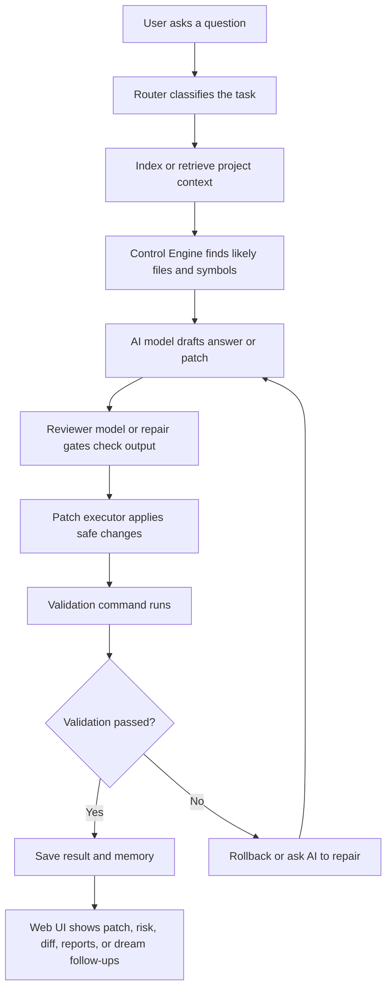

# C.A.T.T.U.S AI Coding Agent

C.A.T.T.U.S is an AI coding assistant that can read a software project, understand the user's question, find the most relevant code, suggest a safe fix, test that fix, and remember useful lessons for later.

Think of it like a careful senior student in a programming club:

- It first looks around the project so it knows what files exist.
- It reads the parts of the code that matter most.
- It asks AI models to reason about the problem.
- It checks whether a proposed code change is safe.
- It runs validation commands when possible.
- It stores what happened so the next run can learn from it.

## What This Project Does

This project is an AI coding mentor and repair system. It supports two main ways of working:

- Human learning mode: explains code, teaches step by step, and helps the user understand bugs or design choices.
- Agent mode: reviews code, plans changes, generates structured patch JSON, applies safe edits, validates them, and logs the result.

The system can run from the terminal or from a Flask web interface. The web interface has grown into a workspace-style dashboard with separate areas for goal-brief intake, chat/patching, benchmarks, dream runs, memory, graphs, and system health.

## Main Features

### 1. CLI and Web Workspace

The project starts from `main.py`.

You can use:

- Terminal mode for interactive prompts.
- Web mode for a browser workspace with repo path input, goal brief building, patch controls, benchmark history, graph views, health checks, dream queue controls, and session history.

Current web workspaces:

- Chat / Patch: answer, context, state, patch card, validation, diff, and candidate views.
- Goal Brief: turn a vague goal into a structured, evidence-based task prompt before an agent acts.
- Benchmarks: browse past benchmark reports and inspect results.
- Dream: queue overnight bug/debt/idea/research work.
- Memory: run memory consolidation, manage lessons/proposals, create handoffs, inspect worker runs, and launch MCP Inspector shortcuts.
- Graph: render clean or debug program graphs.
- Settings / Health: check API keys, DB, embeddings, Ollama, Tree-sitter, and local toolchains.

The Patch tab now shows a structured patch card instead of only raw JSON. It summarizes patch type, confidence, risk, validation command, changed files, and last action, while keeping raw JSON available for debugging.

### 1.5. Goal Brief Builder

Goal Brief Builder is an **assistive intake flow** for vague or risky goals — it helps the operator structure a task gradually rather than forcing a strict interview. Use it before Dream, CONTROL, Claude, ChatGPT, or the full agent when the request is not yet concrete enough to act on safely.

The Goal Brief tab is staged top-to-bottom — **Step 1 Describe → Step 2 Refine → Step 3 Handoff** — with one primary action per stage. Step 1 is a single main box ("What do you want help with?"); rough notes are an optional collapsed detail, and the checklist uses soft, non-blocking wording (e.g. "Not provided yet", "Needed before worker assignment") instead of a red error wall. You can continue with a rough brief — Worker Assignment just stays gated until the final prompt is ready. **Advanced helpers** (mode routing, review pack, raw details) remain available but live in a collapsed secondary section so they don't compete with the main flow.

It keeps a fixed `GoalBrief` schema and uses model guidance only for interviewing:

- ask at most a couple of focused clarifying questions
- summarize what is known
- identify missing evidence
- suggest safe terminal commands for the user to run manually
- accept pasted command output or manual observations
- generate a final high-quality task prompt once enough evidence exists

It writes artifacts under `.agent/goal_briefs/<timestamp>/`:

- `goal_brief.json`
- optional `goal_brief.md`

Important guardrail: Goal Brief Builder is a collector, not a solver. It does not run terminal commands, apply patches, run benchmarks, create benchmark cases, seed or promote lessons, promote memory, mutate proposals, or edit source files.

CLI:

```bash
python scripts/create_goal_brief.py --goal "Fix the weird checkout failure"
python scripts/create_goal_brief.py --brief-ref .agent/goal_briefs/<timestamp>/goal_brief.json --answer "<pasted result>" --export-md
```

Important files:

- `core/goal_brief.py`
- `scripts/create_goal_brief.py`
- `web/app.py`

### 1.6. Worker Assignment / Route Card

Worker Assignment creates a ready-to-copy route card from an existing artifact. It is draft-only: no worker is launched, no model is called, no patch is applied, no validation command runs, and no Dream / Project Evolution / lesson promotion path starts.

Default output:

- `.agent/worker_assignments/<assignment_id>/worker_assignment.json`
- `.agent/worker_assignments/<assignment_id>/worker_assignment.md`

CLI:

```bash
python scripts/create_worker_assignment.py --repo-path . --goal-brief .agent/goal_briefs/<timestamp>/goal_brief.json --mode debug --role implementer
python scripts/create_worker_assignment.py --repo-path . --seed-draft .agent/external_queue_exports/<id>/goal_brief_seed_draft.json --mode documentation --role documenter --dry-run --json
```

In the web UI, create or update a Goal Brief first — **Create Worker Assignment** stays disabled until a usable brief exists (helper text: "Start or load a Goal Brief before creating a Worker Assignment."). After creating, the UI shows one compact card (assignment id, JSON path, Markdown path) plus a read-only Markdown box with a **Copy assignment** button. The Markdown is a compact route card — **Objective**, **Source**, **Scope**, **Task Rules**, **Validation**, **Expected Output** — that states the no-apply / no-launch / no-real-repo-mutation rule once (in Task Rules) instead of repeating the same safety statement across many sections. Copy the Markdown to Codex / Claude / Gemini / Ollama manually. The JSON record keeps `human_approval_required=true`, `apply_allowed=false`, and `worker_launch_allowed=false`; no worker is launched automatically.

Important files:

- `main.py`
- `cli/interactive.py`
- `web/app.py`
- `web/runner.py`
- `web/templates/index.html`
- `web/static/style.css`
- `core/health.py`
- `core/benchmarks_view.py`

### 1.7. Driver Model Routing Contract (H.1)

Worker Assignment tells the human *what* task to send. The Driver tells them *what model level* ("vehicle") is appropriate — but it does not drive yet. H.1 is **contract/report-only**: it reads a worker assignment and recommends the safest allowed vehicle. No model is called, no provider is switched, no worker is launched, no patch is applied, no validation runs, and no Dream / Project Evolution / lesson-promotion path starts.

Vehicle levels (stable string constants):

- `local_only` — a local/free model is enough
- `free_model_ok` — a free model is fine
- `cheap_api_ok` — a cheap API is okay
- `strong_model_recommended` — a stronger API is recommended
- `strong_model_requires_approval` — strong model, only after explicit human approval
- `vision_or_human_caption_required` — a vision model or a human caption summary is required
- `human_only` — a human must handle it
- `blocked` — not permitted in this contract

Default output:

- `.agent/driver_decisions/<driver_decision_id>/driver_decision.json`
- `.agent/driver_decisions/<driver_decision_id>/driver_decision.md`

CLI — create a Worker Assignment, then evaluate the Driver Decision and copy the route manually:

```bash
python scripts/create_worker_assignment.py --repo-path . --goal-brief .agent/goal_briefs/<timestamp>/goal_brief.json
python scripts/evaluate_driver_route.py --worker-assignment .agent/worker_assignments/<assignment_id>/worker_assignment.json
```

Optional flags: `--json`, `--dry-run`, `--output-root`, plus deterministic `--driver-decision-id` / `--created-at` hooks. The two steps stay separate: F.5 does not auto-run H.1, and H.1 never executes anything — copy the recommended vehicle from the decision and route the work yourself. The decision JSON always carries inert flags `model_call_performed`, `provider_switch_performed`, `worker_launch_performed`, `patch_applied`, `validation_run`, and `promotion_performed`, all `false`.

Routing highlights: Review-only → `local_only`/`free_model_ok`; narrow Debug with validation → `free_model_ok`; missing validation → at least `cheap_api_ok` + `missing_validation` flag; Project Evolution → `strong_model_recommended` + approval; Dream Trial → experimental flag + approval (Dream does not start); visual evidence (screenshot / UI layout / chart / OCR / design) → `vision_or_human_caption_required`; security-sensitive work (secrets / API key / auth / token / credential / webhook security) → `strong_model_requires_approval`; `apply_allowed` / `worker_launch_allowed` → `blocked`; missing allowed files → `scope_unclear`; External Queue source → `external_untrusted_source` and never below `free_model_ok`. This contract is the routing foundation for the future A.16 Visual Evidence Intake Contract.

Important files:

- `core/driver_model_routing.py`
- `scripts/evaluate_driver_route.py`
- `tests/test_driver_model_routing.py`

### 1.8. Visual Evidence Intake Contract (A.16)

Text and code validation can pass while nobody has confirmed that a visual / UI / design issue was actually fixed. The Visual Evidence Intake Contract closes that gap. It is **contract-only**: given a Worker Assignment (F.5) or a Driver Decision (H.1) it records whether a visual issue is referenced, whether visual evidence or a human caption summary exists, whether a model could even read that evidence, and whether validation explicitly covers the visual issue — then it decides whether a "resolution claim" is allowed.

**Core rule: a visual/UI/design issue is not "resolved" just because text tests passed.** A claim that the visual issue is fixed requires *either* a human caption summary *or* a vision-capable model, **plus** explicit validation coverage of the visual issue. Validation passing on its own does not prove a visual/UI issue is fixed.

A.16 performs no OCR, calls no vision model, calls no model, and never inspects image bytes. `visual_evidence_readable_by_model` and `validation_covers_visual_issue` are only ever true when the operator passes them explicitly — they are never inferred from a file being present.

Default output:

- `.agent/visual_evidence/<visual_evidence_id>/visual_evidence_contract.json`
- `.agent/visual_evidence/<visual_evidence_id>/visual_evidence_contract.md`

CLI — manual sequence (each step stays separate; A.16 does not auto-run inside F.5 or H.1):

```bash
python scripts/create_worker_assignment.py --repo-path . --goal-brief .agent/goal_briefs/<timestamp>/goal_brief.json
python scripts/evaluate_driver_route.py --worker-assignment .agent/worker_assignments/<assignment_id>/worker_assignment.json
python scripts/create_visual_evidence_contract.py --source .agent/worker_assignments/<assignment_id>/worker_assignment.json --human-summary "Before: chart bars overlap the legend. After: bars are spaced."
```

Optional flags: `--visual-path` (repeatable), `--human-summary`, `--visual-readable-by-model true`, `--validation-covers-visual true`, `--json`, `--dry-run`, `--output-root`, plus deterministic `--visual-evidence-id` / `--created-at` hooks. The contract JSON always carries inert flags `model_call_performed`, `ocr_performed`, `vision_model_called`, `worker_launch_performed`, `patch_applied`, `validation_run`, and `promotion_performed`, all `false`. A.16 supports the H.1 `vision_or_human_caption_required` vehicle: when a task needs visual evidence, A.16 is where the human records the caption summary (or asserts a vision model) before any resolution claim is allowed.

Important files:

- `core/visual_evidence_contract.py`
- `scripts/create_visual_evidence_contract.py`
- `tests/test_visual_evidence_contract.py`

### 1.9. Lesson Teaching Card / Teacher Mode (F.6)

Lesson Teaching Card turns existing evidence into a study-friendly card. It is local and artifact-based: given a lesson, anti-lesson, benchmark case, or failure report JSON, it writes a concise teaching card for human review. It does not invent new lessons, promote lessons, create anti-lessons, modify repo source files, apply patches, run validation, launch workers, trigger Dream / Project Evolution, or call models/webhooks/network.

Default output:

- `.agent/teaching_cards/<teaching_card_id>/teaching_card.json`
- `.agent/teaching_cards/<teaching_card_id>/teaching_card.md`

CLI examples:

```bash
python scripts/create_lesson_teaching_card.py --lesson .agent/lessons/active/<lesson_id>.json
python scripts/create_lesson_teaching_card.py --anti-lesson .agent/lessons/blocked/<lesson_id>.json
python scripts/create_lesson_teaching_card.py --benchmark-case benchmarks/cases/python/python_config_env_mismatch/case.json
python scripts/create_lesson_teaching_card.py --failure-report .agent/audits/<report>.json
```

Teaching Card smoke/copy usage: the Markdown file is the copy/study artifact. The default CLI output prints the teaching card id, JSON path, Markdown path, and a `Copy this Markdown:` hint. Use `--json` for deterministic machine-readable output with no extra human text.

Optional flags: `--json`, `--dry-run`, `--output-root`, plus deterministic `--teaching-card-id` / `--created-at` hooks. The card JSON always carries inert flags `model_call_performed`, `lesson_promotion_performed`, `anti_lesson_created`, `patch_applied`, `validation_run`, `worker_launch_performed`, `dream_triggered`, and `project_evolution_triggered`, all `false`.

Important files:

- `core/lesson_teaching_card.py`
- `scripts/create_lesson_teaching_card.py`
- `tests/test_lesson_teaching_card.py`

### 1.10. Worker Result Review Stub (F.7)

Worker Result Review Stub records output from an external worker for human review. It is local and artifact-only: a human runs the worker elsewhere, then imports the result text or result file against an existing Worker Assignment. The review remains untrusted until a human inspects it. It does not call models, launch workers, apply patches, run validation, import proposals, promote lessons, create teaching cards, trigger Dream / Project Evolution, or call webhooks/network.

Default output:

- `.agent/worker_result_reviews/<review_id>/worker_result_review.json`
- `.agent/worker_result_reviews/<review_id>/worker_result_review.md`

CLI example:

```bash
python scripts/import_worker_result_review.py --worker-assignment .agent/worker_assignments/<assignment_id>/worker_assignment.json --result-file worker_result.md
```

Optional links: `--driver-decision <path>` and `--visual-evidence-contract <path>`. Use `--result-text "<text>"` for a direct paste, `--dry-run` to write nothing, and `--json` for deterministic machine-readable output. The Markdown review summarizes the worker excerpt, claimed changed files, claimed validation, risk flags, missing requirements, recommended next actions, review status, and execution boundary.

Important files:

- `core/worker_result_review.py`
- `scripts/import_worker_result_review.py`
- `tests/test_worker_result_review.py`

### 2. Task Router

Before the agent can help, it tries to understand what kind of request it received.

For example, it can classify a request as:

- bug fix
- code explanation
- code review
- refactor
- feature addition
- architecture planning
- testing or validation

Important file:

- `core/router.py`

### 3. Repository Indexing

When the user gives the agent a project folder, the indexer scans the repository and builds a useful map.

It looks for:

- source files
- functions and classes
- imports
- function calls
- project structure
- code style patterns

Important files:

- `core/indexer.py`
- `core/repo_librarian.py`
- `core/code_dna.py`
- `graph/builder.py`
- `graph/project_map.py`

### 4. Retrieval and Context Gathering

The agent should not guess from the whole project at once. Instead, it retrieves the most relevant snippets.

This is like opening the right textbook page before answering a homework question.

Important files:

- `core/retriever.py`
- `core/feature_context.py`
- `core/source_snippet_fallback.py`

### 5. Control Engine

The Control Engine is the project's main reasoning hub. It uses graph evidence, code snippets, risk scoring, and execution traces to decide what code probably matters.

It produces structured information such as:

- likely target file
- likely target function
- top hypothesis
- evidence
- patch intent
- related snippets
- whether more evidence is needed

The Control Engine's DFS sorts neighbors by `query_bonus * 2 + graph_weight`, where `graph_weight` is the universal node weight computed in `graph/weights.py`. That weight combines structural topology (in-degree, out-degree, complexity) with a history-driven **penalty** term: nodes that have failed before (blocked lessons or failed `patch_attempts` rows) sort to the top of any neighbor list. Each evidence row exposes `graph_weight` so debug context shows why a node ranked highly.

Important file:

- `core/control_engine.py`

### 6. AI Model Collaboration

The system uses AI models in different roles.

- Gemini drafts answers or patch proposals.
- DeepSeek or Ollama can review or critique.
- The pipeline can refine answers after review.
- Model-call attempts can be recorded during benchmark runs, including fallback count and selected model by role.

Important files:

- `agents/gemini_client.py`
- `agents/deepseek_client.py`
- `agents/ollama_client.py`
- `agents/model_stats.py`

### 7. Patch Generation and Safety Gates

When the agent proposes a fix, it tries to keep the patch grounded in real code. The patch system checks whether the target file and target snippet are safe before applying anything.

Patch styles:

- `safe_minimal`: smallest grounded edit, strict safety.
- `balanced`: allows more design-level fixes, but still grounded.
- `vibe`: more creative, manual review expected.

Important files:

- `patching/patch_engine.py`
- `patching/patch_gates.py`
- `patching/patch_plan_executor.py`
- `policy/decision_helper.py`

### 8. Validation and Rollback

After applying a patch, the system can run a validation command such as:

```bash
python main.py
pytest
go test ./...
cargo test
npm test
```

If validation fails, the executor can roll back the patch-touched file to its
previous state.

The web "Test Run Patch" flow now runs against a temporary copy of the repository. That means the real project stays safe while the user gets a more honest signal than a dry-run-only check.

Important files:

- `core/executor.py`
- `core/validator.py`
- `core/validation_command.py`
- `core/preflight.py`

### 8.1. Pre-Automation Validation Guardrails

Two safety boundaries are now explicit before any stronger automation is added:

- **A.18 Safe Validation Execution**: automation-safe callers use
  `SafeValidationCommand`, argv execution with `shell=False`, a required
  timeout, scrubbed environment, and rejection of shell metacharacters,
  `python -c`, destructive commands, env-dumping tools, and shell interpreters.
  Legacy shell validation remains manual/backward-compatible only.
- **A.19 Patch-Plan Atomicity Boundary**: patch-plan atomicity is patch-op
  scoped. Patch operations are rollback-protected, but validation side effects
  are outside patch rollback scope unless validation runs as sandbox validation
  or a future explicit side-effect rollback mechanism is used.

Patch-plan and executor results now expose metadata such as
`atomicity_scope="patch_ops_only"`,
`validation_side_effects_in_rollback_scope=false`, and
`validation_side_effect_policy="reported_not_rolled_back"`. When supported,
validation-created, modified, or deleted files are reported instead of silently
described as fully rolled back. Future automation/self-evolution paths must
require safe validation execution and prefer sandbox validation before trusting
validation results.

### 8.2. Upload Temp Repo Lifecycle

Uploaded folders are staged into C.A.T.T.U.S-managed temp repos, not permanent
project repos. Each temp repo is marked with minimal lifecycle metadata
(`created_at`, source route, repo path, cleanup policy, last access time, and
status) without storing secrets or uploaded file contents in metadata.

Failed upload temp dirs with zero indexable files are cleaned up when safely
possible, or reported as cleanup-eligible if cleanup is refused. Cleanup is constrained to managed temp roots only: arbitrary paths, project roots, `.git`,
home directories, drive roots, and unmanaged repos are refused.

This Upload Temp Repo Lifecycle is a pre-automation guardrail. Future
automation, sandbox, and self-evolution runners must not treat uploaded temp
repos as durable state.

### 9. Memory System

The project can store sessions, messages, code units, patch attempts, dependency edges, and engineering notes in PostgreSQL with pgvector.

This lets the agent remember:

- what it tried before
- which patches worked
- which validation commands are useful
- project-specific lessons

Past failures also feed back into graph reasoning: a blocked lesson (in `.agent/lessons/blocked/`) adds +5.0 to the weight of the file it touched, and each failed row in the `patch_attempts` table adds +1.0 to the matching file or symbol node (`<rel_path>::<target_node_name>` when the patcher recorded a specific symbol). CONTROL DFS, the project map's Critical Symbols list, and the Obsidian `AI_READ_FIRST` ranking all see this boost automatically — files and symbols that have failed before bubble up. The signal is computed at graph-build time and is fail-soft: a missing DB or absent lesson dir degrades silently to zero.

Important files:

- `database/memory.py`
- `database/schema.sql`
- `database/memory_consolidator.py`
- `graph/penalty.py`
- `graph/penalty_constants.py`

### 10. Project Graph and Obsidian Export

The graph layer turns code into nodes and edges.

Examples:

- file contains function
- file imports another file
- function calls another function

Every node carries a universal weight (`graph/weights.py`) that combines structural topology (`α·in_degree + β·out_degree + γ·complexity`, defaults `α=2.0`, `β=1.0`, `γ=0.5`) with a lesson-derived penalty term. CONTROL DFS sorts neighbors by this weight, the project map's Critical Symbols section ranks by it, and the Obsidian export's `AI_READ_FIRST` block lists files in weight order — so prioritization stays consistent across every consumer.

The web UI can render graph views, and the project can export graph notes for Obsidian.

Important files:

- `graph/schema.py`
- `graph/builder.py`
- `graph/query.py`
- `graph/weights.py`
- `graph/penalty.py`
- `graph/exporter.py`
- `graph/obsidian_exporter.py`
- `core/semantic_graph_pipeline.py`

### 11. Phantom Limb Scanner

The Phantom Limb scanner looks for missing structural pieces. It does not prove bugs. It gives careful suggestions.

Examples:

- Python script may need an `if __name__ == "__main__"` guard.
- HTML page may need a `<title>`.
- C++ class with virtual methods may need a virtual destructor.
- TypeScript code may have risky `any` usage.

Important file:

- `core/phantom_limb.py`

### 12. Mutation Oracle

A normal test can pass even when it is weak. The Mutation Oracle checks test strength by making small fake mistakes in the patched code and seeing whether validation catches them.

If the tests catch the fake mistakes, validation is stronger. If fake mistakes still pass, the project may need better tests.

Important file:

- `core/mutation_oracle.py`

### 13. Sleeping Consultant

The Sleeping Consultant is an overnight planning and research workflow. It can queue ideas, bugs, technical debt, or research items, then work on them in temporary copies of the repository.

This protects the real project while the agent explores.

It can also seed dream items from benchmark reports: failed cases become bug follow-ups, and slow passing cases can become technical-debt items.

How to see `auto_approved` or `needs_human_review` in Dream:

- Use Dream mode `patch_if_safe`.
- Queue a narrow `bug` or `debt` item. The planner must decide `safe_to_patch_now=true`.
- If the patch plan applies and validates in a temporary repository, the item status becomes `ready_to_apply`.
- During the refinement phase, `ready_to_apply` items are revalidated in a fresh temporary copy and graded by `lesson_quality`.
- Open the Dream report after the run. A successful revalidation shows badges like `READY_TO_APPLY`, `REFINED 1x`, and one lesson badge: `auto_approved`, `needs_human_review`, or `blocked`.

If the item only shows `PLANNED_NO_PATCH` and `REFINED 1x`, that means Dream only refined the plan. There was no saved `patch_plan.json`, so there is no lesson-quality badge yet. This usually happens when the item is too broad, marked unsafe to patch, or queued as `research` / `idea` instead of a narrow patchable `bug` or `debt`.

Important files:

- `core/sleeping_consultant.py`
- `core/dream_artifacts.py`
- web routes under `web/app.py`

### 14. Benchmarks

The benchmark suite checks whether the agent can fix small broken projects in different languages.

Current case types include:

- C++ account interest
- C++ boundary checks
- Go wallet transfers
- Go missing imports
- Go logging side effects
- Go wrong-file temptation
- HTML signup form accessibility
- JavaScript async missing await
- JavaScript array mutation side effect
- JavaScript null user profile
- JavaScript temperature conversion
- Python discount validation
- Python mutable default argument
- Python off-by-one pagination
- Python exception parsing
- Python SQL account transfer
- Python SQL join filter
- Rust cart reservation
- Rust result error handling
- TypeScript import/export mismatch
- TypeScript inventory restock
- TypeScript optional property guard

Benchmark reports are saved under `.agent/benchmarks/` as JSON, with optional Markdown reports. The web UI can list and open past reports.

Important files:

- `benchmarks/run_benchmarks.py`
- `benchmarks/cases/`
- `core/benchmarks_view.py`

### 15. Health and Observability

The Settings / Health workspace gives cheap, non-blocking checks for the local environment.

It checks:

- Google API key
- optional API keys
- PostgreSQL status
- embedding settings
- Ollama status
- Tree-sitter availability
- local toolchain binaries such as Python, Node, Go, Cargo, and g++

The benchmark runner also records useful metadata such as selected model, model attempts, fallback count, changed files, validation output, skipped toolchain failures, and grouped pass rates.

Important files:

- `core/health.py`
- `agents/model_stats.py`
- `benchmarks/run_benchmarks.py`

### 16. Mayor Mode and Worker Runs

Mayor Mode is the operator workflow for sending a bounded task to an external coding agent without giving that agent the real repo.

The flow is:

1. Create a handoff note under `.agent/handoffs/`.
2. Optionally run a worker in a temp clone with explicit operator approval.
3. Inspect the worker run under `.agent/worker_runs/`.
4. Import a complete worker run as a normal proposal under `.agent/proposals/`.
5. Validate that imported proposal in a temp clone.
6. If validation passes, synthesize lesson-ready proposal artifacts.
7. Create and promote a lesson through the normal manual lesson flow.

Important files:

- `core/handoff_notes.py`
- `core/worker_runs.py`
- `scripts/create_handoff_note.py`
- `scripts/run_subagent_handoff.py`

### 17. MCP Servers and Inspector

The project exposes a narrow MCP surface for external MCP-aware clients.

- Read-only MCP server: 10 evidence-reading tools, no writes.
- Artifact-write MCP server: the same read-only tools plus `create_handoff_note`, `import_worker_run_as_proposal`, and `validate_imported_worker_proposal`.
- MCP audit ledger: bounded summaries of artifact-write calls under `.agent/mcp_audit/invocations.jsonl`.
- MCP Inspector shortcuts: local web buttons that launch Inspector only for fixed read-only or artifact-write targets.

`validate_imported_worker_proposal` is the only artifact-write MCP tool that runs a subprocess, and it does so through the existing temp-clone validation path. It must never apply patches to the real repo.

Important files:

- `core/tool_registry.py`
- `core/mcp_audit.py`
- `mcp_server/read_only.py`
- `mcp_server/artifact_write.py`
- `scripts/mcp_readonly_server.py`
- `scripts/mcp_artifact_write_server.py`
- `web/mcp_inspector_processes.py`

## Pipeline

Here is the simple version:



## Pipeline Explained Like a School Project

Imagine your codebase is a big school notebook.

1. The router reads the question and decides what kind of help is needed.
2. The indexer flips through the notebook and makes a table of contents.
3. The retriever chooses the pages that are probably useful.
4. The Control Engine highlights the paragraph that most likely contains the answer.
5. Gemini writes a first answer or patch.
6. A reviewer checks whether the answer makes sense.
7. The patch engine changes the file only if the target is safe.
8. The validator runs the project's test or build command.
9. The memory system writes down what happened.

## Folder Guide

| Folder or file | What it is for |
| --- | --- |
| `main.py` | Main program entry point. |
| `config.py` | Environment variables, model names, file extensions, and safety settings. |
| `agents/` | AI model clients for Gemini, DeepSeek, and Ollama. |
| `cli/` | Terminal prompts and state creation. |
| `web/` | Flask web UI, workspace tabs, patch card, sessions, graph view, health panel, benchmark views, and dream routes. |
| `core/` | Main system logic: routing, retrieval, prompts, validation, memory refresh, control engine, health checks, benchmark report views. |
| `patching/` | Patch application, patch plans, and safety gates. |
| `graph/` | Program graph construction, querying, Mermaid export, and Obsidian export. |
| `database/` | PostgreSQL schema, memory storage, sessions, artifacts, patch attempts. |
| `reasoning/` | Risk analysis, state reasoning, and deeper project understanding. |
| `policy/` | Patch style policy and auto-apply rules. |
| `benchmarks/` | Small broken repos used to test whether the agent can fix bugs. |
| `mcp_server/` | Local MCP server modules for read-only and narrow artifact-write access. |
| `scripts/` | Operational scripts for background reports, proposal queues, handoffs, and MCP server shims. |
| `.agent/` | Generated project maps, debug files, benchmark reports, graph exports, dream artifacts, handoffs, worker runs, proposals, lessons, and MCP audit logs. |

## How To Run

Create your environment:

```bash
python -m venv .venv
.venv\Scripts\activate
pip install -r requirements.txt
```

Copy the example environment file:

```bash
copy .env.example .env
```

Then add your API keys and database settings in `.env`.

Run the terminal app:

```bash
python main.py --terminal
```

Run the web app:

```bash
python main.py --web
```

Or:

```bash
python -m web.app
```

`python main.py --web` and `python -m web.app` both route through the same web runner. CLI and web patch-result post-processing now share `core.postprocess_gates.run_postprocess_gate_battery(...)`; caller-specific behavior such as web harness decisions remains outside that helper. When the Flask server exits from a normal terminal shutdown path such as `Ctrl+C`, it also attempts to stop matching local MCP Inspector process trees.

Index a repository:

```bash
python main.py --index path\to\repo
```

Run benchmark checks:

```bash
python benchmarks\run_benchmarks.py --check
```

Run benchmarks:

```bash
python benchmarks\run_benchmarks.py --fast --summary
```

Useful benchmark options:

```bash
python benchmarks\run_benchmarks.py --fast --summary --markdown
python benchmarks\run_benchmarks.py --turbo --summary --limit 5
python benchmarks\run_benchmarks.py --latest
python benchmarks\run_benchmarks.py --compare .agent\benchmarks\old.json .agent\benchmarks\new.json
python benchmarks\run_benchmarks.py --fast --summary --skip-toolchain-failures
```

Run MCP helper checks:

```bash
python scripts\mcp_readonly_server.py --list-tools
python scripts\mcp_artifact_write_server.py --list-tools
```

Start MCP servers for an MCP client:

```bash
python scripts\mcp_readonly_server.py
python scripts\mcp_artifact_write_server.py
```

The running MCP servers require the optional `mcp` Python SDK:

```bash
pip install mcp
```

The `--list-tools` commands work without importing `mcp`, so they are safe sanity checks before installing optional dependencies.

View benchmark cases in the web UI:

1. Start the web app:

   ```bash
   python main.py --web
   ```

2. Open `http://127.0.0.1:5000` if the browser does not open automatically.

3. In the repo path box near the top, enter the project folder path. For this
   repo, that is usually:

   ```text
   C:\Users\Admin\Documents\Code\day 14\AI project
   ```

4. Click the **Benchmarks** tab.

5. Under **Past runs**, click a benchmark report. The detail panel shows totals,
   grouped results, flaky cases, slowest cases, and failed cases.

If **Past runs** is empty, create a report first:

```bash
python benchmarks\run_benchmarks.py --fast --summary --limit 5
```

To generate reports that can show flaky cases, run with retry:

```bash
python benchmarks\run_benchmarks.py --fast --summary --limit 5 --retry-failed 1
```

Note: the Benchmarks tab shows saved reports from `.agent\benchmarks\`. The raw
benchmark case folders live in `benchmarks\cases\`.

On Windows, if emoji output causes an encoding error, run:

```powershell
$env:PYTHONIOENCODING='utf-8'
```

### Flaky Case Review (A.17)

When a benchmark run produces flaky cases (cases that failed an early attempt
but passed on retry), the **Flaky Case Review** tool turns the raw report into
an operator-readable review:

```bash
python scripts/create_flaky_case_review.py --latest
# or an explicit report:
python scripts/create_flaky_case_review.py --report .agent/benchmarks/benchmark_report_<ts>.json
```

It is **report-only**. It reads an existing benchmark report (it never runs the
suite), finds the flaky cases, classifies *why* each one may be flaky using
deterministic rules (no model calls), and recommends one next human action per
case (e.g. `add_stability_replay`, `inspect_validation_environment`,
`manual_review_required`). It writes JSON + Markdown review artifacts to
`.agent/reliability/flaky_case_reviews/<review_id>/`. It **recommends** next
actions but does **not** fix flakes, change benchmark cases, prompts, patch
generation, or validation, call any model, or apply patches. Deterministic
`--review-id` / `--created-at` hooks make the artifact reproducible.

### Sandbox Self-Evolution Trial (AUTO.1a)

Before C.A.T.T.U.S is ever allowed to attempt a small self-improvement task on
its own, the **Sandbox Self-Evolution Trial Contract** scores whether that
attempt would even be safe to try:

```bash
python scripts/create_sandbox_self_evolution_trial.py \
    --phase-id AUTO.1a --phase-title "Tidy a helper" \
    --automation-level SANDBOX_2_DRAFT_PATCH \
    --allowed-files core/foo.py --validation "python -m pytest -q"
```

- It is **report-only**: it scores whether a self-evolution attempt would be
  safe to try; it does **not** run any automation.
- It defines five automation levels — `LOCAL_0_OBSERVE`, `LOCAL_1_PREPARE`,
  `SANDBOX_2_DRAFT_PATCH`, `REMOTE_3_DRAFT_PR` (future only), and the forbidden
  `AUTO_4_AUTO_MERGE` — and only defines/scores them; it never executes them.
- It scores an attempt on five deterministic dimensions — safety, scope
  control, validation plan, budget, and reviewability — into a verdict
  (`eligible_for_review`, `not_eligible_for_review`, or `blocked`) plus one next
  safe step, and writes JSON + Markdown to
  `.agent/self_evolution_trials/<trial_id>/`.
- **Self-evolution may be tested in a sandbox; self-approval is forbidden** and
  auto-merge is always blocked. No model / external coding agent launch, no
  real-repo edit, no push / merge / PR, no validation or benchmark run, and no
  Dream / Project Evolution.

It is the **first step** before any n8n / Telegram / GitHub / Claude / Codex
automation is given more power. Deterministic `--trial-id` / `--created-at`
hooks make the artifact reproducible.

### Sandbox Self-Evolution Dry Run (AUTO.1b)

AUTO.1b is the **first executable sandbox layer** — and it is **sandbox
dry-run only**:

```bash
python scripts/run_sandbox_self_evolution_dry_run.py --repo-path . \
    --automation-level LOCAL_0_OBSERVE \
    --validation-json '["python","-m","compileall","-q","core"]' --cleanup
```

- It copies the repo into a disposable, managed sandbox (excluding `.git`,
  `.agent`, caches, temp dirs, virtualenvs, `node_modules`, build outputs, and
  local env / secrets) and runs **only explicitly declared safe validation
  commands** there, via the A.18 safe path (argv, shell disabled, required
  bounded timeout, scrubbed environment — no raw shell, no legacy shell
  validation).
- It records A.19 before/after side effects (created / modified / deleted files)
  and confirms they were sandbox-only; `real_repo_modified` stays `false`.
- It **refuses to run** when the AUTO.1a contract is `blocked`, allows
  self-approval, is eligible for auto-merge, or targets `AUTO_4_AUTO_MERGE` /
  `REMOTE_3_DRAFT_PR`. Verdicts: `dry_run_passed`, `dry_run_failed`,
  `blocked_by_contract`, `validation_skipped`, `sandbox_setup_failed`.
- It **does not generate patches or call models** — and it never applies a patch
  to the real repo, pushes, merges, opens a PR, or contacts GitHub / Telegram /
  n8n. Side effects are never auto-cleaned during the trial; only `--cleanup`
  deletes the whole managed sandbox.

It writes JSON + Markdown to `.agent/self_evolution_trials/<trial_id>/sandbox_dry_run.json`
(and `.md`). Deterministic `--trial-id` / `--created-at` hooks make the artifact
reproducible.

### Sandbox Patch Candidate Evaluation (AUTO.1c)

AUTO.1c is the next sandbox-only executable layer: it evaluates a **provided**
patch candidate in a disposable sandbox.

```bash
python scripts/evaluate_sandbox_patch_candidate.py --repo-path . \
    --patch-file candidate.patch \
    --validation-json '["python","-m","compileall","-q","core"]' --cleanup
```

- It evaluates provided patch candidates **in the sandbox only** — it writes the
  patch into the managed sandbox copy, never to the real repo.
- It **does not generate patches** itself, and it **does not touch the real
  repo** (`real_repo_modified` and `patch_applied_to_real_repo` stay `false`;
  tests assert the repo is byte-identical before/after).
- It rejects unsafe candidates before applying: forbidden paths (`.env`, `.git`,
  `.agent/private`, secrets), absolute / parent-traversal paths, empty patches,
  and oversized patches (unless explicitly marked for manual review). After a
  successful sandbox apply it runs only declared A.18-safe validation and reports
  A.19 side effects around both the patch apply and the validation.
- It **requires human review before any graduation**: it blocks self-approval
  and auto-merge, refuses a `blocked` contract, and never pushes / merges / opens
  a PR or contacts GitHub / Telegram / n8n. Verdicts: `patch_candidate_passed`,
  `patch_candidate_failed_validation`, `patch_candidate_failed_apply`,
  `patch_candidate_rejected_by_safety`, `blocked_by_contract`,
  `validation_skipped`, `sandbox_setup_failed`.

It writes JSON + Markdown to
`.agent/self_evolution_trials/<trial_id>/patch_candidate_evaluation.json` (and
`.md`). A failed apply is reported, never retried or auto-fixed.

### Sandbox Patch Graduation Review (AUTO.1d)

AUTO.1d is a **review-only** graduation gate. It consumes an AUTO.1c patch
candidate evaluation artifact and decides whether the candidate deserves human
review — *passing in a sandbox is not the same as being safe to graduate.*

```bash
python scripts/create_sandbox_patch_graduation_review.py \
    --evaluation .agent/self_evolution_trials/<id>/patch_candidate_evaluation.json
```

- It is **review-only**: it reads the evaluation record and decides; it **does
  not apply patches, run validation, run a benchmark check, or call models**, and
  it never touches the real repo, pushes, merges, or opens a PR.
- It checks the source evaluation deterministically: the source verdict is
  acceptable, the real repo is unchanged
  (`real_repo_modified` / `patch_applied_to_real_repo` are `false`), effects were
  sandbox-only, the human gate is intact (no self-approval, no auto-merge), no
  forbidden path was touched, the patch is reviewable in size, and validation
  passed (or, if skipped, more validation is needed).
- It **blocks self-approval and auto-merge**: a candidate may be recommended for
  human review, but it may not approve itself
  (`human_review_required=true`, `self_approval_allowed=false`,
  `eligible_for_auto_merge=false`). Graduation verdicts:
  `eligible_for_human_review`, `needs_more_validation`, `blocked_by_safety`,
  `not_reviewable`; recommended next steps: `prepare_human_review_packet`,
  `request_more_validation`, `reject_candidate`, `narrow_patch_scope`,
  `manual_review_required`.

It writes JSON + Markdown next to the source evaluation when possible
(`.agent/self_evolution_trials/<trial_id>/patch_graduation_review.json` and
`.md`), otherwise under a folder named for the review id. The Markdown includes a
Human Review Packet (touched files, patch size, validation status, side-effect
summary, and what to inspect manually) so a person can make the call.

### Sandbox Self-Evolution Evidence Pack (AUTO.1e)

AUTO.1e packages the AUTO.1a–1d artifacts into **one** human-readable evidence
pack, so an operator does not have to open four separate files before deciding
what to do next.

```bash
python scripts/create_self_evolution_evidence_pack.py \
    --trial-dir .agent/self_evolution_trials/<id>
```

- It is **report-only**: it reads the AUTO.1a contract, AUTO.1b dry run, AUTO.1c
  patch evaluation, and AUTO.1d graduation review and bundles them. It **does not
  execute, approve, apply patches, run validation or benchmarks, or call models**,
  and it never touches the real repo, pushes, merges, or opens a PR.
- `--trial-dir` auto-discovers the known artifact filenames in a trial directory;
  explicit `--trial-contract` / `--dry-run` / `--patch-evaluation` /
  `--graduation-review` paths override discovery.
- It decides deterministically. Any artifact reporting a hard breach
  (self-approval, auto-merge, real-repo modification, real-repo patch apply, push,
  or merge) forces `blocked`. Otherwise the graduation review drives the verdict:
  `eligible_for_human_review` → `ready_for_human_review`, `needs_more_validation`
  → `needs_more_validation`, `blocked_by_safety` / `not_reviewable` → `blocked`. A
  missing graduation review (or patch evaluation) → `incomplete_pack` (a
  contract-only pack is valid as `incomplete_pack`, not a failure). Recommended
  next steps: `review_patch_candidate`, `request_more_validation`,
  `reject_candidate`, `complete_missing_artifacts`, `keep_report_only`.
- The Markdown bundles a Summary, a Timeline (contract → dry run → patch
  evaluation → graduation review), a Verdicts table, a Risk Summary
  (safety / scope / validation / side effects / budget / human gate), a Human
  Review Packet, Blockers, and Warnings.

It writes JSON + Markdown under the trial directory when possible
(`.agent/self_evolution_trials/<trial_id>/self_evolution_evidence_pack.json` and
`.md`), otherwise under a folder named for the pack id. AUTO.1e is the **bridge
toward future Telegram / GitHub / n8n review summaries — but it does not contact
them**; it only packages the evidence a human needs.

### End-to-End Sandbox Self-Evolution Smoke (AUTO.1f)

AUTO.1f is a **deterministic single-trial smoke scenario** that drives the
AUTO.1a → 1e chain over **one** harmless patch candidate inside **one** trial
directory, so every artifact shares the same `trial_id` and output folder before
any future external review automation is wired in.

```bash
python scripts/run_self_evolution_smoke.py
python scripts/run_self_evolution_smoke.py --trial-id auto1f_smoke --keep-sandbox
```

- It **orchestrates the existing AUTO.1a–1e tools in-process**: it builds the 1a
  contract, runs the 1b dry run, evaluates a 1c patch candidate, reviews 1d
  graduation, and packages the 1e evidence pack — all under one deterministic
  `trial_id`, `created_at`, and output directory.
- The candidate is a **fixed, explicit literal diff it consumes** (it never
  generates a patch) that creates one harmless text file
  (`pkg/auto1f_smoke_demo.txt`) **inside the sandbox copy only**.
- The **only execution** it triggers is declared safe validation
  (`python -m compileall -q core`) inside a disposable managed sandbox. It **does
  not** write to the real repo, generate a patch, call a model, push, merge, open
  a PR, promote a lesson, import a proposal, launch a worker, or contact external
  automation.
- Cleanup is **explicit**: managed sandboxes are removed by default and kept with
  `--keep-sandbox`; the result reports `sandbox_exists_after` either way.
- The clean smoke ends at `ready_for_human_review`. After the run,
  `.agent/self_evolution_trials/<trial_id>/` holds all ten artifacts (the five
  JSON + five Markdown files of the 1a–1e chain).

> **Operational note.** Keep the managed sandbox **outside the repo working
> tree** (`--sandbox-root <dir outside the repo>`) when an IDE/language-server
> builder is active. A repo-local sandbox copy of a foreign-language project
> (e.g. a `.csproj` under `benchmarks/cases/`) can be rebuilt by an external
> watcher that races the A.19 side-effect snapshot — which the chain honestly
> reports as a non-sandbox side effect and downgrades to `needs_more_validation`.
> The smoke itself writes nothing outside the sandbox; the interference is
> external.

## Machine-Readable Phase Registry (ROAD.1)

ROAD.1 gives the roadmap a **machine-readable** companion: a structured registry
of phase metadata that future phases can inspect and filter. It is the metadata
layer only — it **does not choose work and has no execution power**.

```bash
python scripts/validate_phase_registry.py \
    --registry docs/roadmap/phase_registry.json --output-root .agent/roadmap
```

- It is **report-only**: it loads the registry JSON, validates the schema and
  every phase record, and writes a deterministic JSON + Markdown report
  (`.agent/roadmap/phase_registry_report.json` and `.md`). It **does not execute
  phases, run the stored validation commands or benchmarks, call models, apply
  patches, write to the real repo, push, merge, open PRs, or contact GitHub /
  Telegram / n8n**.
- Each phase record carries an `automation_level` (`LOCAL_0_OBSERVE` →
  `AUTO_4_AUTO_MERGE`), a `budget_tier`, a `risk_level`, an allow/forbid file
  scope, a text-only `validation` list, and guardrail booleans
  (`human_approval_required`, `merge_allowed`, `network_allowed`,
  `model_calls_allowed`, `writes_real_repo`, `requires_sandbox`).
- Validation is strict and conservative. It rejects `AUTO_4_AUTO_MERGE`,
  `merge_allowed=true`, a dropped human-approval gate or real-repo-write authority
  on any non-complete phase, network access, model calls outside the
  `strong_model_requires_approval` budget tier, empty `allowed_files`/`validation`
  on active/proposed phases, and any phase whose `forbidden_files` omits `.env`,
  `.git`, or `.agent/private`. The CLI exits nonzero on an invalid registry unless
  `--allow-invalid-report` is passed.
- The seed registry ships eight conservative phases (ROAD.1, ROAD.2, AUTO.2a–2c,
  MODEL.1–3) so the report has real content. The **validation commands are stored
  as text and are never run by ROAD.1.**

ROAD.1 is the **foundation for the ROAD.2 phase picker** — a report-only
selector of safe candidate work. ROAD.1 only validates and summarizes roadmap
metadata; it selects nothing, runs nothing, and changes nothing in the real repo.

## Phase Picker / Night Candidate Report (ROAD.2)

ROAD.2 consumes the ROAD.1 registry and produces a **night candidate report**:
it classifies every phase into a safe-candidate bucket so an operator can see, at
a glance, what is safe to prepare next. It **recommends candidates only and has no
execution power**.

```bash
python scripts/create_phase_picker_report.py \
    --registry docs/roadmap/phase_registry.json --output-root .agent/roadmap
```

- It is **report-only**: it loads the registry, validates it **with the ROAD.1
  validator** (never re-implementing the schema check), classifies each phase, and
  writes a deterministic JSON + Markdown report
  (`.agent/roadmap/phase_picker_report.json` and `.md`). It **does not execute
  phases, modify code, run the stored validation commands or benchmarks, call
  models, apply patches, write to the real repo, push, merge, open PRs, or contact
  GitHub / Telegram / n8n**.
- Each phase lands in exactly one bucket: `safe_to_prepare`, `sandbox_required`,
  `human_approval_required`, `blocked`, `deferred_or_parked`, or
  `complete_or_history`. Buckets are assigned by deterministic rules over the
  ROAD.1 metadata (status, automation level, budget tier, risk level, the guardrail
  booleans, and the ROAD.1 validation result) — never by running anything.
- Each candidate carries `reasons` and a `recommended_next_step`
  (`prepare_worker_assignment`, `prepare_sandbox_trial_contract`,
  `request_human_approval`, `complete_prerequisites`, `keep_parked`,
  `no_action_complete`, or `blocked_until_metadata_fixed`).
- Within each bucket, candidates are ranked deterministically: lower risk first,
  then lower automation level, then track order (ROAD, AUTO, MODEL, GOV, A, F, H),
  then natural phase id. The `top_recommendation` is the best safe candidate.
- **If the registry is invalid, ROAD.2 recommends nothing** — `safe_to_prepare` is
  empty and there is no `top_recommendation`. The CLI exits nonzero on an invalid
  registry unless `--allow-invalid-registry-report` is passed.

ROAD.2 prepares the future AUTO.2 contracts (which themselves remain
contract/dry-run only). It classifies phase metadata and recommends; it executes
nothing, calls no models, touches no network, and changes nothing in the real repo.

## Telegram Evidence Summary Contract (AUTO.2a)

AUTO.2a consumes an **AUTO.1e evidence pack** and produces a **chat-review summary
contract**: a compact, human-readable summary plus an explicit list of what a human
may and may not do on the strength of it. It **defines the summary only and has no
integration or execution power**.

```bash
python scripts/create_telegram_evidence_contract.py \
    --evidence-pack .agent/self_evolution_trials/<id>/self_evolution_evidence_pack.json \
    --output-root .agent/automation_contracts
```

- It is **report-only**: it reads the evidence pack JSON, shapes a deterministic
  JSON + Markdown contract (`.agent/automation_contracts/telegram_evidence_contract.json`
  and `.md`), and **does not contact Telegram, send messages, call webhooks, make any
  network call, call models, apply patches, run validation or benchmarks, push, merge,
  open PRs, or contact GitHub / n8n**.
- The contract carries a `telegram_message` preview, informational `approval_options`
  (`review`, `defer`, `reject`, `request_more_validation`), a `forbidden_actions` list
  (`approve_merge`, `push`, `merge`, `apply_patch`, `run_worker`, `launch_model`,
  `rerun_automation`, `contact_network`), `required_human_checks`, a `risk_summary`,
  and `evidence_links`.
- **Sendability is conservative.** A summary is `is_sendable` only when the pack
  verdict is `ready_for_human_review` or `needs_more_validation` **and** no hard
  guardrail breach is reported. A `blocked` or `incomplete_pack` source, or any breach
  (auto-merge eligibility, real-repo write, push/merge, model call, worker launch,
  self-approval), sets `is_sendable=false` with `send_blockers` explaining why; the CLI
  exits nonzero unless `--allow-blocked-summary` is passed (which still keeps the
  summary not-sendable). For `needs_more_validation`, `request_more_validation` is
  emphasised.
- Every output guardrail is preserved and inert: `human_review_required=true`;
  `self_approval_allowed`, `eligible_for_auto_merge`, `telegram_message_sent`,
  `network_call_performed`, and the rest are all `false`.
- **Chat approval is never merge authority** — the summary always states that human
  review, local evidence, and branch protection remain required.

AUTO.2a prepares the future AUTO.2b / AUTO.2c remote contracts (which themselves remain
contract/dry-run only). It defines wording and limits; it sends nothing, calls no
models, touches no network, and changes nothing in the real repo.

## GitHub Remote PR Safety Contract (AUTO.2b)

AUTO.2b consumes one upstream evidence artifact — an **AUTO.1e evidence pack** or an
**AUTO.2a evidence summary contract** — and produces a **remote-PR safety contract**:
an explicit statement of what must be true before a *future* system may draft a remote
pull request. It **defines the safety contract only and has no integration or execution
power**.

```bash
python scripts/create_github_pr_safety_contract.py \
    --source-artifact .agent/self_evolution_trials/<id>/self_evolution_evidence_pack.json \
    --output-root .agent/automation_contracts
```

- It is **report-only**: it reads the source artifact JSON, detects its kind, shapes a
  deterministic JSON + Markdown contract
  (`.agent/automation_contracts/github_pr_safety_contract.json` and `.md`), and **does
  not contact GitHub, create branches, push commits, open or merge PRs, run git, call
  webhooks, make any network call, call models, apply patches, run validation or
  benchmarks, or contact Telegram / n8n**.
- **PR-readiness rules are conservative.** A future *draft* PR is allowed
  (`is_pr_draft_allowed_in_future=true`) **only** when the source verdict is
  `ready_for_human_review` with no hard guardrail breach and no carried blocker.
  `needs_more_validation` requires more validation first; `blocked` / `incomplete_pack`
  / a missing source / any breach (real-repo write, patch applied, push, merge, model
  call, worker launch, self-approval, auto-merge eligibility, or human review not
  required) all block readiness. **`is_merge_allowed` and `is_auto_merge_allowed` are
  always `false`.** The CLI exits nonzero for a blocked/incomplete source unless
  `--allow-blocked-contract` is passed (which still keeps a PR not allowed).
- The contract carries `required_checks`, `required_branch_protection`,
  `required_human_checks`, a `forbidden_actions` list (`push_to_main`, `force_push`,
  `open_pr_without_human_review`, `merge_pr`, `enable_auto_merge`,
  `bypass_branch_protection`, `apply_patch_to_real_repo`, `launch_worker`, `call_model`,
  `contact_remote_service`), informational `allowed_future_actions`
  (`prepare_draft_pr_after_human_review`, `request_more_validation`, `reject_candidate`,
  `keep_local_only`), a `risk_summary`, and `evidence_links`.
- Every output guardrail is preserved and inert: `human_review_required=true`;
  `pr_created`, `branch_created`, `github_contacted`, `network_call_performed`,
  `push_performed`, `merge_performed`, `eligible_for_auto_merge`, and the rest are all
  `false`.
- **A future PR is never merge authority** — the contract always states that human
  review and branch protection remain required.

AUTO.2b prepares the future AUTO.2c n8n dry run (which itself remains report-only). It
defines branch/PR/no-auto-merge rules; it contacts no remote host, runs no git, calls no
models, touches no network, and changes nothing in the real repo.

## n8n Orchestration Dry Run (AUTO.2c)

AUTO.2c consumes one or more upstream artifacts — an **AUTO.1e evidence pack**, an
**AUTO.2a evidence summary contract**, and/or an **AUTO.2b PR safety contract** — and
produces a **dry-run simulation** of how a future n8n workflow would orchestrate the
review chain. It **simulates only and has no integration or execution power**.

```bash
python scripts/create_n8n_orchestration_dry_run.py \
    --evidence-pack pack.json --telegram-contract tg.json --github-pr-contract gh.json \
    --output-root .agent/automation_contracts
```

- It is **report-only**: it reads the source artifact JSON files, detects each kind,
  shapes a deterministic JSON + Markdown report
  (`.agent/automation_contracts/n8n_orchestration_dry_run.json` and `.md`), and **does
  not contact n8n, call webhooks, make any network call, send Telegram messages,
  contact GitHub, run git, create branches, open or merge PRs, push commits, call
  models, launch workers, apply patches, or run validation or benchmarks**.
- The report lays out a deterministic **7-step simulated plan** (`load_evidence_pack`,
  `build_telegram_summary`, `build_github_pr_safety_contract`,
  `prepare_human_review_notification`, `wait_for_human_review`,
  `prepare_future_draft_pr_request`, `stop_before_live_execution`). Every step records a
  descriptive `would_contact` and **`actual_contact_performed=false`**, and the
  `simulated_notifications` / `simulated_remote_actions` are previews only
  (`actual_send_performed` / `actual_action_performed` are always `false`).
- **Orchestration verdict is conservative.** All-ready sources →
  `overall_verdict="dry_run_ready_for_human_review"` and
  `is_orchestration_allowed_in_future=true`. `needs_more_validation` allows a review
  notification but blocks the draft-PR step. Any blocked/incomplete/missing source, or
  any hard guardrail breach in any source (push/merge/pr_created/branch_created, real-repo
  write, model call, worker launch, self-approval, auto-merge eligibility, github/n8n/chat
  contact, or human review not required), forces `overall_verdict="blocked"`. The CLI
  exits nonzero for a blocked dry run unless `--allow-blocked-dry-run` is passed.
- **Live execution, merge, and auto-merge are always `false`.** Every output guardrail is
  inert: `human_review_required=true`; `live_execution_allowed`, `n8n_contacted`,
  `telegram_message_sent`, `github_contacted`, `network_call_performed`, `pr_created`,
  `branch_created`, and the rest are all `false`.
- **A dry run is never merge authority** — the report always states that human review and
  branch protection remain required before any live remote action.

AUTO.2c completes the AUTO.2 contract track. It previews notifications and remote actions
only; it contacts no n8n / Telegram / GitHub, runs no git, calls no models, touches no
network, and changes nothing in the real repo.

## C.A.T.T.U.S Artifact Dataset Builder (MODEL.1)

MODEL.1 scans existing **C.A.T.T.U.S artifacts** under a repo's `.agent` directory and
normalizes each one into a **stable JSONL dataset row** for future model / classifier
experiments. It is the first step of the MODEL track: it **builds training/evaluation data
artifacts only — it does not train a model, call a model, change routing, or grant any
prediction authority.**

```bash
python scripts/build_artifact_dataset.py --repo-path . \
    --output-root .agent/model_lab/artifact_dataset --json
```

- It scans known artifact families when present — goal briefs, worker assignments, driver
  decisions, visual evidence contracts, worker result reviews, flaky case reviews,
  self-evolution evidence packs, the Telegram / GitHub / n8n remote-safety contracts, the
  phase registry and picker reports, and lesson teaching cards. **Missing directories
  produce warnings, not failures, and malformed JSON is skipped with a warning** — never a
  crash.
- Each row carries stable fields: a deterministic, machine-independent `row_id`; the
  artifact kind and repo-relative path; best-effort `created_at` / `source_id` /
  `task_title` / `task_summary` / `mode` / `risk_level` / `automation_level`; `labels`
  (`recommended_vehicle`, `final_verdict`, `recommended_next_step`); `features`
  (`has_validation`, `has_visual_issue`, `has_security_sensitive_claim`,
  `has_remote_component`, `has_patch_candidate`, `has_human_gate`); a `target`
  (`dataset_task`, `target_label`, `authority="advisory_only"`); and a `quality` block
  (`parse_status`, `missing_fields`, `warnings`).
- It writes three artifacts under `--output-root`:
  `.agent/model_lab/artifact_dataset/artifact_dataset.jsonl`, `artifact_dataset_report.json`,
  and `artifact_dataset_report.md`. Output is **deterministic** for a fixed
  `--report-id` / `--created-at`. `--include-kind` (repeatable) and `--limit` narrow the
  scan; `--json` prints the report summary.
- It is **report-only**: it reads source artifacts and never mutates them. Every report
  guardrail is inert — `model_training_performed`, `model_call_performed`,
  `embedding_call_performed`, `database_write_performed`, `patch_applied`, `validation_run`,
  `benchmark_run`, `network_call_performed`, `worker_launch_performed`,
  `lesson_promotion_performed`, and `merge_performed` are all `false`.

MODEL.1 prepares **MODEL.2 — Driver Classifier Baseline** by producing the normalized
`routing_or_policy_learning` and `risk_classification` rows a future recommend-only baseline
would score. The dataset rows are advisory artifacts only; the deterministic Driver remains
the final gate.

## Driver Classifier Baseline (MODEL.2)

MODEL.2 consumes the **MODEL.1 JSONL dataset** and learns a small **offline, pure-stdlib
baseline classifier** (a single-rule "OneR" over the dataset features, with a majority-class
fallback). It produces an advisory evaluation report and a prediction preview. It **trains and
evaluates an offline baseline only — it does not route live tasks, does not override the
deterministic Driver, does not call model APIs / LLMs / embeddings, and adds no model
authority.**

```bash
python scripts/run_driver_classifier_baseline.py \
    --dataset-path .agent/model_lab/artifact_dataset/artifact_dataset.jsonl \
    --output-root .agent/model_lab/driver_classifier_baseline --json
```

- It reads the dataset (skipping malformed/non-object lines with a warning), picks a target
  field (`--target-field`, default `target.target_label`, with deterministic fallback to
  `labels.recommended_next_step` → `labels.final_verdict` → `artifact_kind` →
  `target.dataset_task` when the primary has fewer than two classes), and extracts a fixed,
  deterministic feature schema (`artifact_kind`, `dataset_task`, `risk_level`,
  `automation_level`, `final_verdict`, `recommended_vehicle`, and the four `has_*` feature
  flags).
- It splits rows into train/test by a **stable per-`row_id` hash bucket** (`--test-ratio`,
  default 0.3), learns the baseline on the train rows, and evaluates on the test rows
  (falling back to in-sample evaluation for tiny datasets). Metrics include `accuracy`,
  `correct`, `total`, and macro `precision` / `recall` / `f1` (with safe zero-division
  handling), plus a confusion matrix.
- It writes three artifacts under `--output-root`:
  `.agent/model_lab/driver_classifier_baseline/driver_classifier_baseline_report.json`,
  `driver_classifier_baseline_report.md`, and `driver_classifier_predictions.jsonl`. Each
  prediction row carries `true_label`, `predicted_label`, a bounded `confidence`,
  `prediction_source`, `correct`, `features_used`, and **`authority="advisory_only"`**.
  Output is **deterministic** for a fixed `--report-id` / `--created-at`; `--json` prints the
  report summary.
- If too few classes exist, it reports `insufficient_class_diversity` (and an empty dataset
  reports an insufficient-data blocker) but **still writes a deterministic report**.
- It is **report-only**: it reads the dataset and never mutates it. Every report guardrail is
  inert — `live_routing_performed`, `driver_override_performed`, `model_api_call_performed`,
  `llm_call_performed`, `embedding_call_performed`, `training_requires_external_model`,
  `database_write_performed`, `network_call_performed`, `patch_applied`, `validation_run`,
  `benchmark_run`, `worker_launch_performed`, and `merge_performed` are all `false`.

MODEL.2 predictions are **advisory only**; the deterministic Driver stays the final gate. It
prepares later MODEL-track work (e.g. **MODEL.3 — Lesson Graph Activation Dataset**) by
establishing a reproducible, no-authority baseline to measure future classifiers against.

## Lesson Graph Activation Dataset (MODEL.3)

MODEL.3 consumes the **MODEL.1 JSONL dataset** plus lesson / anti-lesson candidates and
builds deterministic **lesson activation rows** for future scoring experiments. It uses
text, title, tag, risk, kind, and explicit evidence-link features only. It **does not change
lesson retrieval, inject lessons into prompts, promote lessons, call models, call
embeddings, write databases, or grant execution authority.**

```bash
python scripts/build_lesson_activation_dataset.py \
    --repo-path . \
    --artifact-dataset .agent/model_lab/artifact_dataset/artifact_dataset.jsonl \
    --output-root .agent/model_lab/lesson_activation_dataset --json
```

- It reads MODEL.1 rows when present and scans lesson / anti-lesson candidate files under
  `.agent/lessons/**` and `lessons/**`. Missing source families produce warnings, not
  failures; malformed JSON / JSONL files are skipped with warnings.
- Each output row pairs one query artifact with one lesson candidate and records
  deterministic activation features: `token_overlap`, `title_overlap`, `tag_overlap`,
  `risk_match`, `kind_match`, `has_evidence_refs`, `is_active`, `is_archived`, and
  `is_anti_lesson`.
- Labels are heuristic and advisory: archived / superseded / blocked / duplicate / weak
  candidates become `suppress`; active candidates with overlap or explicit evidence links
  become `activate`; active candidates without overlap become `ignore`; partial records
  become `unknown`.
- It writes three artifacts under `--output-root`:
  `.agent/model_lab/lesson_activation_dataset/lesson_activation_dataset.jsonl`,
  `lesson_activation_dataset_report.json`, and `lesson_activation_dataset_report.md`.
  Output is deterministic for fixed `--report-id` / `--created-at`; `--limit` and
  `--min-overlap` control row count and activation threshold.
- It is **report-only**: every guardrail is inert, including
  `lesson_retrieval_changed`, `prompt_injection_changed`, `lesson_promotion_performed`,
  `lesson_merge_performed`, `lesson_block_performed`, `model_call_performed`,
  `embedding_call_performed`, `database_write_performed`, `network_call_performed`,
  `patch_applied`, `validation_run`, `benchmark_run`, `worker_launch_performed`, and
  `merge_performed`.

MODEL.3 prepares a future **lesson activation scorer**. It builds data only; lesson
selection, prompt construction, and all execution gates remain unchanged.

## Post-MODEL Checkpoint Audit (ROAD.3)

ROAD.3 is the **checkpoint** that closes the ROAD/AUTO/MODEL arc. It reads the roadmap
registry, the **ROAD.1 registry report** and **ROAD.2 picker report**, the generated
**MODEL** datasets and **AUTO.2** automation contracts, and the docs, then writes a
single audit that verifies everything agrees: the registry is valid, every expected
phase (ROAD.1, ROAD.2, AUTO.2a–2c, MODEL.1–3) is complete, the picker recommends no
further work, no inspected artifact hides execution power, and every phase is
documented.

```bash
python scripts/create_checkpoint_audit.py \
    --repo-path . \
    --registry docs/roadmap/phase_registry.json \
    --output-root .agent/roadmap --json --allow-warnings
```

- It reads existing reports when present and **tolerates missing or malformed
  artifacts** — a missing report is a warning, malformed JSON is skipped with a
  warning, and neither crashes the audit.
- It **recursively inspects** each artifact's guardrail dictionaries; any execution
  guardrail that is unexpectedly `true` (model / embedding / network / database /
  patch / validation / benchmark / worker / merge / push / PR / branch / contact /
  lesson / routing) becomes a **blocker**.
- **Verdict:** `pass` (registry valid, all expected phases complete, picker
  recommends nothing, no blockers), `warn` (optional artifacts missing, docs
  incomplete, or generated reports stale — but nothing unsafe), or `fail` (registry
  invalid, an expected phase missing/incomplete, the picker still recommends work, or
  a guardrail breach). It writes `.agent/roadmap/checkpoint_audit_report.json` and
  `.agent/roadmap/checkpoint_audit_report.md`, and the CLI exits nonzero on `fail`,
  and on `warn` unless `--allow-warnings`.
- It is **report-only**: it does not choose new work, execute phases, run validation
  or benchmarks, call models or embeddings, contact the network, run git, apply
  patches, launch workers, or promote / merge / block / retrieve lessons. Git history
  is intentionally not inspected because ROAD.3 does not run git.

ROAD.3 **freezes the completed roadmap arc**: with the eight prior phases shipped and
the picker reporting no safe candidates, the audit confirms the arc is closed and the
recommended next step is to plan the next machine-readable map.

## Post-EVAL/CMD Checkpoint Audit (ROAD.4)

ROAD.4 is the **checkpoint** that closes the EVAL and CMD arcs. It reads the phase
registry, the **EVAL.1–EVAL.3** artifact roots, the **CMD.1–CMD.4** artifact roots,
and the project documentation, then writes a single audit that verifies all seven
required phases (EVAL.1, EVAL.2, EVAL.3, CMD.1, CMD.2, CMD.3, CMD.4) are registered,
complete, report-only, artifact-backed, and documented.

Audit statuses: `pass`, `pass_with_warnings`, `blocked`. A blocked result means one or
more required phases are missing, non-complete, or have a guardrail field set to `True`.
Warnings are emitted for missing artifact root directories, undocumented phases, or
outstanding phase-picker safe candidates.

```bash
python scripts/create_post_eval_cmd_checkpoint_audit.py \
    --repo-path . \
    --registry docs/roadmap/phase_registry.json \
    --json --allow-warnings
```

- It is **report-only**: it does not choose new work, execute phases, call models, apply
  patches, run validation or benchmarks, contact network services, launch workers, push,
  merge, or open PRs. ROAD.4 is a report-only checkpoint audit.

ROAD.4 **freezes the completed EVAL and CMD arcs**: with all seven EVAL/CMD phases
shipped, the audit confirms the arcs are closed and the recommended next step is to
freeze the checkpoint before starting the next roadmap branch.

## Live Benchmark Run Ledger (EVAL.1)

EVAL.1 opens the **EVAL branch** of the next operating roadmap. It is a **report-only
ledger** that reads existing benchmark report artifacts and summarizes **live benchmark
run history** so operators can understand benchmark health over time — run-to-run
tracking and flake classification — instead of treating each run as an isolated event.
It **does not run benchmarks, call models, apply patches, edit benchmark cases, run
validation, contact network services, write to a database, launch workers, or merge.**

```bash
python scripts/create_benchmark_run_ledger.py \
    --repo-path . \
    --input-glob ".agent/benchmarks/benchmark_report_*.json" \
    --output-root .agent/eval/benchmark_run_ledger --json
```

- It scans `.agent/benchmarks/benchmark_report_*.json`, parsing each report and
  ordering runs deterministically by timestamp. A **missing** report set yields an
  empty ledger with a warning, and **malformed** reports are skipped with a warning —
  neither crashes the ledger. Older reports are tolerated: missing aggregates are
  derived from the per-case results.
- Each **run record** captures the run id, timestamp, pass/fail counts, success rate,
  failed cases, models used, fallback count, token/cost totals, and duration. The
  **case history** rolls those up per case (seen runs, pass/fail counts, latest status
  and duration, observed languages/categories/difficulties).
- **Flake candidates** are marked conservatively: a case is `suspected_flaky` only on
  real evidence — `mixed_pass_fail_history` (both pass and fail seen),
  `recovered_on_later_run` (a failure a later run passed), `passed_in_single_case_rerun`
  (a suite failure that passed an isolated rerun), or a `within_run_retry_flake`. With
  too little evidence it does not overclaim (`single_failure_observed`,
  `insufficient_history`).
- It writes `.agent/eval/benchmark_run_ledger/benchmark_run_ledger.json` and
  `benchmark_run_ledger.md`. Output is **deterministic** for a fixed `--ledger-id` /
  `--created-at`; `--limit` keeps the most recent N runs; `--json` prints the report.
  Every report guardrail is inert — `benchmark_run_performed`, `model_call_performed`,
  `patch_applied`, `benchmark_case_modified`, `validation_run`, `network_call_performed`,
  `database_write_performed`, `worker_launch_performed`, and `merge_performed` are all
  `false`.

EVAL.1 turns benchmark runs into trackable evidence. It **reads reports and writes a
ledger** — it adds no benchmark, model, patch, validation, worker, or merge power.

## Benchmark Report Compare (EVAL.2)

EVAL.2 is the second EVAL-branch phase. Where EVAL.1 rolls up *all* cases, EVAL.2
**zooms in on one case** (or every suspected flake candidate) and **explains the
evidence** across the existing benchmark reports: which reports mention the case,
which runs passed or failed, which report is latest and *why*, and whether the
evidence supports a **stochastic flake** or a **broken case**. It is **report-only**
and **does not run benchmarks, call models, apply patches, edit benchmark cases, run
validation, contact network services, write to a database, launch workers, or merge.**

```bash
python scripts/compare_benchmark_reports.py --repo-path . \
    --case-id ts_migration_import_path_case --json
python scripts/compare_benchmark_reports.py --repo-path . --all-flake-candidates
```

- It scans `.agent/benchmarks/benchmark_report_*.json` and builds a **case timeline**:
  one observation per report that mentions the case (status, run-level pass/fail,
  duration, models, fallbacks, tokens/cost, and a short failure summary). A **missing**
  report set or an **unknown** case yields `no_evidence` with a warning, and malformed
  reports are skipped with a warning.
- It explains **report ordering** deterministically — `created_at` when present and
  parseable, otherwise lexical report path — and records `ordering_source`,
  `ordering_value`, and which report `is_latest` for that case.
- It classifies conservatively and never overclaims: `single_pass_only`,
  `single_failure_only`, `likely_flake` (mixed pass/fail across reports, or the ledger
  shows recovery), `likely_broken` (repeated failures with no later pass), or
  `no_evidence` / `insufficient_history`. Evidence labels such as `seen_in_full_suite`,
  `passed_in_single_case_run`, `recovered_on_later_run`, `regressed_after_pass`, and
  `latest_is_fail` make the reasoning explicit.
- It **optionally cross-checks the EVAL.1 ledger** (`--ledger`). A missing ledger is a
  warning only; when present, a case listed there is tagged `ledger_flake_candidate`.
- It writes `.agent/eval/benchmark_report_compare/<case_id>_compare.json` and `.md`
  (or `flake_candidates_compare.{json,md}` for `--all-flake-candidates`). Output is
  **deterministic** for a fixed `--comparison-id` / `--created-at`; `--limit` keeps the
  most recent N reports; `--json` prints the report. Every report guardrail
  (`benchmark_run_performed`, `model_call_performed`, `patch_applied`,
  `benchmark_case_modified`, `validation_run`, `network_call_performed`,
  `database_write_performed`, `worker_launch_performed`, `merge_performed`) is `false`.

For example, EVAL.2 explains `ts_migration_import_path_case` as `likely_flake`: seen
across full-suite and single-case runs, failing in the latest single-case run but
passing in others, recovered on later runs, and listed as a ledger flake candidate —
evidence that points to stochastic live-model behavior rather than a broken case.

## Flake Classification Report (EVAL.3)

EVAL.3 turns the EVAL.1 ledger and EVAL.2 case comparisons into a single
operator-facing **benchmark stability triage**. It answers which cases look stable,
which look flaky, which look likely broken, which need a rerun, and which need more
history. It is **report-only** and **does not run benchmarks, call models, apply
patches, edit benchmark cases, run validation, contact network services, write to a
database, launch workers, or merge.**

```bash
python scripts/create_flake_classification_report.py --repo-path . --json
```

- It reads `.agent/eval/benchmark_run_ledger/benchmark_run_ledger.json` when present,
  reads `.agent/eval/benchmark_report_compare/*.json` when present, and falls back to
  `.agent/benchmarks/benchmark_report_*.json` only when the EVAL artifacts are absent
  or unusable. Missing or malformed artifacts produce warnings, not crashes.
- It classifies each case into deterministic buckets: `stable`, `likely_flake`,
  `likely_broken`, `insufficient_history`, `needs_rerun`, or `no_evidence`. EVAL.2
  `likely_flake` evidence overrides weak ledger ambiguity; mixed pass/fail and
  recovered failures remain flakes even when the latest observation is a failure.
- It writes `.agent/eval/flake_classification_report/flake_classification_report.json`
  and `.agent/eval/flake_classification_report/flake_classification_report.md`.
  Output is deterministic for a fixed `--report-id` / `--created-at`; `--limit`
  keeps the highest-priority case rows.
- Recommended actions are conservative human-review labels such as `monitor`,
  `rerun_single_case`, `inspect_failure_notes`, and `do_not_patch_yet`. Single
  failures recommend rerun evidence, likely broken cases recommend inspection, and
  likely flakes recommend monitoring or rerun evidence; the report never recommends
  automatic code changes.

## Commander Run Contract (CMD.1)

CMD.1 opens the **CMD branch** after the EVAL mini-arc. It is a **report-only
planning contract** that classifies a plain-text task as `instant_run`,
`commander_run`, `needs_clarification`, or `reject_or_defer`. It previews risk,
size, evidence, budget, required gates, stop conditions, allowed next steps, and
forbidden next steps before any large-task workflow starts.

```bash
python scripts/create_commander_run_contract.py \
    --repo-path . \
    --task "Implement a multi-phase roadmap-controlled Commander Mode preview for large tasks" \
    --estimated-files-touched 5 \
    --estimated-lines-changed 120 \
    --requires-validation \
    --requires-benchmark \
    --json
```

- It writes `.agent/commander/contracts/<contract_id>.json` and
  `.agent/commander/contracts/<contract_id>.md`. Output is deterministic for a
  fixed `--contract-id` / `--created-at`.
- It recommends `instant_run` for small, low-risk, local, specific tasks, and
  `commander_run` for multi-file, large, multi-phase, validation/benchmark-heavy,
  architecture, roadmap, automation, model-authority, remote-workflow, or
  stop-condition-sensitive tasks.
- It recommends `needs_clarification` for vague, missing-target, unclear-output,
  ambiguous-risk, or conflicting tasks, and `reject_or_defer` for auto-merge,
  hidden secret access, approval bypass, remote execution without a contract, or
  forbidden-file requests.
- It is **not Commander Mode execution**: it does not run agents, call models,
  apply patches, run validation, run benchmarks, contact network services, launch
  workers, write to a database, push, merge, or open PRs. Guardrails such as
  `commander_execution_performed`, `agent_launched`, `model_call_performed`,
  `patch_applied`, `validation_run`, `benchmark_run_performed`,
  `network_call_performed`, `database_write_performed`, `worker_launch_performed`,
  and `merge_performed` are all `false`.

## Task Decomposition Preview (CMD.2)

CMD.2 continues the **CMD branch** as a **report-only decomposition preview**. It
reads either a CMD.1 Commander Run Contract or plain task text, then produces a
deterministic phase-plan preview with evidence, validation, benchmark, budget,
rollback, and human-checkpoint plans. A CMD.1 contract takes priority when both a
contract and task text are supplied.

```bash
python scripts/create_commander_task_decomposition.py \
    --repo-path . \
    --contract .agent/commander/contracts/<contract_id>_commander-run-contract.json \
    --json
```

- It writes `.agent/commander/decomposition_previews/<preview_id>.json` and
  `.agent/commander/decomposition_previews/<preview_id>.md`. Output is
  deterministic for a fixed `--preview-id` / `--created-at`.
- It previews phase IDs, expected inputs/outputs, evidence requirements,
  validation requirements, risk, stop conditions, allowed actions, forbidden
  actions, budget posture, rollback posture, and explicit human checkpoints.
- It is **not Commander Mode execution**: it does not execute the decomposition,
  run agents, call models, apply patches, run validation, run benchmarks, contact
  network services, launch workers, write to a database, push, merge, or open
  PRs. Guardrails such as `decomposition_executed`, `agent_launched`,
  `model_call_performed`, `patch_applied`, `validation_run`,
  `benchmark_run_performed`, `network_call_performed`,
  `database_write_performed`, `worker_launch_performed`, and `merge_performed`
  are all `false`.

## Budget Governor Preview (CMD.3)

CMD.3 continues the **CMD branch** as a **report-only budget governor preview**.
It reads an optional CMD.1 Commander Run Contract and optional CMD.2 Task
Decomposition Preview, then estimates file, line, time, phase, evidence, budget,
escalation, stop, and human-approval posture before any future execution.

```bash
python scripts/create_commander_budget_governor.py \
    --repo-path . \
    --decomposition .agent/commander/decomposition_previews/<preview_id>.json \
    --json
```

- It writes `.agent/commander/budget_previews/<preview_id>.json` and
  `.agent/commander/budget_previews/<preview_id>.md`. Output is deterministic for
  a fixed `--preview-id` / `--created-at`.
- It classifies budget posture as `within_budget`, `near_limit`,
  `needs_human_reapproval`, or `insufficient_information`; raw limit checks can
  also classify a file, line, or time estimate as `over_budget`.
- It is **not budget enforcement or Commander Mode execution**: it does not
  execute tasks, run agents, call models, apply patches, run validation, run
  benchmarks, contact network services, launch workers, write to a database,
  push, merge, or open PRs. Guardrails such as
  `budget_enforcement_performed`, `commander_execution_performed`,
  `agent_launched`, `model_call_performed`, `patch_applied`, `validation_run`,
  `benchmark_run_performed`, `network_call_performed`,
  `database_write_performed`, `worker_launch_performed`, and `merge_performed`
  are all `false`.

## Commander Readiness Report (CMD.4)

CMD.4 closes the initial **CMD branch** planning chain as a **report-only
readiness check**. It reads optional CMD.1, CMD.2, and CMD.3 artifacts, then
summarizes source coverage, required gates, budget posture, stop conditions,
human approval requirements, and the conservative items required before any
future implementation.

```bash
python scripts/create_commander_readiness_report.py \
    --repo-path . \
    --contract .agent/commander/contracts/<contract_id>.json \
    --decomposition .agent/commander/decomposition_previews/<preview_id>.json \
    --budget .agent/commander/budget_previews/<preview_id>.json \
    --json
```

- It writes `.agent/commander/readiness_reports/<report_id>.json` and
  `.agent/commander/readiness_reports/<report_id>.md`. Output is deterministic
  for a fixed `--report-id` / `--created-at`.
- It classifies readiness as `ready_for_human_approval`,
  `needs_human_reapproval`, `blocked`, or `insufficient_evidence`. It never
  classifies a commander plan as ready for execution.
- It is **not Commander Mode execution**: it does not execute the commander
  plan, run agents, call models, apply patches, run validation, run benchmarks,
  contact network services, launch workers, write to a database, push, merge, or
  open PRs. Guardrails such as `readiness_execution_performed`,
  `commander_execution_performed`, `agent_launched`, `model_call_performed`,
  `patch_applied`, `validation_run`, `benchmark_run_performed`,
  `network_call_performed`, `database_write_performed`,
  `worker_launch_performed`, and `merge_performed` are all `false`.

## Environment Notes

The setup guide mentions two Python environments:

- Python 3.13+ for normal development.
- Python 3.12.13 for Tree-sitter compatibility work.

Important environment variables include:

- `GOOGLE_API_KEY`
- `DEEPSEEK_API_KEY`
- `HF_TOKEN`
- `DB_ENABLED`
- `DATABASE_URL_LOCAL`
- `DATABASE_URL_DOCKER`
- `ROUTER_USE_EMBEDDINGS`
- `INDEX_USE_EMBEDDINGS`
- `RETRIEVER_USE_EMBEDDINGS`
- `OLLAMA_ENABLED`
- `AUTO_PATCH_ENABLED`

Some expensive or environment-sensitive features are intentionally easy to turn off for web/local runs:

- Docker is optional.
- Ollama is optional.
- PostgreSQL memory is optional.
- Embeddings are optional.
- Tree-sitter may be skipped when Python environment switching becomes inconvenient.

This means the project can run in a lighter mode first, then grow into the full memory/retrieval stack when the environment is ready.

## Safety Principles

This project is designed to avoid reckless code changes.

- It blocks unsafe file paths.
- It prefers exact source snippets.
- It scores patch risk.
- It can reject ungrounded patches.
- It can run validation before trusting a fix.
- It can roll back when validation fails.
- It stores patch attempts for later learning.
- It can disable auto-patching through `AUTO_PATCH_ENABLED=false`.
- It ignores obviously destructive user-provided validation commands.
- It tests web patches in temporary repository copies before touching the real project.

## Operator Manual

The system has grown past "run-and-hope". The pieces below are how to drive it on purpose — who's the boss, when to use which tab, and when to stop.

### Mental model — four roles

- **You (the operator / "Mayor")** — the only role that decides what becomes memory or touches the real repo.
- **AI Coding Mentor (this project)** — workspace, evidence collection, safety layer. Not an authority.
- **Subagent (Codex / Claude Code / Gemini / other)** — external worker. Only ever runs in a temp clone, never the real repo.
- **Lessons** — promoted memory. Advisory hints to the prompt, never override the user, repo state, validation, or safety gate.

Core rule:

> **The subagent is not the boss. The Mentor is not certain. The human decides what becomes a lesson and what becomes active.**

### Persona governance (GOV.1)

- C.A.T.T.U.S uses governance personas as **bounded roles, not autonomous personalities**.
- **Explorer / Verifier / Arbiter / Courier / Human** are reusable roles across districts.
- **GOV.1 is docs-only and adds no execution power.**

See the [Persona Governance Manifest](docs/governance/persona_governance_manifest.md) for the four architecture layers (City / District / Persona / Artifact), each persona's permissions and forbidden actions, the anti-inflation rules for adding a new persona, and the forbidden/allowed persona transitions. Core rule: **District = profession. Persona = governance role. Artifact = transferable record. Button = user action.** And: **Human approval is the final activation gate, but evidence remains the judge.**

### Operating Modes / Permission Matrix

The mode matrix is the permission map for C.A.T.T.U.S. It prevents power leakage between modes — a mode may only do what its row allows. If a future feature needs more power, it must pass through a stricter mode or gate rather than silently expanding the current mode.

It tells the operator which modes may call models, write artifacts, modify the real repo, apply patches, or require human approval.

Column guide:

- **Can call model?** — may the mode send a request to an AI model API.
- **Can write artifacts?** — may it write files under `.agent/`.
- **Can modify real repo?** — may it change source files outside `.agent/`.
- **Can apply patch?** — may it write a code patch to the real working tree.
- **Human approval?** — is an explicit human action required before anything consequential happens.
- **Main safety gate** — the mechanism that enforces the mode's limits.

| Mode | Purpose | Typical input | Typical output | Can call model? | Can write artifacts? | Can modify real repo? | Can apply patch? | Human approval? | Main safety gate |
| --- | --- | --- | --- | --- | --- | --- | --- | --- | --- |
| **Chat / Understanding** | Explain code, answer questions, plan | Question or code snippet | Text answer, context | Yes | No | No | No | N/A | No write path exists |
| **Goal Brief Builder** | Turn vague goals into evidence-based task briefs | Vague goal, pasted command output | `goal_brief.json`, optional `.md` | Yes (interviewer only) | Yes (`.agent/goal_briefs/`) | No | No | No (collector only) | Collector-only guardrail; no patch, no run, no promote |
| **Debug / Patch Flow** | Propose and apply a single targeted patch | Repo path, question | Patch card, diff, validation result | Yes | Yes (`.agent/`) | Yes (with gate) | Yes (with gate) | Apply action plus Patch Safety gate | `patch_plan` applies call `evaluate_patch_safety` through `run_lifecycle`; single-file `patch_candidate` real applies call it through `Executor.run`; path traversal guard remains a second layer; validation command safety is separate |
| **Dream / Sleeping Consultant** | Overnight planning, research, debt exploration | Queued items | Dream report, optional `patch_plan.json` | Yes | Yes (`.agent/dream/`) | Temp clone only | Temp clone only | `human_approved_for_proposal=true` required | Temp-clone isolation; real repo unchanged |
| **Proposal → Lesson Flow** | Convert a validated dream result into a lesson candidate | `proposal.md` + `patch_plan.json` | Lesson candidate under `.agent/lessons/candidate/` | No | Yes (`.agent/lessons/candidate/`) | No | No | Human creates candidate; human promotes | Candidate-only write; does not activate without Promote |
| **Lesson Mode** | Advisory hints to the CONTROL prompt | Active lesson files | Retrieved lesson text in prompt | No | No | No | No | Human promoted it to active | Advisory-only; never overrides user, repo state, validation, or Patch Safety gate |
| **Anti-Lesson Mode** | Block a lesson from prompt retrieval | Lesson to block | Moved to `.agent/lessons/blocked/` | No | Yes (moves file within `.agent/lessons/`) | No | No | Human blocks it | Block-only write; blocked lessons add penalty weight to graph nodes |
| **Project Evolution Mode** | Plan large migrations or provider changes | Repo path, migration goal | `migration_plan_dry_run.json`, `.md` | No | Yes (`.agent/project_evolution/`) | No | No | Human reviews plan before next phase | Dry-run only; no source mutation, no model call, no patch apply |
| **Executable Patch Draft** | Produce structured placeholder edit units from an approved plan chain | Approval + draft + candidates + text draft chain | `executable_patch_draft.json`, `.md` | No | Yes (`.agent/project_evolution/executable_patch_drafts/`) | No | No | Full chain approval required; `apply_allowed: false` | All edit units have `apply_allowed: false`; `old_text`/`new_text` are `null` placeholders |
| **Project Evolution Review Gate** | Human-facing risk summary and approval gate for an executable patch draft | Executable patch draft path | `review_gate.json`, `.md` | No | Yes (`.agent/project_evolution/review_gates/`) | No | No | **Required before any apply step** | `apply_allowed: false` locked; `human_approval_required: true`; `approval_status` starts as `pending` |
| **Mayor Mode / Handoff** | Send a bounded task to an external coding agent | Task description, allowed files, validation command | `handoff.md` under `.agent/handoffs/`; optional worker run under `.agent/worker_runs/` | No | Yes (`.agent/handoffs/`, `.agent/worker_runs/`) | No | No | Explicit "Allow run" checkbox to run worker | Temp-clone isolation; real repo bytes unchanged (verified by test) |
| **Worker Run Import / Validation** | Import a worker's output and validate it in a temp clone | Worker run directory | Imported proposal, `apply_result.json` | No | Yes (`.agent/proposals/`) | No | No | Human imports; human validates; human creates lesson | Temp-clone validation only; real repo unchanged; does not auto-promote |
| **MCP Read-only Server** | Let an MCP client inspect evidence and reports | MCP tool call | Evidence JSON | No | No | No | No | N/A | 10-tool read-only allowlist; no write tools exposed |
| **MCP Artifact-write Server** | Let an MCP client create handoffs or validate proposals | MCP tool call | Artifact JSON, validation result | No | Yes (`.agent/` scoped) | No | No | Explicit tool call per action | Audit ledger; no real-repo patch apply; validation is temp-clone only |
| **External Queue / n8n / Discord** | Receive item candidates from external automation | Webhook payload | Dream candidate or Project Evolution candidate | No | Candidate only | No | No | Human approval before any run or apply | Candidate-only write; no auto-execute; webhook cannot reach real-repo patch path |
| **Driver Model Routing (H.1)** | Recommend the safest allowed model "vehicle" for a worker assignment | `worker_assignment.json` (F.5) | `driver_decision.json`, `.md` | No | Yes (`.agent/driver_decisions/`) | No | No | Recommend-only; `approval_required` set per task; never executes | Contract/report-only; no model call, provider switch, worker launch, patch, validation, Dream, or promotion |
| **Visual Evidence Intake (A.16)** | Record whether a visual/UI issue is verifiable before a resolution claim | `worker_assignment.json` (F.5) or `driver_decision.json` (H.1) | `visual_evidence_contract.json`, `.md` | No | Yes (`.agent/visual_evidence/`) | No | No | Report-only; `resolution_claim_allowed` set per task; needs human summary or vision model + validation coverage | Contract-only; no OCR, vision model, model call, worker launch, patch, validation, Dream, or promotion; image bytes never read |
| **Lesson Teaching Card (F.6)** | Turn existing learning evidence into a human study card | Lesson, anti-lesson, benchmark case, or failure report JSON | `teaching_card.json`, `.md` | No | Yes (`.agent/teaching_cards/`) | No | No | Human reviews the card before applying ideas | Artifact-only; no model call, lesson promotion, anti-lesson creation, patch, validation, worker launch, Dream, Project Evolution, webhook, or source mutation |
| **Worker Result Review Stub (F.7)** | Record external worker output for human review | `worker_assignment.json` + pasted/file worker result, optional driver/visual links | `worker_result_review.json`, `.md` | No | Yes (`.agent/worker_result_reviews/`) | No | No | Human review required; result remains untrusted | Artifact-only; no model call, worker launch, patch, validation, proposal import, lesson promotion, teaching card creation, Dream, Project Evolution, webhook, or source mutation |

#### Allowed transitions

- Goal Brief → Debug/Patch Flow ✅
- Goal Brief → Dream ✅
- Dream → Proposal ✅
- Proposal → Candidate Lesson ✅
- Candidate Lesson → Active Lesson only after human Promote ✅
- Project Evolution Plan → Executable Patch Draft ✅
- Executable Patch Draft → Review Gate ✅
- External Queue → Dream Candidate / Project Evolution Candidate ✅
- Worker Run → Imported Proposal → Temp-clone validation ✅
- Worker Assignment → Driver Decision (recommend-only) ✅
- Worker Assignment / Driver Decision → Visual Evidence Contract (report-only) ✅
- Worker Assignment + manual external worker result → Worker Result Review Stub (artifact-only) ✅

- Lesson / Anti-Lesson / Benchmark Case / Failure Report → Teaching Card (artifact-only) ✅

#### Forbidden transitions

- External Queue / n8n → real repo patch ❌
- Dream → direct real repo apply ❌
- Project Evolution Review Gate → apply patch ❌
- MCP Read-only → write artifact or mutate repo ❌
- MCP Artifact-write → real repo patch apply ❌
- Worker Run → active lesson without proposal review ❌
- Lesson → override user request, repo state, validation, or Patch Safety gate ❌
- Driver Decision → model call / provider switch / worker launch / patch apply ❌
- Visual Evidence Contract → OCR / vision model / model call / resolution claim without verification ❌
- Worker Result Review Stub → patch / validation / proposal import / lesson promotion / teaching card creation / worker launch ❌

- Teaching Card → model call / lesson promotion / anti-lesson creation / patch / validation / worker launch / Dream / Project Evolution ❌

#### Power leakage rule

A mode may only do what its row allows. If a future feature needs more power, it must pass through a stricter mode or gate instead of silently expanding the current mode.

#### Current B.10 status

Project Evolution Review Gate is review-only (Phase B.10):

- `apply_allowed` is always `false`.
- `human_approval_required` is always `true`.
- `approval_status` starts as `pending`.
- A review gate report is not permission to mutate the repository.
- No apply button exists yet. No automatic approval exists.

### External Queue import workflow

The External Queue is a **review-only inbox** for outside research or wishlist items arriving from Discord, n8n, Zalo, or any webhook. Importing creates artifacts only — it does not run Dream, patch the repo, or modify source files.

#### What it does

- Accepts text items from `discord`, `n8n`, `zalo`, `webhook`, or `manual` sources.
- Normalises the item, redacts obvious secrets, classifies risk, and writes two artifact files.
- All hardcoded gates: `import_status: pending_review`, `auto_dream_allowed: false`, `human_review_required: true`.
- Read-only index/list CLI: `python scripts/list_external_queue.py --repo-path .` (add `--json`, `--status queued`, or `--limit N` as needed).
- Read-only detail/view CLI: `python scripts/show_external_queue_item.py --repo-path . --queue-id <id>` (add `--json`, `--show-review`, or `--include-raw` as needed).
- Draft-only export CLI: `python scripts/export_external_queue_item.py --repo-path . --queue-id <id> --target goal_brief_seed` (or `dream_candidate_seed` / `project_evolution_seed`) writes inert review drafts only.

#### Operator pipeline (complete)

```
import inert item
  scripts/import_external_queue_item.py
  → .agent/external_queue/<queue_id>/external_queue_item.{json,md}

review recommendation
  scripts/create_external_queue_review.py
  → .agent/external_queue/<queue_id>/external_queue_review.{json,md}
  recommendation: reject | needs_more_evidence
                | convert_to_goal_brief_seed
                | convert_to_dream_candidate
                | convert_to_project_evolution_candidate

list / view
  scripts/list_external_queue.py       (read-only table or --json)
  scripts/show_external_queue_item.py  (read-only detail for one item)

export inert seed draft
  scripts/export_external_queue_item.py --target <target>
  → .agent/external_queue_exports/<queue_id>/<target>_draft.{json,md}
  targets: goal_brief_seed | dream_candidate_seed | project_evolution_seed
```

This pipeline **never**: auto-runs Dream, creates a Goal Brief, creates a Project Evolution plan, calls models, calls webhooks, applies patches, promotes lessons, or runs validation commands. Human approval is required before any target workflow starts.

#### List queue items

Listing is read-only. It does not import, review, convert, execute, promote, patch, call models, or contact Discord, n8n, or webhooks. Invalid artifacts appear as `invalid` or `unknown` rows instead of crashing the listing command. The web list UI is deferred.

```bash
python scripts/list_external_queue.py --repo-path .
python scripts/list_external_queue.py --repo-path . --unreviewed
python scripts/list_external_queue.py --repo-path . --risk high
python scripts/list_external_queue.py --repo-path . --json
python scripts/list_external_queue.py --repo-path . --limit 10
```

#### View one queue item

Viewing one item is read-only. It shows item identity, content summary, gate status, risk/safety warnings, linked artifacts, and review metadata when present. It does not import, review, convert, execute, promote, patch, call models, or contact Discord, n8n, or webhooks. Invalid item/review JSON and missing linked paths are reported instead of crashing the command.

```bash
python scripts/show_external_queue_item.py --repo-path . --queue-id <id>
python scripts/show_external_queue_item.py --repo-path . --queue-id <id> --json
python scripts/show_external_queue_item.py --repo-path . --queue-id <id> --show-review
```

#### Export reviewed item as draft

Exporting creates an inert draft artifact under `.agent/external_queue_exports/<queue_id>/`. It requires a valid review recommendation matching the requested target. It does not create a real Goal Brief, start Dream, create a Project Evolution plan, call models/webhooks, promote lessons, run validation commands, or apply patches.

Three supported targets (one per review recommendation):

```bash
# Goal Brief seed (review recommendation: convert_to_goal_brief_seed)
python scripts/export_external_queue_item.py --repo-path . --queue-id <id> --target goal_brief_seed

# Dream candidate seed (review recommendation: convert_to_dream_candidate)
python scripts/export_external_queue_item.py --repo-path . --queue-id <id> --target dream_candidate_seed

# Project Evolution seed (review recommendation: convert_to_project_evolution_candidate)
python scripts/export_external_queue_item.py --repo-path . --queue-id <id> --target project_evolution_seed

# Dry-run: preview what would be written without creating files
python scripts/export_external_queue_item.py --repo-path . --queue-id <id> --target goal_brief_seed --dry-run

# JSON output: print the full result as JSON
python scripts/export_external_queue_item.py --repo-path . --queue-id <id> --target goal_brief_seed --json
```

#### Manual CLI import

```bash
python scripts/import_external_queue_item.py \
  --repo-path . \
  --source discord \
  --kind research_wishlist \
  --query "Find recent tools for codebase mapping in AI coding agents" \
  --result "Short sourced result pasted from n8n/Discord"
```

#### JSON file import

Create a file, e.g. `docs/examples/external_queue_item.example.json`:

```json
{
  "source": "discord",
  "kind": "research_wishlist",
  "query": "Find recent tools for codebase mapping in AI coding agents",
  "result": "Paste reviewed n8n output here.",
  "submitted_by": "operator",
  "metadata": {
    "discord_channel": "research-output"
  }
}
```

Then import it:

```bash
python scripts/import_external_queue_item.py \
  --repo-path . \
  --input-json docs/examples/external_queue_item.example.json
```

#### Expected output

```
json_path: .agent/external_queue/<queue_id>/external_queue_item.json
md_path:   .agent/external_queue/<queue_id>/external_queue_item.md
import_status:        pending_review
auto_dream_allowed:   false
human_review_required: true
```

#### Human review checklist

- Read `query` and `result` in the artifact markdown.
- Check source quality (was the result reviewed by a human before import?).
- Confirm no secrets appear in the stored artifact (check `risk_reasons`).
- Decide: **reject**, convert to Goal Brief seed, convert to Dream candidate, or convert to Project Evolution candidate.
- Do not auto-apply, auto-commit, or auto-promote anything.

#### Forbidden actions

- Do not pipe n8n output directly into Dream apply.
- Do not let Discord commands patch the repo.
- Do not promote lessons from the external queue without proposal evidence.
- Do not treat imported research as verified truth until reviewed.

#### Secret note

If a secret is detected the importer redacts obvious secret-like values (e.g. `sk-…`, Bearer tokens, `password=…`) and raises risk to `high`. The raw token is never written to disk — but still **rotate any exposed credential manually**.

### Decision tree — which tab for which job

| Goal | Use | Don't use |
| --- | --- | --- |
| Understand code, plan, ask questions | **Chat / Understanding mode** | Don't apply patches or run subagents from Chat |
| Turn a vague goal into an actionable task | **Goal Brief tab / `create_goal_brief.py`** | Don't let an agent act before evidence exists |
| Apply a single targeted patch | **Instant Run / Patch flow** | Don't use for exploration |
| Generate proposals from benchmark gaps | **Dream tab → Make proposal** | Don't expect Dream to auto-apply |
| Promote a validated proposal into prompt memory | **Memory tab → Lessons → Promote** | Don't promote without reading the proposal |
| Send a bounded task to an external coding agent | **Memory tab → Mayor Mode (Handoffs)** | Don't tick "Allow run" without an exit plan |
| Inspect external-worker output | **Memory tab → Worker Runs** | Don't import incomplete or dry-run artifacts |
| Let an MCP client inspect evidence | **Read-only MCP server** | Don't expose real-repo write tools |
| Let an MCP client create safe artifacts | **Artifact-write MCP server** | Don't treat artifact creation as approval to run/apply |
| Measure the whole system | **Benchmarks tab / `run_benchmarks.py`** | Don't run after every small change |

### Goal Brief Builder

Use Goal Brief Builder when the user goal is vague, evidence is missing, or the next agent should not act yet. The output is a structured task brief and final prompt, not a patch.

Recommended flow:

1. Open **Goal Brief** in the web workspace, or run `python scripts/create_goal_brief.py --goal "<goal>"`.
2. Answer the interviewer questions.
3. If it suggests a terminal command, run that command yourself and paste the result back.
4. Review known evidence, missing information, suggested commands, and final prompt.
5. Copy the final prompt into Dream, CONTROL, ChatGPT, Claude, or a full agent run only after the brief is ready.

The model may guide the next question, but it must not invent command output. Missing evidence stays listed as missing information until the user provides it.

### Patch flow safety gate

The Patch Safety gate (`core/patch_safety.evaluate_patch_safety`) is the write gate for real patch application, not a correctness proof and not a replacement for grounding gates.

Current write paths:

- `patch_plan` apply paths call `evaluate_patch_safety` through `core.run_lifecycle.run_patch_plan_with_artifacts(...)` before `patching.patch_plan_executor.apply_patch_plan(...)`.
- Single-file `patch_candidate` real applies call `evaluate_patch_safety` through `core.executor.Executor.run(...)` before `patching.patch_engine.apply_patch_from_json(...)`.
- Web patch routes surface the same safety block reasons for patch-card and patch-plan apply/test actions.
- The path traversal guard in the patch engine remains a second layer.
- Validation command safety is separate in the validation/runner layer; passing Patch Safety does not approve a validation command or prove patch correctness.

A patch is blocked before it writes if it touches forbidden files (`.env`, `.agent`, `.git`, `node_modules`, `target`, tests/benchmark validation files), uses unsafe paths, or shows other safety reasons. The web UI surfaces the block reason; the CLI propagates it through `apply_result`.

Don't bypass the gate. If you find yourself wanting to, fix the patch instead.

### Dream item statuses — what they mean

When you open a Dream run, items carry one of:

- `ready_to_apply` — has a `patch_plan.json`, passed sandbox revalidation. You may consider applying it.
- `planned_no_patch` — plan only, no patch generated yet (often debt/research items, or a blocked patch). Check `patch_blockers` for why.
- `needs_manual_review` — patch exists but the safety/quality grade said it needs a human.
- `blocked_missing_context` — not enough information to plan safely.
- `patch_skipped_needs_vibe` — `safe_minimal` couldn't fit; would need `balanced` or `vibe` style.
- `research_note_created` — only a research/design note was produced.

Dream produces **evidence**, not authority. Read the artifact before acting.

### Proposal → lesson lifecycle

Lessons live globally under `.agent/lessons/{candidate,active,blocked}/`. They are not per-analyzed-repo. The lifecycle:

1. **Generate a proposal.** Web: Dream tab → Make proposal on a specific item. CLI: `python scripts/run_patch_proposal_queue.py --max-items 1`. Items must carry `human_approved_for_proposal=true` to be processed.
2. **Inspect the proposal.** Memory tab → Proposals → View. Read `proposal.md` and `patch_plan.json`. The artifact lives under `.agent/proposals/<run>/<item>/`.
3. **Create a lesson candidate.** Web: "Create candidate lesson" on the proposal card. CLI: `python scripts/create_lesson_from_proposal.py --proposal-dir .agent/proposals/<run>/<item>` (or add `--create-lesson-candidates` to the proposal queue command).
4. **Promote candidate → active.** Memory tab → Lessons → Candidate filter → Promote. This is the only step that makes the lesson retrieval-eligible.

Proposal-created lessons are candidate-only by default. `scripts/create_lesson_from_proposal.py` force-disables `LESSON_AUTO_ACTIVE` around `save_candidate_lesson(...)` and restores the previous value in `finally`, so proposal-created lessons still require human Promote before they can become active. `lesson_quality` still routes blocked evidence to `blocked`, and retrieval still reads active lessons only.

A candidate lesson is **not** used by the prompt. Active is required.

### When does a lesson reach the prompt?

All three of:

1. The lesson is in `.agent/lessons/active/`.
2. The lesson record's `active_knowledge_allowed` is `true`.
3. The env var `LESSON_RETRIEVAL_ENABLED=true` is set at process start.

Verify by running a patch flow with retrieval on, then inspecting `.agent/debug_last_control_prompt.txt` for the block:

```
[ACTIVE LESSONS — advisory hints, lowest priority]
```

Active lessons are **advisory hints, lowest priority**. The user request, repo state, validation output, and Patch Safety gate all outrank them.

### Cooling Brain (Memory Temperature) — experimental tie-break toggle

"Cooling Brain" is the Memory Temperature layer. Every lesson/note carries a thermal band — 🔥 hot / 🌤 warm / ❄️ cold / 🧊 frozen — derived from how recently and how often it has been useful (`T_now = clamp(T_base · exp(-λ · age_days) + reheating − risk, 0, 1)`, with a hard-freeze override for audit-only records). By default this is **explain-only**: it changes nothing about retrieval.

The toggle lets temperature act as a **conservative tie-breaker** when ranking active lessons for the CONTROL prompt. It is **OFF by default**.

**What it does when ON (and only when `LESSON_RETRIEVAL_ENABLED=true` too):** within a group of lessons whose relevance scores are *near-equal*, hotter lessons rise and colder ones fall. That is the *only* change — relevance scores are preserved, the set of lessons is unchanged, cold lessons are **never** hard-filtered, and frozen / audit-only / blocked lessons are **never** surfaced (they sink to the bottom of their group). The effect is visible only as the order of entries inside the `[ACTIVE LESSONS]` block.

**How to turn it on (the button):**

1. Open the **Settings / Health** tab → **Harness Controls** panel.
2. Flip the **"Memory temperature → retrieval (tie-break, experimental)"** toggle on.
3. It is an *editable-live* control: it takes effect immediately for the next retrieval (no restart), and the desired value is saved to `.agent/harness_overrides.json`.
4. To make it survive a process restart, click **"Apply to `.env`"** in the same panel (writes `MEMORY_TEMPERATURE_RETRIEVAL_ENABLED=true`, backing up `.env` first).

Equivalent without the UI: set `MEMORY_TEMPERATURE_RETRIEVAL_ENABLED=true` in `.env`. The companion flag `MEMORY_TEMPERATURE_TIEBREAK_ONLY` stays **locked on** (read-only) so the toggle can only ever do the safe tie-break — it can never hard-filter or aggressively reorder.

**See it before trusting it:** the read-only report `GET /graph/explainability/view?repo_path=<repo>` renders the per-note temperature bands and a *shadow* retrieval preview (original rank vs. what the tie-breaker would do) without changing live behavior.

### Mayor Mode (Phase 7.1) — handoffs to external agents

A bounded way to ship a task to Codex / Claude Code / Gemini / other without ever modifying the real repo.

**Default (note only):**

1. Memory tab → Mayor Mode (Handoffs) → Create new handoff.
2. Fill title, worker, task type, allowed files, validation command, context summary.
3. Click **Create handoff**. A note lands under `.agent/handoffs/<YYYYMMDD_HHMMSS>_<slug>.md`. No subprocess runs.

**With explicit opt-in:**

1. Tick **"Allow running subagent in temp clone"**.
2. Click **Create + Run (in temp clone)**.
3. The system copies the repo to a temp directory (excluding `.git`, `.agent`, `node_modules`, etc.), writes `HANDOFF.md` into it, and runs the worker's command there. Output lands in `.agent/worker_runs/<run>/`.
4. Real repo files are byte-identical before and after (verified by test).
5. If the worker produced a `proposal.md` / `patch_plan.json`, it's copied to the artifact dir. To act on it, run it through the normal proposal → lesson flow — Phase 7.1 does not auto-promote anything.

Worker commands default to `codex exec --full-auto`, `claude --print`, `gemini --prompt-file HANDOFF.md`. Override via env vars `HANDOFF_CODEX_CMD`, `HANDOFF_CLAUDE_CODE_CMD`, `HANDOFF_GEMINI_CMD`, `HANDOFF_OTHER_CMD`. Default timeout 300s, overridable.

**When to opt in to Allow Run:** the task is narrow, the allowed/forbidden files are explicit, the validation command is clear, and you're prepared to spend the worker's API quota.

**When not to:** the task is vague, the repo is in an odd state, or you only wanted to explain or understand something — use Chat instead.

### Worker run review and import

Phase 7.2+ bridges a worker's temp-clone output back into the normal proposal and lesson path. It still does not make the worker authoritative.

Use it from the web UI:

1. Memory tab → Mayor Mode → Worker Runs.
2. Click **View details** on a completed run.
3. If the run is complete and produced `proposal.md` plus `patch_plan.json`, click **Import as proposal**.
4. Validate the imported proposal from the UI. Validation applies the worker's `patch_plan.json` in a fresh temp clone and writes `apply_result.json`, `validation.json`, and `validation_output.txt` back into the proposal artifact.
5. If validation passes, the system can synthesize `case.json` and `patch_proposal.json` for the existing lesson flow.
6. Create a candidate lesson, read it, then promote it manually if it deserves to become active memory.

The real repo should stay byte-identical during import and validation. Imported worker output is skipped by the proposal queue unless a human explicitly approves the next step.

### MCP usage

There are two MCP server entry points:

```bash
python scripts/mcp_readonly_server.py
python scripts/mcp_artifact_write_server.py
```

Use `--list-tools` before connecting a client:

```bash
python scripts/mcp_readonly_server.py --list-tools
python scripts/mcp_artifact_write_server.py --list-tools
```

Current surfaces:

- `mcp_readonly_server.py`: 10 read-only tools for health, benchmark reports, Dream reports, lessons, worker runs, and the tool registry.
- `mcp_artifact_write_server.py`: those same read-only tools plus `create_handoff_note`, `import_worker_run_as_proposal`, and `validate_imported_worker_proposal`.

The artifact-write server does not expose real-repo patch application, Dream apply, subagent execution, or lesson promotion/blocking. MCP validation is limited to an already-imported worker proposal, applies the patch plan only in a temp clone, and writes evidence back to the proposal artifact directory.

Audit and Inspector:

- Web: open `/mcp/audit?limit=50` or use the **View MCP audit** link in the Sub-agent header.
- Web: use **MCP Inspector** in the Sub-agent header to launch Inspector for either the read-only or artifact-write server.
- Terminal: stopping the Flask web server also attempts to clean up matching local `@modelcontextprotocol/inspector` process trees.

### Benchmarks — when to run

| Situation | Command |
| --- | --- |
| Sanity-check that all 54 benchmark cases load | `python benchmarks/run_benchmarks.py --check --quiet` |
| Iterate on one case | `python benchmarks/run_benchmarks.py --fast --summary --case cpp_account_interest` |
| Full milestone confirmation | `python benchmarks/run_benchmarks.py --fast --summary --skip-toolchain-failures --markdown --retry-failed 1` |

Rule of thumb: after a small code change, run the targeted unit tests. After a milestone, run the full benchmark. Don't claim a full-suite pass in a roadmap entry until a fresh full run has actually passed.

### Daily workflow

**Start of session:**

```bash
git status
python -m compileall -q core web scripts tests
python -m pytest --basetemp=.tmp/pytest -p no:cacheprovider
```

**Pick exactly one of:** fix a bug, create a proposal, create a lesson, run a subagent, refactor debt, update docs. Mixing two within one commit makes the git history harder to read later.

**End of session:** same compileall + pytest, then `git status` and `git log --oneline -5`. Commit messages should name the kind of work (`Add ...`, `Extract ... into blueprint`, `Polish ...`).

### Four sentences worth remembering

- If it **writes to the real repo**, the Patch Safety gate runs first.
- If it becomes **memory** (a lesson), evidence (a validated proposal) comes first.
- If it **runs another agent**, an explicit human opt-in checkbox comes first.
- If it becomes **active**, a human Promote step comes first.

## Current Project Status

This is an active AI engineering project, not a tiny demo. The code already includes:

- multi-model AI workflow
- graph-based code understanding
- semantic retrieval
- automatic patch execution
- validation and rollback
- memory storage
- 54 benchmark cases across several languages; `python benchmarks/run_benchmarks.py --check` reports 54 checked, 0 errors
- held-out evaluation split (`held_out_v1`): 7 adversarial cases (multi-file root cause, callback dispatch ambiguity, false-positive suppression) kept separate from the main benchmark — latest result 7/7 passed, avg 50.31 s, fallback count 5
- watchlist tracking for held-out instability: `go_multifile_root_cause` flagged at 0.50 historical failure rate; currently passing; watchlist is observational only and does not affect pass/fail scoring
- patch minimality experiment (greenlighted; historical 31-case suite): variant pipeline matched 31/31 correctness, ran 5.6 s faster per run, and used 2 fewer fallbacks versus baseline
- same-suite trend tracking: benchmark comparisons are grouped by case-set fingerprint so same-total / different-case reports are never compared against each other
- benchmark reports with summary, latest, compare, markdown, and web viewing support
- model-call statistics for benchmark runs
- web UI workspace tabs for chat/patch, goal brief intake, benchmarks, dream, memory, graph, and health
- Goal Brief Builder for prompt-assisted, evidence-first task briefs before agent action
- structured patch card showing confidence, risk, validation command, changed files, and last action
- overnight planning through the Sleeping Consultant
- health checks for API keys, optional services, and local toolchains
- Mayor Mode handoffs, temp-clone worker runs, worker-run import, and temp-clone imported-proposal validation
- read-only and artifact-write MCP servers with a narrow allowlist, including temp-clone imported-proposal validation
- MCP audit route and local MCP Inspector shortcuts
- universal node weights with a lesson-history penalty term that biases CONTROL DFS, project-map rankings, and Obsidian AI_READ_FIRST toward files and symbols with prior failures; explainability CLI (`scripts/explain_graph_weights.py`) audits each node's topology, complexity, and penalty contributions
- **H.1 Driver Model Routing Contract — complete (contract/report-only).** Evaluates a Worker Assignment (F.5) and recommends the safest allowed vehicle (`local_only` → `blocked`) into `.agent/driver_decisions/`, via `python scripts/evaluate_driver_route.py --worker-assignment <path>`. No real model switching yet — it never calls a model, switches providers, launches a worker, applies a patch, runs validation, triggers Dream / Project Evolution execution, calls webhooks, or promotes lessons (guardrail-tested). Lays the routing foundation for the future A.16 Visual Evidence Intake Contract.

- **F.6 Lesson Teaching Card / Teacher Mode v0 complete.** Creates local teaching cards from lesson, anti-lesson, benchmark case, or failure report JSON via `python scripts/create_lesson_teaching_card.py --lesson <path>`. Output lives under `.agent/teaching_cards/`; no model call, lesson promotion, anti-lesson creation, patch, validation, worker launch, Dream, Project Evolution, webhook, or source mutation is performed.
- **F.6a Teaching Card Smoke + Copy Polish complete.** Adds fixture smoke coverage for lesson, anti-lesson, benchmark case, and failure report cards; keeps Markdown compact and copy-friendly; default CLI text now includes a `Copy this Markdown:` hint while `--json` remains deterministic and plain JSON.
- **F.7 Worker Result Import / Review Stub complete.** Imports pasted or file-based external worker output against a Worker Assignment into `.agent/worker_result_reviews/`. The result stays untrusted and human-review-only; no model call, worker launch, patch, validation, proposal import, lesson promotion, teaching card creation, Dream, Project Evolution, or webhook/network behavior is performed.
- **F.8a Worker Assignment prompt compacting + Goal Brief UI de-dup complete.** UX/prompt-format polish only. The route card Markdown is now a compact six-section card (Objective, Source, Scope, Task Rules, Validation, Expected Output) that states the no-apply / no-launch / no-real-repo-mutation rule once instead of repeating it across Context, Constraints, Stop Conditions, Safety Rules, and a Final Summary; the JSON record (including the inert flags and full safety arrays) is unchanged. The Goal Brief tab gates **Create Worker Assignment** behind a usable brief and collapses the duplicate summary / Markdown / empty-state surfaces into one compact card. No new execution power: no model call, worker launch, patch/apply, validation run, Dream, Project Evolution, webhook/network, lesson promotion, or proposal import was added.
- **F.8c Goal Brief assistive intake simplification complete.** UX-only. The Goal Brief tab now reads as an assistive flow rather than a strict interview: a three-step stage indicator (Describe → Refine → Handoff), one primary task box ("What do you want help with?") with rough notes collapsed into an optional detail, a non-blocking checklist (soft labels like "Not provided yet" / "Needed before worker assignment" instead of a red "Missing" wall), friendly "good enough" guidance before handoff, and assistive button wording ("Start assisted brief", "Help me structure this", "Suggest workflow mode"). Mode routing, review pack, and raw details moved into a collapsed **Advanced helpers** section. Worker Assignment stays gated exactly as in F.8b (Create disabled until the final prompt is ready; Copy assignment hidden until Markdown exists; no empty boxes). The Goal Brief Builder remains a collector — no model call beyond the existing interview route, worker launch, patch/apply, validation run, Dream, Project Evolution, webhook/network, lesson promotion, or proposal import was added.
- **F.8b Goal Brief action-bar cleanup complete.** UX-only follow-up to F.8a. The Goal Brief tab now reads top-to-bottom as one action per stage: conversation actions (Start brief / Send reply) → chat + checklist → the Worker Assignment handoff (**Copy final prompt** + **Create Worker Assignment**) moved *below* the checklist and gated on a ready brief (disabled with helper text until the final prompt is built) → one compact Worker Assignment card whose preview/Markdown/Copy-assignment controls stay hidden until an assignment exists (no empty boxes, no duplicate action bars). The Review Pack is now a collapsed secondary `<details>` so its Copy button no longer competes with the primary Create Worker Assignment. No backend permission, Worker Assignment JSON schema, or execution power changed.

## Web App Security

Every state-changing request (POST, PUT, PATCH, DELETE) passes one gate, `web/auth_gate.py`, before any route runs. Browser requests and API clients follow separate contracts (AUTH.WEB.1). Every other request (GET, HEAD, OPTIONS) is served only under a trusted `Host` (AUTH.WEB.READ.1, see [Trusted host for reads](#trusted-host-for-reads)).

### Browser requests: exact origin, CSRF token, authentication

A request that carries browser metadata (`Origin`, `Sec-Fetch-*` or `Referer`) must pass three independent checks, in this order:

1. **Exact origin.** `Origin` must equal an allowed origin as a whole: scheme, host and port. `http://localhost:5000`, `http://127.0.0.1:5000`, `https://localhost:5000` and `http://localhost:5001` are four different origins. A missing, `null`, repeated or malformed `Origin` is rejected.
2. **CSRF token.** Each page gets a token bound to its browser session. `web/static/request_integrity.js` sends it with every same-origin `fetch` (`X-CSRF-Token` header) and native POST form (`csrf_token` field).
3. **Authentication.** With `WEB_AUTH_TOKEN` set, a signed-in browser session or a valid token header. Without it, a loopback client.

A valid token never makes a wrong origin acceptable, and a correct origin never replaces the token.

### `WEB_AUTH_TOKEN` (optional)

When set, the UI shows a **Sign in** panel. The token is sent once, in a POST body to `/auth/login`, and the server answers with a derived session cookie (`HttpOnly`, `SameSite=Lax`, `Secure` over HTTPS). The token itself is never rendered into pages or scripts, kept by the browser or placed in a URL. A browser session ends when the server restarts, when `WEB_AUTH_TOKEN` changes, or after 12 hours; the panel then asks you to sign in again.

API and CLI clients (requests without browser metadata) keep sending the token in a header, without a CSRF token:

- Header: `X-CATTUS-Web-Token: <token>`
- Header: `Authorization: Bearer <token>`

If `WEB_AUTH_TOKEN` is **not set**, mutating requests are allowed only from loopback addresses (127.0.0.1, ::1, localhost). Any non-loopback client receives `403 Forbidden`. Browser requests still need the exact origin and the CSRF token.

> **Warning:** If you expose the web app beyond localhost (e.g., `host=0.0.0.0`), you **must** set `WEB_AUTH_TOKEN` to prevent unauthenticated remote access to mutation routes such as `/apply_patch`, `/dream/apply`, `/mcp/inspector/launch`, and `/harness/controls/apply-env`.

### `WEB_ALLOWED_ORIGINS` (optional)

By default the only allowed browser origin is the address the server listens on, for example `http://127.0.0.1:5000` for `python main.py --web`. It is never taken from the request's `Host` or `Origin` header, and a server listening on `0.0.0.0` has no default browser origin.

Set `WEB_ALLOWED_ORIGINS` to a comma-separated list of complete origins to replace that default, for example when you open the app as `localhost`, through a published Docker port or behind a reverse proxy:

```text
WEB_ALLOWED_ORIGINS=http://127.0.0.1:5000,http://localhost:5000
```

Each entry is `scheme://host[:port]` with `http` or `https`. Scheme and host are case-insensitive, and a missing port means 80 or 443. Paths, wildcards and user info make an entry invalid; invalid entries are skipped with a printed warning, never widened into a pattern, and at most 16 entries are read. For the Docker Compose service (port `5056:5000`), set `WEB_ALLOWED_ORIGINS=http://localhost:5056` together with `WEB_AUTH_TOKEN`.

### Trusted host for reads

Pages, static files and every read route are served only when the request's `Host` header names this server: the host and port of an allowed origin (the listening address, or the `WEB_ALLOWED_ORIGINS` entries above). A DNS-rebinding page, for example `http://evil.example:5000` resolved to 127.0.0.1, therefore receives no repository source, evidence, reports, sessions, Dream artifacts or browser session. The check runs in one WSGI boundary (`web/read_host.py`) before any route, redirect, static file or session, and `Host`, `Origin`, `Referer` and `X-Forwarded-*` never add a trusted host.

- `localhost`, `127.0.0.1` and `::1` are different hosts, and the port always counts. With the default `http://127.0.0.1:5000`, the addresses `http://localhost:5000` and `http://127.0.0.1:7999` are refused.
- A `Host` without a port matches only an origin on its scheme's default port: `https://cattus.example` accepts `Host: cattus.example` and `Host: cattus.example:443`.
- A well-formed host this server is not configured for gets `421 Misdirected Request`; a missing, repeated or malformed `Host` gets `400 Bad Request`. The refusal is JSON (plain text for page navigations) with `error_code` `host_not_allowed`, `host_missing`, `host_ambiguous` or `host_malformed`, and carries no data, cookie or redirect.
- A server listening on `0.0.0.0` or `::` without `WEB_ALLOWED_ORIGINS` refuses every page and read.
- API and CLI read clients need no token, CSRF token or `Origin`; they only have to use a configured address, for example `curl http://127.0.0.1:5000/health`.
- `WEB_AUTH_TOKEN` authenticates mutations only. Reads are not authenticated in either mode, so any client that can reach the server and send a configured `Host` can read. The host check stops browsers on other sites, not other clients on the network.

Deployment notes:

- `python main.py --web`: nothing to configure; open `http://127.0.0.1:5000`.
- `WEB_HOST=localhost`: the server binds the resolved loopback address (`127.0.0.1`), so the `http://localhost:5000` address it opens is refused until you set `WEB_ALLOWED_ORIGINS=http://localhost:5000` (list `http://127.0.0.1:5000` too to keep both).
- Docker Compose (`5056:5000`, `WEB_HOST=0.0.0.0`): set `WEB_ALLOWED_ORIGINS=http://localhost:5056`. Without it the published UI returns 421. A probe inside the container must send that host, for example `curl -H "Host: localhost:5056" http://127.0.0.1:5000/health`.
- Reverse proxy or TLS termination: list the public origin (`https://cattus.example`) and forward the public `Host` (nginx: `proxy_set_header Host $host;`). `X-Forwarded-Host` and `X-Forwarded-Proto` are ignored, because the app has no trusted-proxy configuration.

### `WEB_SECRET_KEY` (optional)

Flask secret key. If not set, a dev-only insecure placeholder is used. This is safe for local development but **must** be set to a strong random value for any network-exposed deployment.

### Local Development

With default settings (no `WEB_AUTH_TOKEN`), open the app at the address it prints (`http://127.0.0.1:5000`); mutating requests are accepted from that page on this machine only. Other addresses for the same server, such as `http://localhost:5000`, are refused unless they are listed in `WEB_ALLOWED_ORIGINS`.

## Short Summary

C.A.T.T.U.S is a repo-aware AI coding agent. It reads a project, finds the important code, reasons about bugs or features, proposes safe patches, validates the result, reports what happened through a web workspace, coordinates bounded external-worker handoffs, exposes safe MCP evidence tools, and learns from each run.
