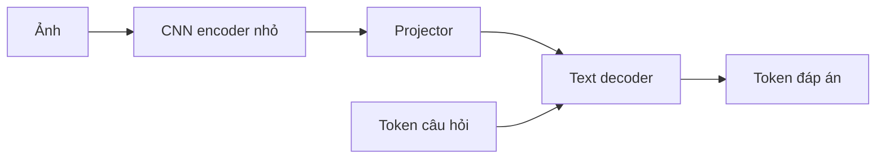

# Tự xây VLM: lộ trình từ tensor đến hỏi đáp ảnh

Điểm xuất phát: bạn đang học machine learning, chưa dùng PyTorch hoặc tự viết vòng
lặp train. Ta sẽ học qua các mô hình nhỏ, quan sát dữ liệu và gradient trước khi
nối chúng vào một VLM. Mỗi bài có phần dự đoán, tự viết, chạy và giải thích kết quả.

Phần sản phẩm hiện chỉ giữ hình từ nguồn. Hình được trích xuất chưa có nhãn chuẩn,
chưa phải bộ dữ liệu huấn luyện; việc nhập tài liệu không tự khởi động training.

## Bài đầu có thể thử ngay

Chạy `python examples/learning/vlm/01_arrays_and_gradient.py` ở repository root.
Ghi dự đoán rồi thêm `--reveal` để đối chiếu. NumPy đang có trong môi trường của
project; bài này không tải dữ liệu hoặc cài thêm thư viện.

Một tensor có thể hình dung là một bảng số với nhiều trục. Scalar có shape `()`,
vector có một trục như `(4,)`, ma trận có hai trục như `(4, 3)`. Ảnh RGB có thể biểu
diễn bằng ba trục: cao, rộng, kênh màu. Shape mô tả kích thước từng trục; dtype mô tả
kiểu số; các giá trị số là dữ liệu thực tế. Có shape đúng chưa đủ chứng minh dữ liệu đúng.

Ví dụ ảnh 4×4 RGB thường được đọc theo HWC `(4, 4, 3)`. Một CNN dùng quy ước NCHW
cần đổi thứ tự trục thành CHW `(3, 4, 4)`, rồi thêm batch thành `(1, 3, 4, 4)`.
`transpose` đổi vị trí các trục; `reshape` không thay thế thao tác này. Các số 0 trong
bài chỉ giúp nhìn shape, không chứa thông tin để mô hình học phân biệt hình.

Phần train đầu tiên là đường thẳng `prediction = w*x + b`, với loss MSE. Ta tính
`dL/dw = mean(2*(prediction-target)*x)` và `dL/db = mean(2*(prediction-target))`, rồi
cập nhật `w -= learning_rate*dL/dw`, tương tự cho b. Bài một mẫu trong script dùng
`prediction=w*x`, chưa có bias. Dấu gradient quyết định hướng cập nhật; learning rate
quyết định độ dài bước. Không cần đổi sang network phức tạp trước khi hiểu đoạn này.

Bạn tự thử:

1. Viết shape của hai ảnh RGB 8×8 ở dạng NCHW và giải thích từng trục.
2. Với `x=2`, `target=5`, `w=1`, tính prediction, MSE và gradient bằng tay.
3. In gradient của ba bước train đầu tiên; giải thích vì sao w và b đổi theo hướng đó.
4. Đổi learning rate từ 0.02 thành 0.002 rồi 0.2, quan sát loss và giải thích.
5. Vì sao loss trên bốn mẫu train giảm vẫn chưa chứng minh mô hình tổng quát tốt?

## Các chặng tiếp theo

| Chặng | Bạn tự làm | Điều kiện đi tiếp |
| --- | --- | --- |
| 1. Tensor và gradient | Bài NumPy ở trên; kiểm tra shape, MSE và một bước cập nhật bằng tay. | Giải thích được vì sao tham số thay đổi. |
| 2. PyTorch và autograd | Viết lại đường thẳng bằng tensor, `requires_grad`, `backward`, optimizer và `zero_grad`. | Gradient tự động khớp phép tính tay; hiểu gradient tích lũy. |
| 3. Dataset và đánh giá | Chia train/validation/test; Dataset/DataLoader; phát hiện rò rỉ giữa các tập. | Báo riêng loss train và validation, không dùng test để chọn cấu hình. |
| 4. Image encoder nhỏ | Tạo ảnh hình học bằng code rồi train CNN nhỏ đọc màu, hình dạng hoặc số lượng. | Đọc đúng shape sau từng lớp; tốt hơn baseline trên ảnh chưa thấy. |
| 5. Thành phần ngôn ngữ | Tokenizer giới hạn, embedding, chuỗi câu hỏi/đáp án và decoder nhỏ. | Hiểu token logits, cross-entropy, padding và teacher forcing. |
| 6. VLM nhỏ | Nối image encoder, projector và decoder; thêm câu hỏi để tạo câu trả lời ngắn. | Đổi ảnh hoặc câu hỏi làm đầu ra thay đổi đúng; bỏ ảnh làm giảm chất lượng ở câu cần hình. |
| 7. Mô hình có sẵn | Thử encoder/LM đã học trước, đóng băng từng phần và train projector; chọn cấu hình theo tài nguyên máy. | So sánh cùng tập đánh giá, ghi rõ phần nào được train và chi phí. |

Một kiến trúc thực hành có thể là:

CNN ở đây là một lựa chọn dễ quan sát để học image encoder. Về sau có thể thay bằng
ViT. Projector đổi đặc trưng ảnh sang kích thước mà thành phần ngôn ngữ nhận được;
chỉ nối shape khớp nhau chưa khiến hai phần hiểu nhau, cần dữ liệu và mục tiêu train.
Kiến trúc LLaVA là một ví dụ nghiên cứu nối encoder ảnh đã học trước với language
model qua phép chiếu; ta tham khảo ý tưởng ở chặng sau, không bắt đầu bằng việc
huấn luyện một mô hình lớn từ đầu. [Nguồn LLaVA](https://llava-vl.github.io/).

## Dữ liệu và kiểm tra cho lab VLM

Ban đầu dùng cảnh hình học tổng hợp để biết chính xác nhãn, vị trí và câu trả lời.
Đây là bài học hỏi đáp ảnh có phạm vi nhỏ, chưa phải hệ thống hiểu mọi sơ đồ kiến trúc.
Khi thêm sơ đồ bài giảng thật, cần nhãn và đáp án được xem lại cùng vị trí nguồn.

Chia dữ liệu theo ảnh/cảnh nguồn trước khi tạo nhiều câu hỏi. Các câu hỏi từ cùng
một ảnh không được tách sang cả train lẫn test. Kiểm tra thêm ảnh trắng, tráo ảnh
giữa các câu và câu hỏi không cần ảnh để biết mô hình đang dùng thông tin thị giác
hay chỉ đoán từ mẫu ngôn ngữ. Chưa xác định được đáp án từ hình thì giữ trạng thái
chưa biết; không lấy dự đoán của chính model làm nhãn chuẩn rồi tự báo độ chính xác.

PyTorch chưa được cài trong môi trường hiện tại. Khi tới chặng 2, tạo môi trường
riêng cho lab, chọn bản PyTorch hỗ trợ máy và thử CPU trước với bài nhỏ. Các thư viện,
checkpoint và cấu hình training của lab không được đưa vào dependency khởi động Teacher.

Tài liệu nền: [PyTorch — Tensors](https://docs.pytorch.org/tutorials/beginner/basics/tensorqs_tutorial.html),
[PyTorch — vòng lặp tối ưu](https://docs.pytorch.org/tutorials/beginner/basics/optimization_tutorial.html).
