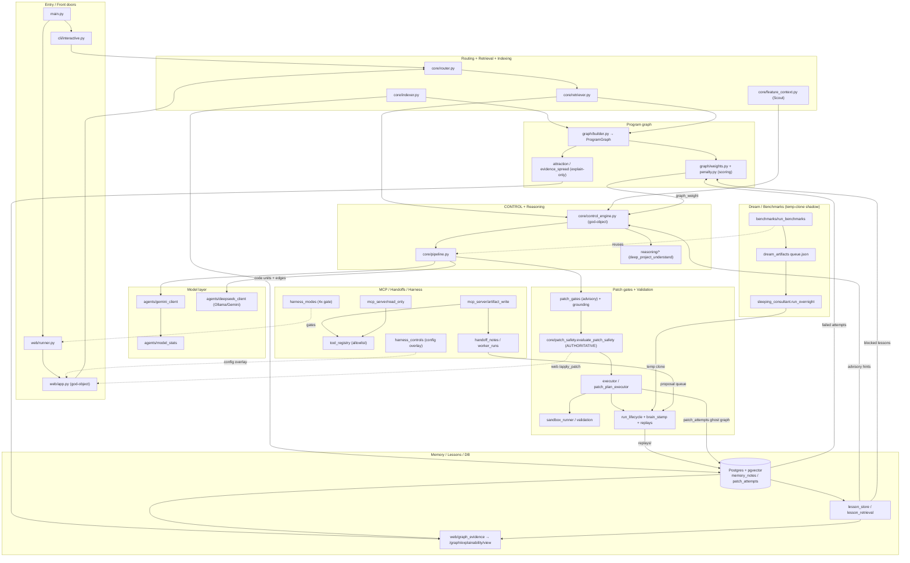

# Phase 13 Audit — C.A.T.T.U.S (post Phase 12.15)

- **Date:** 2026-06-01
- **Scope:** Read-only architectural + hygiene audit of the whole repository after Phase 12.15 (Harness Control registry / overlay / `.env` apply / docker-compose preview-apply).
- **Deliverable:** this report only. **No code was changed; no destructive commands were run; `.env`, `docker-compose.yml`, benchmark reports, experiment records, and existing `.agent/` artifacts were not edited.**
- **Codebase size:** ~80k LOC of Python; ~140 non-test modules + 110 test files; two front doors (CLI + Flask web), two MCP servers, a Postgres+pgvector memory layer, and an offline Dream/benchmark shadow.

## How this audit was produced (and its confidence model)

This was run as a multi-agent audit: 8 parallel subsystem mappers → an architecture-narrative synthesizer + 5 independent dimension auditors (stale/dup, test gaps, risky paths, doc gaps, cleanup) → one adversarial skeptic per dimension → a completeness critic. Every agent was read-only and required to cite `file:line` evidence.

**Honest caveat on verification coverage.** The adversarial-verification phase was interrupted by a session/usage limit: only the **test-gaps** dimension received its full automated adversarial re-check. To compensate, the auditor (me) **independently re-verified the highest-stakes claims** in the other four dimensions by direct `grep`/read. Each finding below is tagged:

| Tag | Meaning |
| --- | --- |
| ✅ **Verified** | Confirmed by the dimension's adversarial verifier *or* by my own independent re-derivation (greps/reads cited inline). |
| 🔶 **Audited** | Produced with cited evidence by the dimension auditor, but its adversarial verifier was lost to the limit and I did not separately re-derive it. Treat as high-quality but single-source. |
| ⤵️ **Corrected** | My independent verification changed the auditor's (or the critic's) conclusion. Read the correction. |

The single most important correction: the completeness critic nominated a *"latent behavior bug carried across both entrypoints"* (`promote_ts_*` dedent) as the **#1 Phase 13 priority**. My direct read of the code **refutes the behavior-bug framing** — see [Risk-R7](#risk-r7--duplicated-promote_ts-tail-is-asymmetric-but-idempotent-not-a-behavior-bug). It is a real duplication/asymmetry hazard, not a correctness defect. This is exactly the kind of plausible-but-wrong escalation the adversarial pass exists to catch.

---

## 1. Current Architecture

C.A.T.T.U.S is a repo-aware coding agent shaped as **a single linear pipeline with two front doors and one offline shadow of itself**. The live request path is:

```
entry → routing → retrieval → graph → CONTROL → model → patch gates → validate → memory
```

Two entrypoints (interactive CLI `cli/interactive.py` and Flask web `web/app.py` via `web/runner.py`) build the same `AgentState` (`core/agent_state.py`) and drive that pipeline; the web path layers an extra per-request **harness-mode** gate on top (four `decide_harness_mode` checkpoints in `web/runner.py`). Beside the live pipeline sits an **overnight/offline layer** (Dream + benchmarks + experiments) that reuses the same executors but only ever runs inside **temp clones**, never the user's real repo. An **external-collaboration edge** (two MCP servers + handoff/worker-run import) lets a foreign agent file bounded artifacts that re-enter the pipeline through the proposal queue. Persistence is split across two substrates — Postgres+pgvector (semantic memory, "ghost graph", sessions) and a file-based lesson store under `.agent/` — behind a hard `db_enabled()` guard so the agent degrades gracefully when the DB is absent.

### 1.1 Layers

1. **Entry.** `main.main()` initializes the DB, parses `--index/--web/--terminal`, and dispatches to the CLI or `web.runner.launch_web()` (which lazy-imports `web.app.app`).
2. **Routing.** `core/router.py` classifies mode/language/intent/complexity and gates the retriever via individual primitives (`classify_task`, `detect_input_mode`, `detect_language`, `should_use_retriever`, `should_auto_patch`). The composed `route_request` orchestrator is **dead code** (no callers).
3. **Retrieval / Indexing.** `core/retriever.retrieve_context` assembles a macro/meso/micro context blob from the program graph, project map, DB code-unit/dependency search, call-chain traces, and `trace_execution_flow`. Tree-sitter and embeddings are both fully optional — every branch has a keyword/regex/full-file fallback. `core/indexer.py` is the offline half (parse → per-symbol code units + dependency edges → Postgres + project map + code-DNA + Phantom Limb report).
4. **Graph.** `graph/builder.build_graph_from_repo` produces an in-memory `ProgramGraph`. `graph/weights.compute_node_weights` (topology + complexity) merged with `graph/penalty.build_penalty_map` (lesson-blocked + patch-failure signals) is **the only graph analytic that affects ranking** — it surfaces as `graph_weight` in CONTROL scoring. The explain-only graph layers (`attraction`, `evidence_spread`) consume the graph read-only.
5. **CONTROL.** `core/control_engine.run_control_structured` is the reasoning hub: build/cache graph → `select_entry_nodes` → `control_dfs_v2` scored DFS → `infer_hypotheses` → `build_patch_intent` → `build_control_prompt`. `core/pipeline.py` chooses CONTROL-vs-generic prompting and orchestrates draft → review → planner → auto-patch. The `reasoning/*` package is a thin helper layer — only `deep_project_understand` and `analyze_symbol_risk` are reached by CONTROL; the rest is alive only via the legacy retriever path.
6. **Model.** `agents/gemini_client` drafts/refines; `agents/deepseek_client` (a **misnomer** — it is Ollama-or-Gemini, no DeepSeek API) and `agents/ollama_client` critique. `agents/model_stats.ModelStatsScope` records per-role usage/cost.
7. **Patch gates (advisory).** In-pipeline gates scrub/reject the JSON and lower confidence: `reject_schema_drift`, `_enforce_safe_minimal`, then `reject_ungrounded_patch` + `reject_ungrounded_candidate_quotes` (grounding against on-disk source). `patching/patch_gates.py` is a 1520-line god-object owning import-promotion, schema repair, and three grounding/recovery strategies.
8. **Validate (authoritative).** The single hard deny gate is `core/patch_safety.evaluate_patch_safety` (traversal, protected dirs, `.env*`, test/benchmark paths). Application + validation + rollback run through `core/executor.Executor` (single file) or `patching/patch_plan_executor.apply_patch_plan` (atomic multi-op, LIFO rollback), optionally in `core/sandbox_runner` (allowlist + temp clone / Docker). Every patch-plan apply is wrapped by `run_lifecycle.run_patch_plan_with_artifacts` (brain_stamp + replay bundle under `.agent/replays/`).
9. **Memory.** `database/memory.py` persists sessions, messages, artifacts, semantic `memory_notes` (vector(384) HNSW), and the `patch_attempts` ghost graph; `memory_consolidator` compresses/archives. The file-based lesson store (`lesson_store` + `lesson_quality` + `lesson_retrieval`) feeds validated patch proposals back as lowest-priority advisory hints injected into CONTROL prompts — closing the learning loop.

### 1.2 End-to-end data flows

**A. Chat / patch (live).** `AgentState` built → `index_repository` → `router` gates `retrieve_context` → `run_control_structured` (graph build/cache, entry-node selection from `deep_project_understand` + hotspots, `control_dfs_v2`, hypotheses, `patch_intent`, CONTROL prompt) → optional Scout enrichment (`feature_context`) → `run_draft_pipeline` (Gemini) → `run_review_pipeline` (critic) → optional planner → `finalize_answer` + grounding rejections → `maybe_run_auto_patch` → on apply: `evaluate_patch_safety` (web routes) → `Executor`/`apply_patch_plan` apply-validate-rollback wrapped by `run_patch_plan_with_artifacts` → persist `task_runs`/`patch_attempts` + engineering memory; web also writes `web/sessions.json`.

**B. Dream / overnight (offline shadow).** `benchmark_web` runs `benchmarks/cases/` via the live pipeline in temp clones → `dream_artifacts.seed_queue_from_latest_benchmark` builds `queue.json` → `sleeping_consultant.run_overnight` branches per item-mode (patch / plan-only / patch-if-safe / research / idea / case-idea), patch-capable modes calling `run_patch_plan_with_artifacts` against a temp clone → clamped 1–3 round refinement → `/dream/report` reads it back; `experiments`/`explainability_dogfood` pin report pairs into `.agent/experiments/`.

**C. Mayor-Mode / MCP handoff (external edge).** MCP client → `read_only.py` (10 read tools) or `artifact_write.py` (those + exactly 3 write tools), gated by `tool_registry.is_tool_allowed` → `create_handoff_note` writes `.agent/handoffs/` → operator (not the tool) runs the subagent via `scripts/run_subagent_handoff` → `import_worker_run_as_proposal` → `validate_imported_worker_proposal` applies the plan in a tempdir and, on success, synthesizes `case.json`+`patch_proposal.json` so the existing lesson flow accepts it.

**D. Retrieval + graph-weight.** `build_graph_from_repo` (cached per repo) → `compute_node_weights` = `α·norm(in)+β·norm(out)+γ·norm(complexity)` (defaults α=2.0, β=1.0, γ=0.5) then `_apply_penalty` **adds** blocked-lesson (OMEGA=5.0) + patch-failure (1.0) signals → `control_engine` pulls `graph_weight` into each evidence item, into `score_control_node`, and into the DFS neighbor-ordering key. This is the **only** path where graph weight changes behavior; `rank_nodes_by_weight` separately orders PROJECT_MAP "Critical Symbols" and Obsidian `AI_READ_FIRST` (read consumers, no scoring impact).

### 1.3 Diagram



### 1.4 Phase evolution — the defining structural trait

The spine (router → retriever → graph → CONTROL → patch → validate → memory) is **load-bearing and well-integrated**. The recent phases, however, share a distinctive pattern: the **"explain-only / dogfood" layer**. Each Phase 12.x capability arrived as a *deterministic, read-only* module that classifies already-loaded data and renders Markdown into the web explainability report (or a one-shot script) **without hooking into ranking, patching, validation, or storage**:

- **12.11** scope-aware evidence spread (`graph/evidence_spread.py`) — explain-only.
- **12.12–12.13** explainability stack: `evidence_confidence`, `graph/attraction`, `core/related_notes` — all explain-only, all terminating at `/graph/explainability/view`.
- **12.14** memory temperature: `memory_temperature` (explain-only) + `memory_temperature_dogfood` (evidence artifact) + `memory_temperature_experiment_plan` (whose feature flags are documentation strings the code never reads).
- **12.15** harness controls: a config-overlay registry/panel with `.env` + docker-compose preview/apply, plus `LOCKED_INVARIANT` rows that *describe* invariants enforced elsewhere but are display-only labels.

The benefit is auditability and dogfood evidence; the cost is module-count growth and parallel near-duplicate machinery (delta routines, hub-detection heuristics, dogfood records). The net shape is **a solid, fully-wired core surrounded by a thickening shell of read-only explanation/experiment modules** whose primary consumer is the web report and the audit trail.

---

## 2. Duplicated or Stale Modules

| ID | Finding | Severity | Status |
| --- | --- | --- | --- |
| D1 | `core/repo_inventory.py` is an orphaned duplicate of `repo_librarian.inspect_repo_inventory` | medium | ✅ Verified |
| D2 | `core/router.route_request` is a dead orchestrator (zero callers) | low | ✅ Verified |
| D3 | Three `memory_temperature_*` + `explainability_dogfood`/`memory_temperature_dogfood` are explain-only scaffolding (~1,330 LOC) | medium | ⤵️ Corrected (severity framing) |
| D4 | Four independent `_graph_cache` implementations; `clear_graph_cache` invalidates only one | medium | ✅ Verified |
| D5 | `reasoning/decision_engine` + `state_reasoner` + `reasoning_engine.build_reasoning_context` reachable only via the legacy retriever path | medium | 🔶 Audited |
| D6 | `detect_repo_language` triplicated with divergent heuristics | low | ✅ Verified |
| D7 | Two divergent default-command tables (`validation_command` vs `preflight`) | low | 🔶 Audited |
| D8 | Four–five near-identical "baseline vs variant delta" routines | low | 🔶 Audited |
| D9 | Three near-parallel "structured reasoning over notes" pipelines with duplicated text helpers (`dream_references`/`dream_trials`) | low | 🔶 Audited |
| D10 | `graph/exporter.export_json`/`export_mermaid` orphaned while their helpers stay live | low | ✅ Verified |
| D11 | `database/schema.sql` duplicates inline `init_db()` DDL and is never loaded at runtime | low | 🔶 Audited |
| D12 | Stray committed artifacts (`uh a docker fix.txt`, `project presentation (tmp)/`) | low | ✅ Verified |

**D1 — `core/repo_inventory.py` orphan.** `git grep` for `core.repo_inventory` returns zero importers; every live caller (`indexer:19`, `feature_context:6`, `sleeping_consultant:15`, `web/runner:32`, `web/app:24`, `worker_runs:323`) uses `core.repo_librarian.inspect_repo_inventory` instead. The 48-line file exposes the same signature as the 250+-line librarian version but without the librarian's infra-file gating — a decoy that misleads grep-based search. *Safe to delete after a final no-dynamic-reference check (done).*

**D2 — `router.route_request` dead.** `git grep "route_request"` returns only the definition at `router.py:362`; all real callers use the lower-level primitives directly. *(Independently re-confirmed: only the `def` line, no caller.)*

**D3 — memory-temperature / dogfood scaffolding.** `memory_temperature_dogfood.py` (442 LOC) and `explainability_dogfood.py` (582 LOC) are near-parallel (both define `build_dogfood_record` + `_metric_delta`, both diff the latest two benchmark reports → `.agent/experiments/`). `memory_temperature.py` itself is consumed only by `web/graph_evidence.py`. The flags `MEMORY_TEMPERATURE_RETRIEVAL_ENABLED` / `MEMORY_TEMPERATURE_TIEBREAK_ONLY` are registered in `harness_controls.py` as `READ_ONLY_PLANNED`/`wired=False` and `config.py` never reads them. **⤵️ Correction:** the auditor called this *"the largest concentration of debt (~1,330 LOC)."* That is true by LOC but misleading by impact — this is **provably inert, tested, explain-only code**, the *lowest-risk* debt class. Do not let its size pull it up the Phase 13 queue ahead of correctness/safety items. Recommendation stands: consolidate the two dogfood modules and stop treating them as core; **do not delete** (they have tests + script consumers).

**D4 — four graph caches, one invalidation hook.** ✅ Re-verified by direct grep: module-level `_graph_cache` dicts in `control_engine.py:25`, `retriever.py:225`, `semantic_graph_pipeline.py:7`, and `reasoning/deep_project_understand.py:8`. `clear_graph_cache` (`control_engine.py:37-43`) clears **only** control_engine's dict; `cli/interactive.py:197` and `web/runner.py:305` call it, but `select_entry_nodes` reaches `deep_project_understand.get_cached_graph` (keyed by raw `repo_path`, **never invalidated**). *(This also corrects the architecture narrative, which mislabeled the fourth cache as living in `web/graph_evidence.py`.)* Consequence — a **stale-graph correctness hazard**: a long-lived web session can serve a stale graph to CONTROL after edits while believing the cache was cleared. This finding therefore also belongs under §4 (risky paths).

**D5 — legacy reasoning helpers.** `decide_patch_action` / `build_reasoning_context` / `state_reasoner` are imported only by `core/retriever.py` (the heavy `trace_execution_flow` legacy block); `control_engine` imports only `deep_project_understand` + `analyze_symbol_risk` and reimplements its own `recommend_action`/root-cause. Two unrelated `explain_root_cause` functions coexist. 🔶 Confirm whether retriever's `trace_execution_flow` still influences any live answer before retiring.

**D10 — `graph/exporter` partial death.** `export_json`/`export_mermaid` have no non-self callers; `web/app.py:1685-1696` reuses only the module's `safe_id`/`escape_mermaid_label` helpers. Split the live helpers out before removing the dead top-level functions, or a blanket delete breaks the live path.

**D12 — stray artifacts.** `git ls-files` confirms `uh a docker fix.txt` (root) and `project presentation (tmp)/` (`.pptx`, a 298 KB `.pptx.BACKUP`, `.docx`, `.md`) are tracked; no code references them. See also [C1](#6-small-cleanup-candidates)/[C2](#6-small-cleanup-candidates).

---

## 3. Test Gaps

This dimension received the **full adversarial verification pass** (all six findings confirmed; the verifier added a reinforcing note on unscreened `shell=True` call sites). There is **no coverage tooling anywhere** — `pytest.ini` has no `addopts`/`--cov`, and no `pytest-cov`/`coverage`/`conftest.py`/`pyproject.toml`/`setup.cfg` exists — so none of the gaps below can be tool-quantified.

| ID | Finding | Severity | Status |
| --- | --- | --- | --- |
| T1 | Single-file patch apply/rollback path (`Executor` + `patch_engine`) has zero coverage | **high** | ✅ Verified |
| T2 | No coverage measurement configured anywhere | medium | ✅ Verified |
| T3 | Validation-command safety gate + default-command detection untested | **high** | ✅ Verified |
| T4 | `router.py` task/retriever/auto-patch gating completely untested | medium | ✅ Verified |
| T5 | `self_correct_loop`, `mutation_oracle`, `preflight`, `diagnostics` have no direct tests | medium | ✅ Verified |
| T6 | `retriever`, `indexer`, non-CONTROL `prompter` builders lack characterization tests | low | ✅ Verified |

**T1 (high).** No test instantiates `Executor` or calls `apply_patch_from_json`/`backup_file`/`restore_backup`/`_score_patch_risk`; `tests/test_executor.py`/`test_patch_engine.py` never existed (`git log --diff-filter=D`). The **multi-op** plan path *is* covered (`test_run_lifecycle.py:37` exercises `apply_patch_plan` rollback), but the single-file path — literal→AST→fuzzy match, the high-risk dry-run short-circuit (`executor.py:140`), the literal-match rollback (`executor.py:161-187`), `.bak` backup/restore — is exercised by nothing. *Verifier note:* matches under `tests/` for `Executor`/`core.executor` are all false positives — `dry_run` boolean fields, graph node-id string literals, and **forbidden-import purity assertions** (`test_sandbox_runner.py:455`, `test_prompt_cost_quantifier.py:455`). **Caveat (critic ⤵️):** the *most dangerous* sub-behaviors (traversal, `.env`) are covered transitively by `patch_safety` tests at the route layer; the genuinely-uncovered gap is the single-file risk-scoring/rollback branch — narrower than "zero coverage of the write path" implies, but still the right thing to characterize before any patching-subsystem cleanup.

**T3 (high).** `validation_command_safety_issue` (the destructive-command regex: `rm -rf`, `git reset --hard`, `git clean -f`, `format`, `mkfs`, `shutdown`, with subtle `(?:^|[;&|]\s*)` anchoring), `get_default_validation_command`, `extract_user_validation_command`, plus `validator.run_validation_command` (`shell=True`) and `classify_validation_output` — all have zero tests. **Reinforcing finding (verifier + critic):** `run_validation_command(shell=True)` is reached from **five** call sites — `run_benchmarks.py:710`, `mutation_oracle.py:303`, `preflight.py:122`, `patch_plan_executor.py:242`, and `executor` — and the safety regex only fires on the *user-paste* path (`extract_user_validation_command`), so defaults and model-/profile-derived commands reach the shell unscreened. See [Risk-R4](#risk-r4).

**T4 (medium).** `classify_task`/`detect_*`/`should_use_retriever`/`should_auto_patch` gate whether retrieval and the safety pipeline even engage; the only `tests/` matches are a graph node-id string (`test_graph_attraction.py:93`) and a **monkeypatch-away mock** (`test_harness_modes_web.py:16`). Pure-function characterization tests are cheap here.

**Recommended order:** stand up `pytest-cov` (baseline `core`/`patching`/`graph`) → characterize `Executor` single-file apply/rollback, `validation_command_safety_issue` boundaries (incl. `;`/`&&` chains), and `classify_validation_output` → then `router` and `diagnostics` (pure regex). **Do this before any cleanup that touches these modules** — otherwise the cleanup operates blind.

---

## 4. Risky Behavior-Changing Paths

| ID | Finding | Severity | Status |
| --- | --- | --- | --- |
| R1 | CLI/auto-patch apply path bypasses the authoritative `evaluate_patch_safety` gate | medium | ✅ Verified |
| R2 | Harness-controls live config-patching reaches consumers inconsistently; `OLLAMA_ENABLED` live toggle is a silent no-op for its main consumer | medium | ✅ Verified |
| R3 | Live controls cannot disable a safety gate **today**, but the invariant is guaranteed only by registry data, not a structural guard | low | 🔶 Audited |
| R4 | Auto-detected/default validation commands skip the destructive-command screen applied to user commands | low→medium | ✅ Verified |
| R5 | Graph penalty *adds* to node weight and feeds CONTROL DFS scoring + neighbor ordering — a penalty-source change silently reorders evidence | low | 🔶 Audited (hazard, unproven impact) |
| R6 | `list_active_lessons` docstring asserts global-only scope; code returns the repo+global union (advisory hints reach the CONTROL prompt) | low | ✅ Verified |
| R7 | Duplicated `promote_ts_*` pipeline tail is asymmetric across both entrypoints | low | ⤵️ Corrected — **not** a behavior bug |
| R8 | `builder.py` double-adds `executes` edges for functions → double-counts function complexity on the scoring path | low–medium | ✅ Verified |

**R1 — auto-patch bypasses the hard gate.** ✅ Re-verified: `evaluate_patch_safety` is called **only** at the 5 Flask write routes (`patch_routes.py:77/163/258/375`, `web/app.py:846` `/dream/apply`) plus `seed_lessons_from_benchmark.py` and tests. `pipeline.maybe_run_auto_patch` (the CLI/agent auto-apply path) goes straight to `run_patch_plan_with_artifacts` → `apply_patch_plan`, whose only path guards are `_resolve_safe_target` (traversal) and `validate_patch_plan_grounding` (traversal + snippet existence) — neither blocks `tests/`, `test_*.py`, `benchmarks/.../case.json`, or protected dirs. The single-file path (`apply_patch_from_json` → `security.is_safe_path`) blocks `.env`/secrets but **not** test/benchmark paths (the `security.py` BLACKLIST has no `tests`/`benchmarks` entry). **Net:** a model-drafted plan that rewrites a failing test or a benchmark `case.json` would be refused in the web UI but **silently applied by the CLI/agent auto-patch loop** — precisely the failure mode `patch_safety._CATEGORY_WHY["test"]` warns about. Safety is currently an emergent property of *which entry point you came through*. The clean fix (to record, not implement) is to enforce `evaluate_patch_safety` once at the `run_patch_plan_with_artifacts`/`Executor.run` chokepoint.

**R2 — live config-patching is consumer-dependent.** ✅ Verified (auditor read the lines): `set_override` mutates the `config` *module attribute* for `EDITABLE_LIVE` controls. `LESSON_RETRIEVAL_ENABLED` (read via `getattr(_config, …)` at `control_engine.py:855`) and `MUTATION_ORACLE_ENABLED` (re-imported inside `Executor.run`) honor the live patch — but `OLLAMA_ENABLED` is read via `os.getenv("OLLAMA_ENABLED")` at `web/app.py:2528` and `health.py:191`, which `setattr(config, …)` never updates. So the panel reports `applied_live=True` while `/local_critique` keeps refusing. The "save = takes effect now" contract is not uniform; converging all controlled flags onto `getattr(config, NAME)` (or also setting `os.environ`) would fix it.

**R4 — asymmetric command screening.** ✅ The destructive-command regex screens only the user-supplied validation line; `get_default_validation_command` results and DB-recalled tooling-profile `test_command`s flow to `run_validation_command` (`shell=True`, real-repo cwd) unscreened. Benign today, but a new language default or a poisoned profile would not be caught. Combined with the five unscreened call sites from [T3], this is the most concrete shell-safety hole — arguably **medium**, not low.

**R6 — lesson-scope docstring contradicts code.** ✅ Verified: `lesson_retrieval.list_active_lessons` docstring (lines 88-90) says global-only, but it passes `repo_path` into `list_lessons`, and `_scope_roots_for_query` (`lesson_store.py:359-371`) returns the **repo+global union**. Active lessons are injected as advisory hints into the CONTROL prompt, so a maintainer "restoring global-only" per the stale docstring would silently change prompt content. This is the same drift `docs/ROADMAP_TRUTH_AUDIT_2026-05-20.md:26-29` flagged in May and **still unresolved**. Three authoritative sources (this docstring, README:716, the code) disagree.

<a id="risk-r7"></a>**R7 — ⤵️ the "headline bug" that isn't.** The completeness critic escalated a duplicated `promote_ts_*` block to **#1 Phase 13 priority**, calling it *"the single most concrete potential behavior bug in the entire audit."* I read both copies. **The structural observation is real:** in both `main.py:94-118` and `web/runner.py:477-502`, after each retry `if repair_reasons:` / `if state.mode == "reviewer"` block, the GO promotion (`promote_go_missing_import_candidate_to_patch_plan`) sits **inside** the `if`, but the two TS promotions are **dedented to run unconditionally** — so TS promotion fires up to 3× per run regardless of whether a repair occurred, and the quirk is copied identically across both entrypoints. **But it is not a behavior bug:** `promote_ts_duplicate_import_candidate_to_patch_plan` (`patch_gates.py:263-265`) early-returns when a `patch_plan` already exists (*"Do not touch real patch plans … caller wins"*), so repeated/unconditional calls are **idempotent no-ops**. There is no double-promotion. The real value here is the **duplicated ~40-line pipeline tail** (draft→review→repair→promote→reject→auto-patch) hand-copied across `main.py` and `web/runner.py` — a genuine maintenance hazard (one must be edited in lockstep with the other) and a low-severity cleanup, **not** a correctness defect. *Downgraded from "top priority" to a low-severity duplication item.*

**R8 — ✅ confirmed double-`executes`-edge.** `graph/builder.py:66-70` adds an `executes` edge for every symbol's expression steps; lines 72-77 then re-run the same loop (same `node_id`, same edge) for `kind == "function"`. `ProgramGraph.add_edge` (`schema.py:37`) does `self.edges.append(...)` — **no dedup** — so each function's expression edges are appended twice. `weights.py:90-92` increments `executed[function]` per `executes` edge, and `complexity = executed[node_id]` (line 102), so **function complexity is double-counted**. *Impact (nuanced):* the doubling is uniform across functions, so within-function order is preserved; it inflates function complexity ~2× *relative to* file/type nodes (whose complexity uses `contained`, not doubled), on the **lowest-weighted scoring axis** (γ=0.5) and partly absorbed by normalization against `max_complexity`. It also bloats the exported edge list and any other `executes`-counting consumer. Real defect, cheap fix (delete the redundant expression sub-loop at 72-77; keep the function-only `calls` loop at 79-82), modest ranking impact — **more clearly real, and more clearly bounded, than R5's hypothetical.**

---

## 5. Documentation Gaps

| ID | Finding | Severity | Status |
| --- | --- | --- | --- |
| G1 | README documents nothing about the entire Phase 12.x explainability + harness-controls stack (which ships user-facing web UI that can rewrite `.env`/`docker-compose.yml`) | medium | ✅ Verified |
| G2 | The roadmap-cited harness-controls design spec does not exist (dangling reference) | medium | ✅ Verified |
| G3 | No dedicated plan/spec design docs for any phase 9 → 12.15; design history collapses into one long roadmap file | low | 🔶 Audited |
| G4 | `lesson_retrieval` docstring + README Operator Manual claim global-only lesson scope, contradicting the code (= R6) | medium | ✅ Verified |
| G5 | README benchmark section lists ~21 case types and "31 cases" but **32** ship | low | ⤵️ Corrected (count real; denominator caveat) |
| G6 | `TECHNICAL_DEBT.md` route-extraction list is stale (omits 3 already-extracted blueprints) | low | ✅ Verified |

**G1.** A case-insensitive README grep for `harness_control|memory_temperature|evidence_spread|attraction|explainability|dream_trial|dream_reference|evidence_confidence|related_notes|harness_mode` hits only line 865 (the `explain_graph_weights.py` CLI). The README enumerates 17 feature areas and stops at MCP; nothing covers 12.11–12.15. Yet `web/templates/index.html` renders a "Harness Control" panel and an "evidence spread" surface a user clicks. The **most write-capable feature in the project** (it rewrites `.env`/`docker-compose.yml`) is invisible in the canonical onboarding doc.

**G2.** ✅ Re-verified: `docs/AI_Coding_Mentor_Roadmap_Refresh_2026-05-16.md:33` cites `docs/superpowers/specs/2026-06-01-harness-controls-design.md`, and `git ls-files` confirms that path is **absent**. *(That same roadmap blockquote is, ironically, the most complete harness-controls documentation that exists — it records the registry fields, the 5 locked invariants, the 12.15a/b/c split, "1379 passed", and `benchmark --check 32/0`. Backfilling the spec from it is straightforward.)*

**G5.** ⤵️ `git ls-files 'benchmarks/cases/**/case.json'` = **32**; README says 31 and lists ~21 types, omitting the adversarial/held-out cases (`*_multifile_root_cause`, `*_callback_dispatch_ambiguity`, `*_false_positive_no_patch`, `*central_node_temptation`, `*duplicate_filename_temptation`, `*pandas_iloc*`, `ts_nested_dispatch_root_cause`, …). **Caveat:** the README also describes a separate "held-out_v1: 7 adversarial cases" split, so its own "31 main + 7 held-out" numbers don't cleanly reconcile against the single 32-folder tree — clarify whether held-out lives inside or outside `benchmarks/cases/` before settling on a number.

**G6.** `TECHNICAL_DEBT.md` (last touched 2026-05-21) lists only `patch_routes.py` as extracted, but `web/app.py:52-67` also registers `dream_trials_routes`, `dream_references_routes`, and `harness_controls_routes`. The doc undersells progress while the 2679-line god-object remains real.

---

## 6. Small Cleanup Candidates

| ID | Finding | Severity | Status |
| --- | --- | --- | --- |
| C1 | Stray presentation binaries committed (`.pptx` + 298 KB `.BACKUP` + `.docx`) under `project presentation (tmp)/` | medium | ✅ Verified |
| C2 | `uh a docker fix.txt` — useful Docker-Scout guide with a junk filename, referencing untracked tooling | medium | ✅ Verified |
| C3 | `pytest.ini` is **gitignored / untracked** (and `tmp_tests/` it excludes is empty + ignored) | medium | ✅ Verified |
| C4 | The 4 repo-wide TODO markers are intentional generated-output strings, not real debt | low | ✅ Verified |
| C5 | Dead duplicate defs: `router.detect_repo_language`, `router.route_request`, `core/repo_inventory.py` | low | ✅ Verified |
| C6 | Two *live* `detect_repo_language` impls with divergent heuristics in the same patch flow | low | ✅ Verified |
| C7 | Misplaced `if __name__ == "__main__"` guard in `web/app.py:2583` with a route defined after it | low | ✅ Verified (cosmetic) |
| C8 | `TECHNICAL_DEBT.md` tracks only `web/app.py`; the other 4 god-objects are untracked | low | ✅ Verified |
| C9 | Mixed-language (Vietnamese) inline comments across 8+ production modules | low | 🔶 Audited |

**C3 — `pytest.ini` untracked (notable).** ✅ Re-verified: `git check-ignore pytest.ini` matches and `git ls-files pytest.ini` is empty. The **single source of truth for how 110 tests are discovered is not in version control** — a fresh clone has no test config. Decide whether to track it (likely yes); if tracked, drop the now-vestigial `tmp_tests` from `norecursedirs`. *(Note: `__pycache__` and `.env` are correctly gitignored — not issues.)*

**C4.** Grep returns exactly 4 TODO markers, all in `patching/patch_synthesizer.py` — and reading them, three are literal `# TODO:` strings the synthesizer *emits into generated fallback patches* (`patch_gates`/synthesizer strategies), and the fourth is the scorer that *penalizes* candidates containing "TODO". So the repo has **zero genuine TODO/FIXME debt** — a cleanup scanning for TODOs would mis-triage these.

**C5/C6.** `detect_repo_language` is defined 3× (`router.py:16`, `repo_librarian.py:258`, `web/patch_helpers.py:21`); nothing imports the `router` copy (dead — bundle with the C5 deletions). The other **two are both live in the same patch flow** (`web/runner.py:284` uses the librarian version, `patch_routes.py:295/390` uses the marker-based `patch_helpers` version) and use unrelated heuristics — a repo with both `*.py` and `package.json` can resolve differently. Consolidate to one.

**C9.** `git grep -lP` for Vietnamese diacritics finds inline comments in 8 modules (e.g., `patch_synthesizer.py:51,55` `# không swap nếu có return`). Comments-only normalization, zero behavior risk.

*(Verified as NOT findings: `OMEGA_BLOCKED`/`OMEGA_TRANSIENT` are centralized in `graph/penalty_constants.py`; the `# …` lines flagged by a commented-code scan in `control_engine`/`repo_librarian`/`treesitter_parse` are genuine explanatory comments.)*

---

## 7. Cross-cutting themes

1. **Duplication without a shared primitive is the dominant pattern.** Path-safety "resolve inside root" is reimplemented in ~6 places (`patch_engine`, `patch_plan_executor`, `patch_safety`, `patch_gates`, `security`, `validator`); `detect_repo_language` ×3; default-command tables ×2; graph caches ×4; hub/utility detection ×3 (`weights.is_noise_node`, `evidence_spread` `_HUB_DEGREE=4`, `attraction` `_HIGH_IN_DEGREE=30` — disagreeing thresholds + different name regexes); delta routines ×4–5; JSON extraction ×2 (`ollama_client._extract_json_object` vs `json_utils.extract_json_block`). The repo consistently re-implements rather than extracts.
2. **The authoritative-vs-advisory safety split is real and uneven.** The one hard gate (`evaluate_patch_safety`) lives only at the 5 Flask routes; the CLI/auto-patch/sandbox-less validation paths rely on weaker per-op traversal checks. Safety depends on the entry point, not on a chokepoint invariant (R1, R4).
3. **Explain-only/dogfood/experiment scaffolding has accreted faster than core integration** (D3, §1.4) — real, tested, wired to nothing but the web report or one-shot scripts.
4. **Docs and code diverge at the most dangerous edges** — the lesson-scope contradiction (3 places), the missing harness-controls spec for the most write-capable feature, README silent on the entire 12.x surface.
5. **No safety net on the safety code** — the modules that can mutate the real repo or run shell commands (`Executor`, `validation_command`, `run_validation_command`, `router` gating) are exactly the ones with zero tests, and there is no coverage tool to reveal it.

### Coverage gaps in this audit itself (be aware)

- **`scripts/` (27 files) was treated only as a consumer, never audited in its own right** — yet `run_patch_proposal_queue._process_item`/`_run_validation_command` is load-bearing (wrapped by `proposal_runner`, `worker_runs`, and dream proposals). No dead-script / shell-out / real-repo-mutation sweep was done there.
- **`agents/` clients were mapped but not dimension-audited** — no test-gap or fallback-chain risk finding for `gemini_client`/`deepseek_client`/`ollama_client` (what happens when Gemini quota is exhausted mid-pipeline?).
- **`database/schema.sql` drift was asserted, not measured** — nobody diffed it against the inline `init_db()` DDL.
- **Web front-end JS/templates and `core/security.is_safe_path` (Windows symlink/UNC/case handling) were not independently audited** — relevant given the win32 environment and that web routes can write `.env`/`docker-compose.yml`.
- **No performance/resource dimension and no config/env-flag-coherence dimension** were run (the 4 graph caches, the lazy per-`save_memory_note` model load, and the `EMBEDDING_PROVIDER` vs `*_USE_EMBEDDINGS` split are scattered across other findings rather than consolidated).
- **The adversarial-verification pass completed for only 1 of 5 dimensions** (session limit). 🔶 findings are single-source; I independently re-verified the load-bearing ones (D1, D2, D4, D10, D12, R1, R2, R6, R7, R8, G2, G5, C3, C5, C6) but not the low-severity remainder.

---

## 8. Prioritized Phase 13 backlog

Ranked after my corrections (this overrides the completeness critic's ordering where my verification disagreed — notably demoting the `promote_ts_*` item it ranked #1).

1. **Close the safety-gate chokepoint gap + screen all `shell=True` validation commands (R1 + R4 + T3).** Make `evaluate_patch_safety` and `validation_command_safety_issue` enforce at the executor/`run_patch_plan_with_artifacts` chokepoint so safety stops depending on entry point. These are the findings where a safety *invariant* (no test/benchmark rewrite, no destructive shell command) is one refactor away from silently breaking.
2. **Add characterization tests for the untested safety path *before* any cleanup (T1, T3, T4).** `Executor` single-file apply/rollback, `validation_command_safety_issue` destructive-regex boundaries (incl. `;`/`&&` chains), `classify_validation_output`. Stand up `pytest-cov` (T2) first to baseline. Cleanup that touches these without tests is operating blind.
3. **Fix the `builder.py` double-`executes`-edge (R8).** Confirmed correctness defect on the scoring path, cheap fix (remove the redundant expression sub-loop at `builder.py:72-77`).
4. **Resolve the lesson-scope contradiction (R6 / G4) one way and make code + docstring + README agree.** It sits on the CONTROL-prompt path; three authoritative sources currently disagree — the exact trap a cleanup falls into.
5. **Decide + invalidate the un-cleared `deep_project_understand` graph cache (D4).** Either a shared cache module with one invalidation hook, or at minimum wire `clear_graph_cache` to reach all four dicts — closes the stale-graph hazard.
6. **Delete confirmed dead code and consolidate duplicate primitives (D1, D2, D10, C5, C6).** `repo_inventory.py`, `route_request`, `router.detect_repo_language`, orphaned `export_json`/`export_mermaid`; then one shared path-safety helper. **Lowest risk — but explicitly after #2**, so the consolidation is protected by tests.
7. **Documentation pass (G1, G2, G6) + decide on `pytest.ini` tracking (C3) + remove stray artifacts (C1, C2, D12).** Cheap hygiene; backfill the harness-controls spec from the roadmap blockquote.

**Deliberately ranked lower** (large but low-risk, and the dogfood debt is *inert*): the explain-only / `memory_temperature` consolidation (D3) and the `web/app.py` route extraction / god-object splits (C7, C8). Do not let LOC size pull them ahead of the correctness and safety-invariant items above. The `promote_ts_*` duplication (R7) is a small cleanup item, **not** a behavior bug — fold it into the entrypoint-pipeline de-duplication whenever `main.py`/`web/runner.py` are next touched.

---

### Appendix — verification ledger (auditor's own re-derivations)

| Claim | Command / read | Result |
| --- | --- | --- |
| `evaluate_patch_safety` only at web routes | `git grep evaluate_patch_safety(` | Only `patch_routes.py:77/163/258/375`, `web/app.py:846`, `seed_lessons_from_benchmark.py:390`, tests. **R1 confirmed.** |
| `promote_ts_*` dedent | read `main.py:82-129`, `web/runner.py:462-513`, `patch_gates.py:239-308` | Dedent real + duplicated; promote fn early-returns on existing `patch_plan` (`:263-265`) → **idempotent, R7 not a bug.** |
| `builder` double `executes` edge | read `builder.py:55-84`, `weights.py:83-110`, `schema.py:36-47` | Second loop re-adds identical edges; `add_edge` appends w/o dedup → **R8 confirmed.** |
| 4 graph caches / 1 invalidation | `git grep _graph_cache\|clear_graph_cache` | control_engine/retriever/semantic_graph_pipeline/deep_project_understand; clear hits only control_engine → **D4 confirmed.** |
| `pytest.ini` untracked | `git check-ignore pytest.ini`; `git ls-files pytest.ini` | Ignored + not tracked → **C3 confirmed.** |
| benchmark case count | `git ls-files 'benchmarks/cases/**/case.json' | wc -l` | 32 (README says 31) → **G5 confirmed.** |
| dangling harness-controls spec | `git grep` roadmap + `git ls-files` spec path | Cited at roadmap `:33`, file absent → **G2 confirmed.** |
| dead `route_request` / `repo_inventory` | `git grep route_request`, `git grep core.repo_inventory` | Only defs / no live importers → **D2, D1, C5 confirmed.** |
| TODO markers | `git grep -E 'TODO|FIXME|HACK|XXX'` (source) | 4 hits, all `patch_synthesizer.py` (generated-output strings) → **C4 confirmed.** |
| stray artifacts / `.env.example` / `__pycache__` | `git ls-files` | `(tmp)` dir + `uh a docker fix.txt` tracked; `.env.example` tracked; `__pycache__` not tracked → **D12/C1/C2 confirmed; no false "missing .env.example".** |
